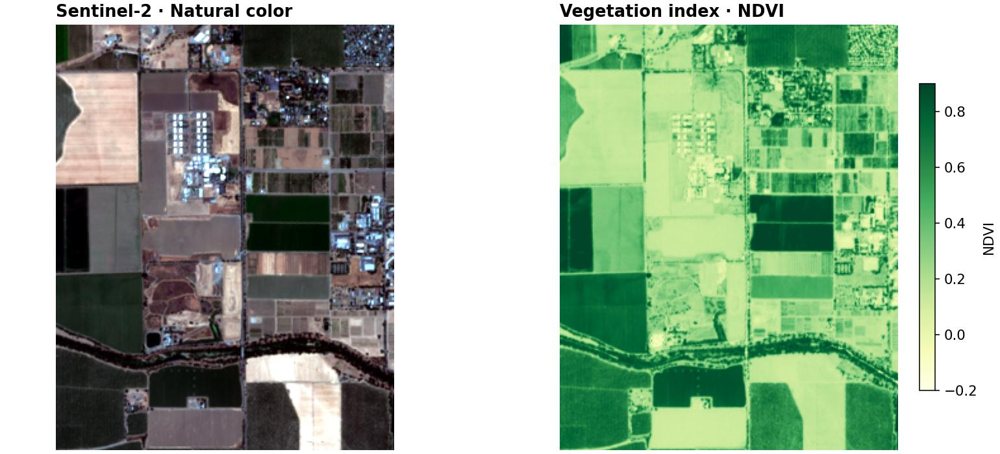

# GeoSave

**From satellite imagery to geospatial machine learning, in ordinary Python.**

GeoSave connects imagery discovery, raster preparation, interactive maps, and
Lightning-based model development. Work with xarray Datasets and GeoDataFrames
while keeping the coordinates, CRS, nodata, and band metadata needed to turn
results back into usable maps.

[Documentation](https://weedkat.github.io/geosave-engine/) ·
[Examples](https://github.com/weedkat/geosave/tree/main/examples) ·
[Installation](https://weedkat.github.io/geosave-engine/install/)



## What can I do with it?

- **Find and download imagery.** Search STAC collections and load the bands,
  dates, area, and pixel grid you need.
- **Explore before processing.** Inspect rasters, vectors, and catalogs on
  interactive maps or create static plots.
- **Prepare useful datasets.** Align inputs explicitly, calculate spectral
  indices, preserve nodata, and save GeoTIFF, Zarr, NetCDF, or GeoParquet.
- **Use pretrained model components.** Build models with supported encoders,
  decoders, and heads, including geospatial foundation-model integrations.
- **Train and map predictions.** Make chips from aligned xarray Datasets,
  train with Lightning, and merge chip predictions onto their source grids.

GeoSave is **Alpha**: APIs are evolving. These examples track `main`.

## Install

Python **3.12+**. Choose a source:

**Stable · PyPI** — the release command is `python -m pip install geosave`.
A public release was not yet available on 6 November 2026; use a preview below
until one is published.

**Test build · [TestPyPI](https://test.pypi.org/project/geosave/)**

```bash
python -m pip download --no-deps --index-url https://test.pypi.org/simple/ --dest wheels "geosave==0.3.0.dev38"
python -m pip install --upgrade ./wheels/geosave-0.3.0.dev38-py3-none-any.whl
```

This downloads only GeoSave from TestPyPI; dependencies use your normal index.
For training, add `[ml]` to the quoted wheel path. Use `[all]` for the notebooks.
Replace the version in both commands when choosing a newer test build.

**Latest source · GitHub** — requires Git:

```bash
python -m pip install --upgrade "geosave @ git+https://github.com/weedkat/geosave.git@main"
```

Use `geosave[ml] @` for training or `geosave[all] @` for every extra.
Replace `main` with a commit SHA to pin an experiment. See the
[installation guide](https://weedkat.github.io/geosave-engine/install/) for
extras, development setup, and version checks.

## Make a vegetation map

Download a small real Sentinel-2 crop, calculate NDVI, and save a georeferenced
result. No account or GPU is needed for this example.

```python
from urllib.request import urlretrieve

import geosave as gs

urlretrieve(
    "https://raw.githubusercontent.com/weedkat/geosave/main/docs/assets/sample-scene.tif",
    "scene.tif",
)
with gs.open_raster("scene.tif") as stored:
    scene = stored.gs.mask_and_scale()
    ndvi = gs.features.ndvi(scene, nir="nir", red="red").rename("ndvi")
    ndvi.gs.to_cog("output", path_format="ndvi.tif")
```

Open `output/ndvi.tif` in your GIS. The sample is a 752 KiB crop of agricultural
land near Davis, California. An index shows spectral variation; one scene
does not establish crop health, drought, or change.

Follow the [vegetation tutorial](https://weedkat.github.io/geosave-engine/first-raster/)
for the map and interpretation, or run
[zone summaries](https://github.com/weedkat/geosave/blob/main/examples/vegetation_zones.py)
to produce a map and CSV for two demonstration areas.

## Follow a land-cover project

[The notebook series](https://github.com/weedkat/geosave/tree/main/examples)
uses real Sentinel-2 imagery and expert-annotated labels: inspect class balance,
train a baseline, acquire new imagery for existing labels, then predict and
export maps for a forest area. Tiles are split before making training chips.
The teaching download is about 400 MB; the short runs demonstrate a workflow,
not a validated operational model.

| Your next task | Guide |
| --- | --- |
| Download imagery for your area | [Search and download](https://weedkat.github.io/geosave-engine/guides/download-imagery/) |
| Explore imagery on a map | [Explorer](https://weedkat.github.io/geosave-engine/guides/explore/) |
| Start with pretrained weights | [Pretrained models](https://weedkat.github.io/geosave-engine/guides/pretrained/) |
| Create an editable training project | [Workspaces](https://weedkat.github.io/geosave-engine/guides/workspaces/) |
| Look up a function | [API reference](https://weedkat.github.io/geosave-engine/reference/) |

## Development

```bash
git clone https://github.com/weedkat/geosave.git
cd geosave
uv sync
uv run pytest
uv run zensical build
```

See [contributing](https://weedkat.github.io/geosave-engine/contributing/architecture/)
for architecture and contracts. Training workspaces own their Dataset,
DataModule, and LightningModule; edit `src/templates/` to change future
workspace generation.
