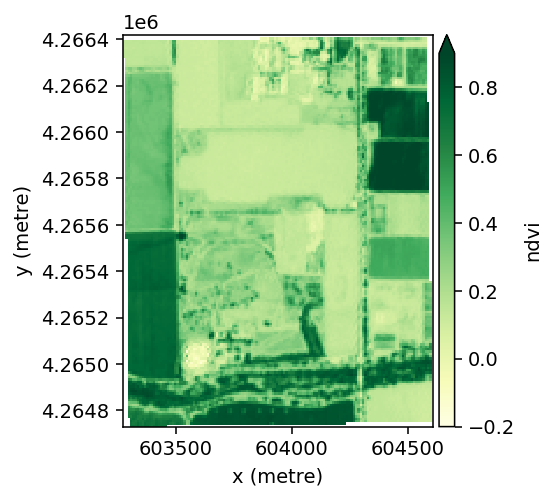

# Crop a vegetation map to an area

Calculate NDVI only within an area of interest, then save a map for a GIS.
Use this workflow when your imagery covers more ground than you need.

**You need:** the base package and the [sample scene](../basics/first-raster.md#open-the-sample).
The example selects a smaller area within the Davis scene using longitude
and latitude bounds.

## Limit the area before calculating

```python
import geosave as gs
from geosave.geodata import io

scene = gs.open_raster("sample-scene.tif")
region = gs.GeoRegion.from_bbox((-121.815, 38.525, -121.800, 38.540))
area = scene.gs.crop(region.extent)
ndvi = gs.features.ndvi(area, nir="nir", red="red").rename("ndvi")
ndvi_plot = ndvi.gs.plot(cmap="YlGn", clim=(-0.2, 0.9), xlabel="")
ndvi_plot
```



Cropping keeps the source pixel grid and masks outside the boundary. It does
not resample. The calculation remains lazy until you display or save it.

## Save the cropped map

```python
from pathlib import Path

Path("prepared").mkdir(exist_ok=True)
path = io.write_cog(ndvi.to_dataset(), "prepared/ndvi.tif")
print(path)
```

```text
prepared/ndvi.tif
```

## Adapt the area

Replace the bounds with `(west, south, east, north)` in degrees. If you have
boundary polygons, pass their GeoDataFrame directly to `.gs.crop(boundaries)`;
it must declare a CRS.

For your own image, identify its red and near-infrared bands and pass those
names to NDVI. See [alignment](align-rasters.md) when you need a different
grid, or [large rasters](large-data.md) when the result will not fit in memory.

**Next:** [explore the result](../basics/explore.md), or
[prepare imagery and labels for training](../basics/training-chips.md).
