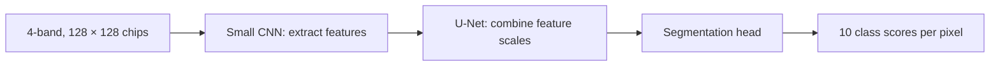

# Build a land-cover model

Create a segmentation model for four-band imagery and ten land-cover classes.
Compose existing stages, then train the resulting PyTorch module in your project.

**You need:** `geosave[ml]`. This small baseline needs no pretrained download.

## Compose the model

```python
from geosave.ml import build_model

model = build_model({
    "encoder": {
        "name": "small_cnn",
        "init_args": {"in_channels": 4, "input_size": 128},
    },
    "decoder": {"name": "unet"},
    "head": {
        "name": "segmentation",
        "init_args": {"num_classes": 10},
    },
})
```



The encoder supplies its feature dimensions to the decoder. The head restores
the configured input size. You do not need to connect the tensors manually.

The encoder finds patterns at several spatial scales. The decoder combines
that context into a detailed feature map, and the head produces one score
per class at each pixel. The resulting model takes batches shaped
`(batch, 4, 128, 128)` and returns `(batch, 10, 128, 128)`.

These are randomly initialized weights. Train them before interpreting outputs
as land-cover predictions. The class order must match your label codes;
unannotated pixels belong to the training task's ignore policy.

The four input bands and ten classes match the
[image/label example](../basics/training-chips.md). Shared
[preparation](model-inputs.md) decides their units, order and normalization
before the model is called. Configure its `bands` with all four names for
this model, in the order `red`, `green`, `blue`, `nir`.

## Use it in a project

Use the same stage mapping as `model_chain` in a
[segmentation workspace configuration](../reference/training.md), or put
`model` inside your own LightningModule. It is an ordinary PyTorch module.

Share [input preparation](model-inputs.md) between training and inference.
After training, [save a release](release.md) with the pipeline settings needed
to turn new imagery into a map.

## Start from pretrained features

Replace the encoder with one suited to your bands, dates and available
weights. Follow [pretrained models](pretrained.md) for supported combinations.
The decoder and head must match the encoder's feature contract.

Custom stages and registration belong in the
[model-chain reference](../reference/model-chain.md). See
[training contracts](../concepts/training.md) for targets, loss and metrics.
