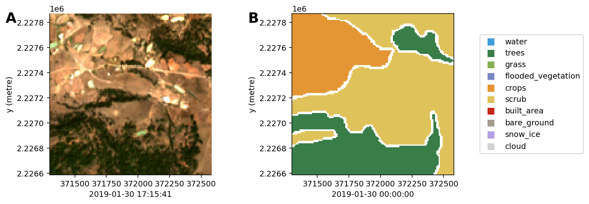

# Read overlapping training chips

Read overlapping image/label pairs without preparing a separate file for
every chip. Both layers follow the same windows and keep their own values.

Overlap gives neighboring samples some shared context. Split scenes or
regions into train and validation sets before creating these windows, so
shared pixels do not appear on both sides of the evaluation.

**You need:** `geosave[ml]` and the aligned files from
[images to training chips](../basics/training-chips.md).

## Plan overlapping samples

```python
import xarray as xr

import geosave as gs

image = gs.open_raster("training-image.tif")
labels = gs.open_raster("training-labels.tif")
tree = xr.DataTree.from_dict({
    "image": image.gs.mask_and_scale(),
    "labels": labels,
})
chips = gs.RasterChipper([tree], size=128, stride=96, mode="shift")
len(chips)
```

```text
9
```

Adjacent windows start 96 pixels apart, sharing at least 32 pixels. At the
scene boundary, `shift` moves the last windows inward to keep them inside
the image. Planning windows reads no pixels.

`size` controls the patch seen by the model; `stride` controls how far the
window moves. Here the last move can be shorter than 96 pixels because the
256-pixel scene does not divide evenly into those steps.

## Inspect the middle pair

```python
chip = chips[4]
chip_plot = chip["image"].to_dataset().gs.plot(
    rgb=("red", "green", "blue"), xlabel="",
) + chip["labels"].to_dataset().gs.plot("label", xlabel="")
chip_plot
```



Image and label boundaries stay aligned. Indexing returns a lazy window;
plotting or converting it reads its pixels.

```python
sample = chip.gs.to_tensor()
{name: tuple(value.shape) for name, value in sample.items()}
```

```text
{'image': (4, 128, 128), 'labels': (1, 128, 128)}
```

For prediction over a whole scene, use a [raster pipeline](release.md#run-with-a-raster-pipeline).
It handles chip batching and blends overlapping scores before decoding the
output. See the [sampling reference](../reference/chips.md) for edge modes and
the merger contract when implementing a custom prediction workflow.
