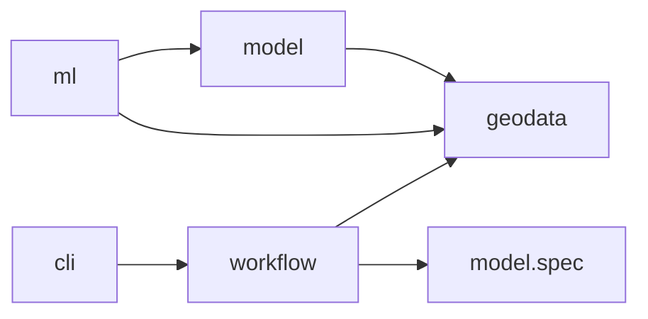

# Architecture

GeoSave composes native ecosystem objects. Raster readers return xarray objects,
vector readers return GeoDataFrames, and training classes are Lightning classes.
A GeoSave wrapper exists only where it owns an invariant the underlying object
cannot represent.

| Concern | Library |
| --- | --- |
| Raster representation | xarray `Dataset` / `DataArray` / `DataTree` |
| Vector representation | `GeoDataFrame` |
| Training | PyTorch Lightning |
| Workflow orchestration | Prefect |
| Model publishing | Hugging Face Hub |
| STAC | PySTAC, stac-geoparquet, rustac, odc-stac |

## Packages

| Package | Owns |
| --- | --- |
| `geodata` | Raster/vector accessors, metadata, public `io`, transforms, STAC, cuts, benchmark downloads, visualization. |
| `model` | Chain composition, registry, encoders, decoders, heads, model specifications, native releases. |
| `ml` | Lightning training behavior, task and method datasets and DataModules, builders, augmentation, callbacks. |
| `workflow` | Serializable runtime configs, complete Prefect flows, reusable tasks. |
| `cli` | Command arguments, workspace creation, optional scaffolds. |
| `templates` | Files copied into generated consumer workspaces. |

Dependencies point from training toward model and data:



Importing `geodata`, `model.spec` or the workflow flows does not load torch;
`.gs.to_tensor()` imports it when called. `model` never imports `ml`. Some
third-party encoder libraries load Lightning internally, but GeoSave's chain,
heads, registry and release do not require it.

## Data flow

```text
files ──► item table ──► windows ──► model inputs ──► Lightning ──► release
 COG       (stac)         (cuts)      (model.spec)      (ml)       (model.release)
```

1. [Rasters](basics/rasters.md) and [I/O](basics/io.md): writers own pixels and
   return the files they wrote.
2. [STAC](guides/stac.md): Items are built from those files into a table.
3. [Catalogs and cuts](guides/catalogs-and-cuts.md): the table becomes windows,
   each readable as a lazy stack.
4. [Model spec](guides/model-spec-and-release.md): declares inputs,
   preprocessing, cuts and transforms.
5. [Training](guides/training.md): a Module and DataModule consume the windows.

## Geospatial contracts

- Raster operations stay lazy where possible; nothing materializes a whole
  raster unless the operation requires it.
- Metadata needed for CF/GDAL round trips is preserved: CRS, coordinates,
  spatial dimensions, transform, nodata, dtype, and band or variable identity.
- Reprojection, resampling, dtype conversion, coordinate changes and eager
  computation are explicit calls.
- Constructors use `y, x` for every CRS, with CF coordinate metadata describing
  latitude/longitude or projected coordinates. Loaded objects keep their spatial
  dimension names.

## Errors and warnings

Use `TypeError` for unsupported object types, `ValueError` for invalid values or
incompatible data, and `KeyError` for missing mapping entries. Pydantic
validators raise `ValueError` so malformed specifications stay native
`ValidationError`s. `AnchorFetchError` separates an empty STAC search from
transport and asset failures, and `CollectionNotFoundError` (a `LookupError`)
lets recipes try another catalog without swallowing a malformed response.

Dependency exceptions are preserved: add context with `error.add_note(...)` and
re-raise. Cleanup handlers re-raise after closing their resources. Workflows and
Lightning own retry and presentation policy.

Warnings describe operations that continue with data loss, an assumption or an
incomplete result. Categories live in `geodata.warnings` and inherit from
`GeoSaveWarning`; turn them into errors with
`warnings.simplefilter("error", GeoSaveWarning)`.

## Where code lives

- Dimension and coordinate names: `geodata.conventions`.
- Reader selection and assembly: `geodata.io.readers`; format modules own their
  encodings and `geodata.io.raster.gdal` owns GDAL configuration.
- `Palette` and `parse_color`: `geodata.utils.color`, shared by metadata,
  persistence, visualization and training.
- Spatial dask mapping: `geodata.features.dask_mapping`.
- Window row accessors: `geodata.cuts.sample`, registered when `cuts` is imported.
- STAC item construction and asset records: `geodata.stac.item`, exposed by `stac`.
- Geometry, variable selection, statistics and geocoding: `geodata.core`.
- Training data: each method's DataModule declares the `Sample` its datasets
  return and takes one torch Dataset per split; Datasets are written per data
  source. Evaluation scores chips one by one.
- Internal plans and open design questions: `planning/`, outside published docs.
- Workspace copying: `cli.core.copy`.
- Generated workspaces compose GeoSave and Lightning APIs; they own no library
  implementations.

See the [API reference](reference/geodata.md) for the public objects.
