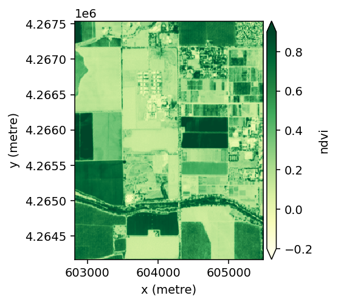

# Choose bands for a vegetation map

Satellite files contain several bands. Select the red and near-infrared bands
needed for NDVI, then save the resulting map.

**You need:** the base package and the [sample scene](first-raster.md#open-the-sample).

## Select the measurements you need

```python
import geosave as gs
from geosave.geodata import io

scene = gs.open_raster("sample-scene.tif")
image = scene[["red", "nir"]]
list(image.data_vars)
```

```text
['red', 'nir']
```

This is ordinary xarray selection. A Dataset holds named bands; `scene["red"]`
selects one band as a DataArray. Their coordinates keep the pixels located.
The double brackets keep a Dataset containing both selected bands. This lets
the index function find them by name without combining them into an unnamed
array. Selecting bands does not read their pixels.

## Calculate and plot an index

```python
ndvi = gs.features.ndvi(image, nir="nir", red="red").rename("ndvi")
ndvi_plot = ndvi.gs.plot(cmap="YlGn", clim=(-0.2, 0.9), xlabel="")
ndvi_plot
```



Higher values often indicate green vegetation. GeoSave decodes the bands'
stored scaling and missing values before calculating NDVI. Band selection
and calculation stay lazy; displaying the map reads pixels.

Vegetation usually reflects more near-infrared than red light. NDVI expresses
that contrast as `(nir - red) / (nir + red)`. The colorbar shows the index,
not a probability or a vegetation class.

## Save the map

```python
from pathlib import Path

Path("output").mkdir(exist_ok=True)
path = io.write_cog(ndvi.to_dataset(), "output/ndvi.tif", overwrite=True)
print(path)
```

```text
output/ndvi.tif
```

The TIFF keeps the source grid and the name `ndvi`. You can open it in a GIS.
`to_dataset()` gives the derived band its named Dataset representation for
the writer. No new coordinates or grid need to be constructed.

**Next:** [crop a map to your area](../advanced/crop-imagery.md), or
[understand stored values](attrs.md). See [xarray objects](../concepts/xarray-structure.md)
for dimensions and indexing, and the [raster reference](../reference/rasters.md)
for conversion methods.
