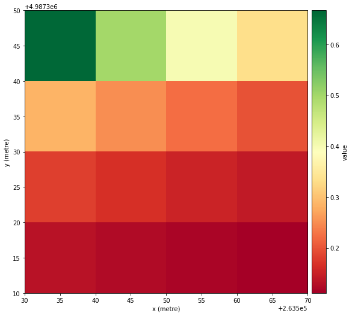

# Work with rasters

Build a small image with two named bands:

```python
import numpy as np

import geosave as gs

anchor = gs.GeoAnchor.from_coordinates(
    latitude=45, longitude=12, shape=4, resolution=10, crs="EPSG:32633"
)
red = np.arange(1, 17, dtype="uint16").reshape(4, 4)
scene = gs.raster(
    {"red": (("y", "x"), red), "nir": (("y", "x"), red + 4)},
    anchor.geobox,
    nodata=0,
)
scene
```

Output:

```text
<xarray.Dataset> Size: 132B
Dimensions:      (y: 4, x: 4)
Coordinates:
  * y            (y) float64 32B 4.987e+06 4.987e+06 4.987e+06 4.987e+06
  * x            (x) float64 32B 2.635e+05 2.635e+05 2.636e+05 2.636e+05
    spatial_ref  int32 4B 32633
Data variables:
    red          (y, x) uint16 32B 1 2 3 4 5 6 7 8 9 10 11 12 13 14 15 16
    nir          (y, x) uint16 32B 5 6 7 8 9 10 11 12 13 14 15 16 17 18 19 20
```

A raster stores values in a grid of pixels. Here each pixel covers 10 metres
by 10 metres. `red` and `nir` are two measurements of those same locations.

`scene` is an xarray `Dataset`. Its data variables are the bands, its `y` and
`x` coordinates locate pixel centres, and `spatial_ref` carries the coordinate
reference system (CRS). GeoSave adds geospatial operations through `.gs`.
You can still use normal xarray selection and arithmetic.

| Object | Stores | Use when |
| --- | --- | --- |
| `DataArray` | One named or unnamed array with coordinates and attrs | Working with one band or a model output. |
| `Dataset` | Named arrays on shared coordinates | Working with several bands or derived features. |
| `DataTree` | Named Dataset groups | Keeping inputs with different variables, dates, or grids together. |

The constructors attach coordinates and metadata to NumPy or lazy arrays; they
do not resample or compute pixels. For time series and other options, see
[raster grids](../concepts/raster-grids.md).

## Select bands and pixels

```python
scene["red"]
```

Output:

```text
<xarray.DataArray 'red' (y: 4, x: 4)> Size: 32B
array([[ 1,  2,  3,  4],
       [ 5,  6,  7,  8],
       [ 9, 10, 11, 12],
       [13, 14, 15, 16]], dtype=uint16)
Coordinates:
  * y            (y) float64 32B 4.987e+06 4.987e+06 4.987e+06 4.987e+06
  * x            (x) float64 32B 2.635e+05 2.635e+05 2.636e+05 2.636e+05
    spatial_ref  int32 4B 32633
Attributes:
    _FillValue:  0
```

One band is an xarray `DataArray`. Select several bands with
`scene[["red", "nir"]]` to keep a `Dataset`. Use `isel` for pixel positions:

```python
patch = scene.isel(y=slice(0, 2), x=slice(0, 2))
patch
```

Output:

```text
<xarray.Dataset> Size: 52B
Dimensions:      (y: 2, x: 2)
Coordinates:
  * y            (y) float64 16B 4.987e+06 4.987e+06
  * x            (x) float64 16B 2.635e+05 2.635e+05
    spatial_ref  int32 4B 32633
Data variables:
    red          (y, x) uint16 8B 1 2 5 6
    nir          (y, x) uint16 8B 5 6 9 10
```

The patch keeps the coordinates of the selected pixels. Selecting fewer pixels
changes the extent; it does not resample them.

For a file you already have, start with `gs.open_raster("scene.tif")`.
The [read and write guide](io.md) gives a complete local round trip.

## Calculate an index

```python
ndvi = gs.features.ndvi(scene, nir="nir", red="red")
scene = scene.assign(ndvi=ndvi)
scene
```

Output:

```text
<xarray.Dataset> Size: 196B
Dimensions:      (y: 4, x: 4)
Coordinates:
  * y            (y) float64 32B 4.987e+06 4.987e+06 4.987e+06 4.987e+06
  * x            (x) float64 32B 2.635e+05 2.635e+05 2.636e+05 2.636e+05
    spatial_ref  int32 4B 32633
Data variables:
    red          (y, x) uint16 32B 1 2 3 4 5 6 7 8 9 10 11 12 13 14 15 16
    nir          (y, x) uint16 32B 5 6 7 8 9 10 11 12 13 14 15 16 17 18 19 20
    ndvi         (y, x) float32 64B 0.6667 0.5 0.4 ... 0.125 0.1176 0.1111
```

NDVI compares near-infrared and red reflectance. This synthetic example only
shows the calculation. The feature function returns an unnamed `DataArray`;
assignment gives it the name `ndvi`.

Indices decode nodata and scale/offset first. See
[describe raster values](attrs.md).

## Plot a band

```python
scene.gs.plot("ndvi", cmap="YlGn", xlabel="")
```



The color scale shows the band's values. `xlabel=""` leaves out a location
caption and avoids its reverse-geocoding lookup. Name three variables to draw a
composite: `scene.gs.plot("B08", "B04", "B03")`.

## Explore on a map

```python
scene.gs.explore("ndvi", basemap="Imagery")
```

`explore` returns an interactive map with a layer sidebar. It needs a live
notebook kernel or `panel serve`. See [the interactive explorer](../concepts/explorer.md)
for layers, catalogs, performance and serving.

## Put new pixels on an existing grid

```python
prediction = np.ones((4, 4), dtype="uint8")
labels = gs.raster({"label": (("y", "x"), prediction)}, scene, nodata=255)
labels
```

Output:

```text
<xarray.Dataset> Size: 84B
Dimensions:      (y: 4, x: 4)
Coordinates:
  * y            (y) float64 32B 4.987e+06 4.987e+06 4.987e+06 4.987e+06
  * x            (x) float64 32B 2.635e+05 2.635e+05 2.636e+05 2.636e+05
    spatial_ref  int32 4B 32633
Data variables:
    label        (y, x) uint8 16B 1 1 1 1 1 1 1 1 1 1 1 1 1 1 1 1
```

Passing `scene` as the reference places the prediction on the same grid.
Dimensions must be named and end in `y, x`. For one `DataArray`, use
`gs.array(prediction, scene, dims=("y", "x"), nodata=255)`.

## Prepare an image tensor

```python
image = scene[["red", "nir"]].gs.to_tensor(dtype="float32")
image.shape, image.dtype
```

Output:

```text
(torch.Size([2, 4, 4]), torch.float32)
```

The tensor has channels first, in the selected variable order. Converting
reads the pixels and does not mask nodata or scale values; keep the raster to
place model outputs later. Time series, mixed dtypes and masking are covered in
[metadata and pixel values](../concepts/metadata.md).

## Put rasters together

Use named groups when inputs have different variables or time coordinates:

```python
sample = gs.tree({"optical": scene, "label": labels})
sample
```

Output:

```text
<xarray.DataTree>
Group: /
│   Dimensions:      (y: 4, x: 4)
│   Coordinates:
│     * y            (y) float64 32B 4.987e+06 4.987e+06 4.987e+06 4.987e+06
│     * x            (x) float64 32B 2.635e+05 2.635e+05 2.636e+05 2.636e+05
│       spatial_ref  int32 4B 32633
├── Group: /optical
│       Dimensions:      (y: 4, x: 4)
│       Coordinates:
│           spatial_ref  int32 4B 32633
│       Data variables:
│           red          (y, x) uint16 32B 1 2 3 4 5 6 7 8 9 10 11 12 13 14 15 16
│           nir          (y, x) uint16 32B 5 6 7 8 9 10 11 12 13 14 15 16 17 18 19 20
│           ndvi         (y, x) float32 64B 0.6667 0.5 0.4 ... 0.125 0.1176 0.1111
└── Group: /label
        Dimensions:      (y: 4, x: 4)
        Coordinates:
            spatial_ref  int32 4B 32633
        Data variables:
            label        (y, x) uint8 16B 1 1 1 1 1 1 1 1 1 1 1 1 1 1 1 1
```

A tree is an xarray `DataTree` with one `Dataset` per group.
`sample["optical"].to_dataset()` retrieves a raster, and
`sample.gs.to_tensor()` returns a dictionary of tensors keyed by group name.

Continue with [raster grids](../concepts/raster-grids.md) for CRS, alignment,
and resampling, or [large rasters](../guides/large-data.md) for lazy processing.
For a task starting with files, follow [file ingestion](../guides/ingest-files.md).
The full API is in [rasters](../reference/rasters.md) and
[features](../reference/features.md).
