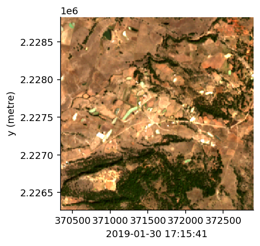
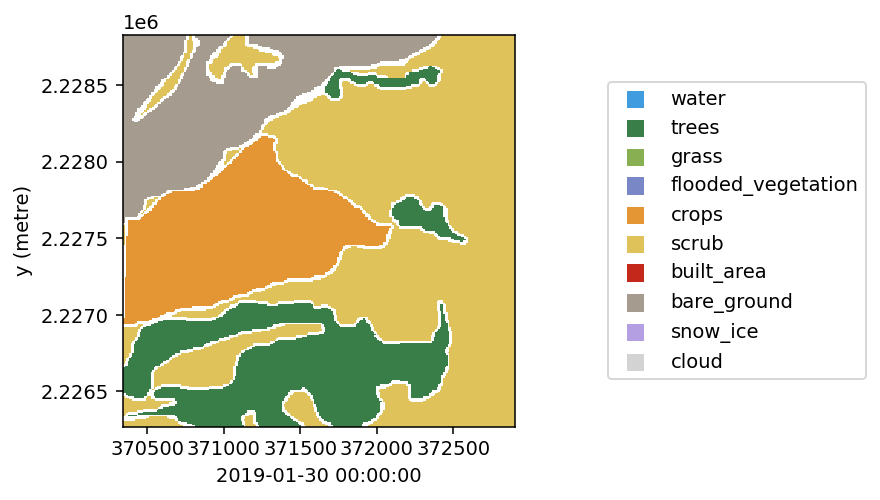

# From images to training chips

Open a satellite image and its expert labels, inspect them, then read one
chip as named tensors. Install `geosave[ml]` for tensor conversion.

Models commonly learn from fixed-size patches rather than whole scenes.
Each patch needs the image measurements and the labels for exactly the same
ground area. This walkthrough keeps that pairing through sampling.

Download [training-image.tif](../assets/training-image.tif) and
[training-labels.tif](../assets/training-labels.tif) into your working directory.
These are small, aligned crops of real Sentinel-2 imagery and Dynamic World
training annotations. [Source and attribution](../assets/README.md#training-pair).

## 1. Open the image

```python
import geosave as gs

image = gs.open_raster("training-image.tif")
list(image.data_vars)
```

```text
['red', 'green', 'blue', 'nir']
```

Each named variable is a band in an ordinary xarray Dataset.
Red, green and blue form the natural-color view below; near-infrared is an
additional measurement that a model can use to distinguish vegetation.

```python
image_plot = image.gs.plot(rgb=("red", "green", "blue"), xlabel="")
image_plot
```



## 2. Open the labels

```python
labels = gs.open_raster("training-labels.tif")
```

The labels keep integer class IDs. `255` means no annotation.
Their colors come from the embedded class legend: trees, crops, scrub and
bare ground are categories, not image intensities. Compare their boundaries
with the image before preparing samples.

```python
label_plot = labels.gs.plot("label", xlabel="")
label_plot
```



## 3. Keep image and labels together

They share the same pixel grid. A DataTree keeps them as separate named
Datasets, so their dtypes and metadata stay separate.
The names `image` and `labels` identify the two parts of each sample.
The chip iterator applies one window to both, so they stay aligned.

```python
import xarray as xr

inputs = image.gs.mask_and_scale()
tree = xr.DataTree.from_dict({"image": inputs, "labels": labels})
chips = gs.RasterChipper([tree], size=128)
location, chip = next(iter(chips))
(location.top, location.left)
```

```text
(0, 0)
```

Decoding turns stored image numbers into reflectance. Labels stay unchanged.
This matters because image scaling describes a measurement, while scaling
class IDs would change their meaning.
The 256 × 256 scene gives four 128 × 128 chips; planning them reads no pixels.

## 4. Read one sample

```python
pixels = chip.gs.to_tensor()
{name: tuple(tensor.shape) for name, tensor in pixels.items()}
```

```text
{'image': (4, 128, 128), 'labels': (1, 128, 128)}
```

Each tensor is `(band, y, x)`. Image channels follow the selected band order;
labels remain under their own name. Tensor conversion reads this chip's pixels.

The image has four channels; the label raster has one. This is a sampled data
pair, before the training Dataset arranges targets for its loss. See
[training targets](../concepts/training.md#choose-the-target-for-the-task) for
class IDs and the ignore value.

For your own pairs, check alignment and class meanings first; [align rasters](../advanced/align-rasters.md)
when grids differ.

**Next:** [prepare model inputs](../advanced/model-inputs.md), or
[read overlapping training chips](../advanced/overlapping-chips.md).
