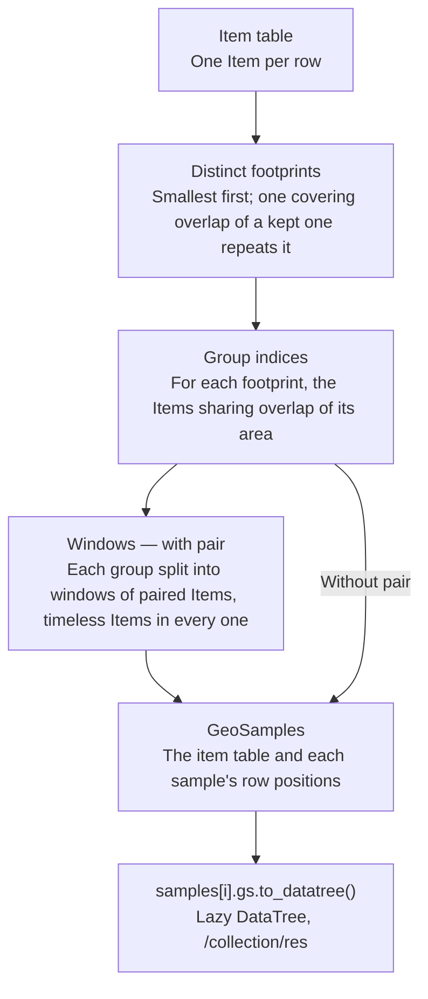

# Samples from a catalog

```python
items = gs.open_vector("catalog.parquet")      # one STAC Item per row
samples = items.gs.sample(pair=["s2", "s1"], tolerance="2D", window=3, freq="MS")
tree = samples[0].gs.to_datatree()             # DataTree: /s2/r10m, /s2/r20m, /s1/r20m, /dem/r30m
```

An item table follows stac-geoparquet: one Item per row. `sample()` groups those
Items without opening a file and returns `GeoSamples`: the item table and, for
each sample, the positions of its rows. Samples may share rows, since a swath
or a DEM belongs to several, which a pandas GroupBy cannot hold:

```text
items                                          samples.indices
   id       collection  datetime  geometry     0  [0, 1, 2, 3, 6]
0  s2_0105  s2          Jan 5     A            1  [2, 3, 4, 5, 6]
1  s1_0106  s1          Jan 6     A
2  s2_0204  s2          Feb 4     A            samples[1]  ->  items.iloc[[2, 3, 4, 5, 6]]
...
6  dem      dem         -         A
```

`samples[i]` is a sample's rows, so it opens, queries and draws as any item
table does. `samples.footprints` holds each sample's footprint, where its
Items overlap, and `samples.footprints.gs.explore()` maps them.

## How Items are grouped



Groups may share Items: a radar swath belongs to every tile it covers, and a
DEM to every window of its tile. Each step works on the Items' index; only
`build_samples` lays the rows out.

## Pairs and windows

Each Item of the first `pair` collection is one time step, joined by the nearest
Item of every other `pair` collection within `tolerance`. `window` consecutive
steps form one sample, a new one every `step`. With `freq`, a step is a
`resample` bucket filled by its `keep` pair, and a window holding an empty
bucket is skipped with a `DroppedRowsWarning`. Dated Items of a collection
outside `pair` join no sample.

## Reading and persistence

`samples[i].gs.to_datatree()` opens the selected Item rows lazily, one grid
node per native grid. `GeoSamples` uses positional indexing with `samples[i]`;
it is not a GeoDataFrame. To read a single Item from the original table, use
`items.iloc[i].gs.to_datatree()`. Close opened trees when finished.

Persist the item table, not samples, and sample it again after reading;
sampling reads no pixels.
