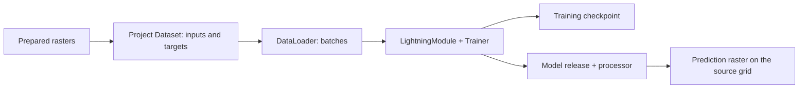

# How the library works

```python
from pathlib import Path

import geosave as gs
from geosave.geodata import io

scene = gs.open_raster("sample-scene.tif")
patch = scene[["red", "nir"]].isel(y=slice(0, 128), x=slice(0, 128))
ndvi = gs.features.ndvi(patch, nir="nir", red="red").rename("ndvi")

Path("output").mkdir(parents=True, exist_ok=True)
io.write_cog(ndvi.to_dataset(), "output/ndvi.tif")
scene.close()
```

With the [sample scene](../first-raster.md), this is a complete workflow:
open, select, calculate, save. `scene` and `patch` are native xarray Datasets;
`ndvi` is a DataArray. Importing GeoSave registers `.gs` accessors on native
xarray and GeoPandas objects.

## Choose the object for the job

| What you have | Python object | Purpose |
| --- | --- | --- |
| One band or array | DataArray | Values with named axes, coordinates and attrs. |
| Bands on a shared grid | Dataset | Named variables on shared coordinates. |
| Several observations or grids | DataTree | Datasets in a caller-defined hierarchy; each node can have its own grid. |
| Features or STAC Items | GeoDataFrame | Geometry and attributes; Item assets point to files. |

`gs.Dataset`, `gs.DataArray`, and `gs.DataTree` are the native xarray types.
Normal indexing, arithmetic, concatenation and merging remain available.
Decoding values, changing grids, converting dtype and computing pixels should
be explicit. See [metadata](metadata.md) before combining packed imagery.

## Add only the stages your workflow needs

| Need | Operation | Result |
| --- | --- | --- |
| Describe a place and time | `GeoRegion` | Geometry, CRS and optional period, without a pixel grid. |
| Discover observations | `StacClient.search` | Item table, without raster pixels. |
| Load on an exact grid | `stac.load_dataset(items, geobox=grid)` | Dataset on the supplied GeoBox. |
| Retain native asset grids | `stac.load_native_datasets(items)` | One `(crs, resolution, Dataset)` per native grid. |
| Read model-sized windows | `RasterChipper([tree], size=256)` | Lazy raster windows; explicit conversion reads pixels. |
| Publish dated raster assets | `scene.gs.to_catalog(folder)` | Written TIFFs and an Item table. |

Catalog sampling is currently unavailable. Select observations with GeoPandas
or select dates on a prepared Dataset. [Catalogs](../guides/catalogs-and-cuts.md)
and [chips](../guides/chips.md) work independently.

Keep file-backed sources open until dependent work finishes. Lazy execution
delays pixel work; it does not guarantee small downloads or bounded peak memory.
See [lazy execution](lazy-data.md) and [remote storage](storage.md#use-remote-storage).

## Add training when you need a model



Your Dataset owns reads, band order, target codes and split selection. RasterChipper
is optional; it cuts prepared one-grid DataTrees. A DataModule can organize loaders and device-side transforms;
the LightningModule owns loss and metrics, and Trainer runs the loop.
Start with the [offline training tutorial](../guides/training.md).

Prepare inputs with the same code at training and inference. A native model
release saves registered stage construction and weights, and optionally a
processor: registered ingest, preparation and decoding classes that run the
model chip by chip over a raster. See [model inputs](../guides/model-inputs.md)
and [releases](../guides/release.md#run-the-model-with-a-processor).
ModelSpec and dependent geospatial workspace workflows are paused.

Package ownership belongs in [the contributor architecture](../contributing/architecture.md).
