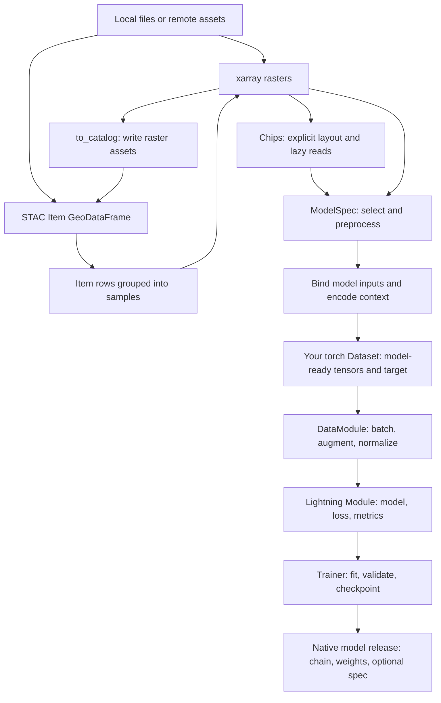

# How the library works

```python
import geosave as gs
from geosave.model.spec import ModelSpec

spec = ModelSpec.load("model_spec.yaml")
scene = gs.open_raster("optical.tif")
prepared = spec.preprocess({"optical": scene})
inputs = spec.model_inputs(prepared)
```

This fragment assumes the spec declares `rasters.optical` and its model inputs.
`prepared` maps names to selected rasters and preprocessing results. `inputs`
maps model argument names to raster objects and any encoded context. Neither
call runs the network, and `model_inputs` does not convert pixels to tensors.
The [model spec guide](../guides/model-spec.md) provides a complete example.

## What GeoSave adds to native objects

`gs.Dataset`, `gs.DataArray`, and `gs.DataTree` are native xarray types at
runtime. `GeoDataset`, `GeoDataArray`, and `GeoDataTree` are their `.gs`
accessors. GeoSave supplies geospatial operations and preserves the meaning of
pixels; ordinary xarray and GeoPandas operations remain available.

Keep four decisions separate:

| Decision | Value that represents it |
| --- | --- |
| Which ground and time are of interest? | A `GeoAnchor`: geometry with a CRS and optional temporal coverage. |
| Which observations belong together? | Item rows grouped by Region, Pair, Slot and Window into `GeoSamples`. |
| Where will each output pixel lie? | A native `GeoBox`: CRS, affine transform and shape. |
| Which model-sized windows are read and merged? | `Chips`, retaining one raster layout per input tree. |

A Region is the geographic support used for sampling; a Pair joins nearby
observations across collections; a Slot places a Pair in time; a Window takes
consecutive Slots. These are not interchangeable with spatial Chips.
`GeoSamples` stores overlapping Item-row memberships, so one radar swath can
belong to several Regions. Its rows remain native GeoDataFrames.

A sample's Item membership does not crop its assets. Native opening reads their
full grids, and Chips currently lays out their union. Select the intended
geographic support explicitly when a shared swath extends beyond your Region;
see [sample reading limits](../guides/catalogs-and-cuts.md#choose-the-reading-grid).

## From files to model results



The diagram shows alternatives: a model may consume a whole raster or a Chip.
These are composable steps. You can process a raster without making a model,
train from an existing torch Dataset without a catalog, or call a model
directly without Lightning or Prefect.

## What each step accepts and returns

| Step | Input | Output | Work performed |
| --- | --- | --- | --- |
| Open a raster | One path, URL, or UPath. | `xarray.Dataset` or grouped `xarray.DataTree` | Reads header and coordinates; pixels can remain lazy. |
| Describe saved files | Paths and optional collection/date information. | STAC Item `GeoDataFrame` | Opens headers and records footprints, dates, grids, and assets. |
| Group samples | Item rows and pairing/window settings. | `GeoSamples`, retaining Item row positions per sample | Lists each sample's Items without reading pixels. |
| Read one sample | One sample's rows, `samples[i]`. | `xarray.DataTree` | Opens collections lazily on their native grids. |
| `spec.preprocess` | Declared raster names mapped to Datasets. | Selected rasters and processing results by name. | Validates requirements and runs declared calls. |
| `spec.model_inputs` | Prepared rasters. | Pixel rasters and context by model argument name. | Resolves references; optional context reads metadata. |
| Convert pixels | Selected rasters; decode explicitly when physical values are needed. | NumPy arrays or torch tensors. | Materializes pixels; returns values without coordinate labels. |
| Train | Task-specific Dataset samples and a model configuration. | Fitted model, metrics, configured logs/checkpoints. | DataModule prepares batches; Module and Trainer run learning. |
| Save a release | ModelChain and optional ModelSpec. | Transformers-compatible release directory. | Saves constructor configuration and weights. |

“Lazy” describes when pixel computation runs; it does not guarantee how many
bytes a remote reader transfers. Sampling and chip layout inspect metadata;
Dask transformations defer pixel work; tensor conversion and persistence
execute it. Remote COGs opened with `storage_options` currently download first,
as described in [storage](storage.md#use-remote-storage).

Preprocessing can be lazy if its functions support lazy arrays. Arbitrary
declared calls can compute or have side effects. A spec validates its
declarations; it does not make an eager function lazy.

## Preparation and training own different work

Each step takes a catalog and gives one. `spec.ingest(anchor, path, geobox=grid)` saves the
declared rasters from their STAC recipes as a raw catalog; a catalog of your own
files serves the same purpose. The optional Prefect ingestion flow writes that
catalog and stops there.

`spec.prepare(raw, keep=["label"])` runs raster selection and preprocessing on
every sample of the raw catalog and returns a prepared catalog of the rasters
model inputs read, plus retained labels. It computes pixels while writing, to a
temporary folder unless given a path. Sample a catalog with `catalog.gs.sample(...)` and cut opened trees with
`gs.Chips(...)`; tensor transforms run later in the DataModule. The current
`prepare` implementation does not yet handle nested collection/grid trees;
see [the preparation limitation](../guides/model-spec.md#catalog-preparation-limitation).

A torch Dataset supplies source-specific reading, splitting, target codes and
the model's tensor layout. The generated project DataModules consume those samples;
they do not infer train/validation splits or discover data sources.

## Inference must match the input contract

A direct chain call accepts its named tensors and returns its stage outputs.
For segmentation these are logits; interpreting class codes and confidence is
an explicit step. A release stores its optional spec beside the weights; load
and execute that spec separately. Its `forward` does not automatically run
the spec's tensor normalization.

Keep band order, temporal axes, units, missing-value handling, context encoding,
and normalization consistent with training. Preserve the reference raster to
place outputs back on its grid. See [pretrained models](../guides/pretrained.md),
[releases](../guides/release.md), and [training contracts](training.md).

## Where GeoSave fits

| Package | What it owns | Main dependency objects |
| --- | --- | --- |
| `geosave.geodata` | Metadata-aware I/O, accessors, transforms, STAC, windows. | xarray, GeoPandas, PySTAC, Dask. |
| `geosave.model` | Chain construction, stages, input specs, releases. | PyTorch; Transformers for releases. |
| `geosave.ml` | Reusable builders, metrics, losses, transforms, callbacks, and CLI. | Lightning, torchmetrics, Kornia. |
| `geosave_flows` | Optional acquisition jobs composing library APIs. | Prefect. |

Importing `geosave` registers the accessors without importing torch. Optional
dependencies load when their features are used. Model specs can be loaded
without a training stack. For contributor package boundaries, read
[Architecture](../contributing/architecture.md).
