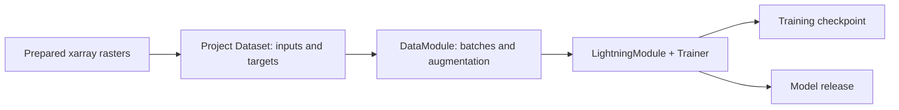

# How the library works

```python
import geosave as gs

scene = gs.open_raster("sample-scene.tif")
patch = scene[["red", "nir"]].isel(y=slice(0, 128), x=slice(0, 128))
ndvi = gs.features.ndvi(patch, nir="nir", red="red").rename("ndvi")
ndvi.gs.to_cog("output", format_paths="ndvi.tif")
scene.close()
```

With the [sample scene](../first-raster.md), this is a complete data workflow:
open, select, calculate, save. `scene` and `patch` are native xarray Datasets;
`ndvi` is a DataArray. You do not need a catalog, model recipe, workspace, or
workflow engine to use GeoSave.

## Native objects first

Importing GeoSave registers `.gs` accessors on xarray and GeoPandas objects.
Use normal indexing and arithmetic, then `.gs` for geospatial operations.
`gs.Dataset`, `gs.DataArray`, and `gs.DataTree` are native xarray types;
`GeoDataset`, `GeoDataArray`, and `GeoDataTree` implement their accessors.

| What you have | Python value | What it represents |
| --- | --- | --- |
| One band | `xarray.DataArray` | Values, dimensions, coordinates, and metadata |
| Bands on a shared grid | `xarray.Dataset` | Named variables, such as red and near-infrared |
| Several collections or grids | `xarray.DataTree` | Explicit groups of Datasets |
| Features or STAC Items | `geopandas.GeoDataFrame` | Geometry and attributes; Item assets point to pixel files |

An operation should make changes to pixel meaning explicit: decode packed
values, reproject onto another grid, convert dtype, or read pixels into memory.
Ordinary xarray operations remain available, but may not preserve every metadata
contract. See [metadata](metadata.md) before combining encoded imagery.

## Place, observations, grid, and chips

These answer different questions:

| Question | Value |
| --- | --- |
| Which place and time are of interest? | `GeoRegion`: geometry, CRS, and optional temporal coverage |
| Which observations belong together? | `GeoSamples`: catalog row positions grouped by footprint and optional calendar windows |
| Where are the pixels? | Native `GeoBox`: CRS, affine transform, and shape |
| Which model-sized windows should be read? | `Chips`: windows of prepared Datasets or DataArrays |

A declared region can differ from a raster's rectangular grid footprint. A
sample's Item membership does not crop or align its assets. Select the intended
extent and prepare a shared grid before constructing Chips. Chips neither
chooses a union grid nor opens catalog rows for you.

## Add a catalog when you need observation selection

```python title="Adaptation example — use your catalog and collection name"
items = gs.open_vector("catalog.parquet")
samples = items.gs.sample(collections=["optical"], freq="MS", window=3)
with samples[0].gs.to_datatree() as tree:
    scene = tree["optical"].gs.combine_stac()
    chips = gs.Chips([scene], size=256)
    pixels = chips[0].gs.to_numpy(dtype="float32")
```

This example assumes compatible native grids. Each collection independently
populates calendar slots; a window selects consecutive slots. `samples[i]`
returns native rows. Loading retains source observations and timestamps, so
reduction, interpolation, and alignment remain explicit operations. For mixed
grids, [choose the reading grid](../guides/catalogs-and-cuts.md#choose-the-reading-grid)
before converting the tree to a Dataset.

Sampling and chip construction inspect metadata. Indexing a chip returns a lazy
xarray window; `gs.to_numpy` computes it. Keep source rasters open until dependent reads
finish. “Lazy” describes when work runs, not a guarantee about remote transfer
size or peak memory. See [lazy execution](lazy-data.md) and [remote storage](storage.md#use-remote-storage).

## Add training when you need a model



Your project Dataset owns reading, band order, target codes, and train/validation
selection. Chips is optional. A DataModule batches samples and applies the
method's tensor operations; the LightningModule owns loss and metrics, and
Trainer runs training. Start with the [offline training tutorial](../guides/training.md)
for a complete example before adopting a generated workspace.

ModelSpec is optional when sharing processing between training and inference:

```python
from geosave.model.spec import ModelSpec

spec = ModelSpec.load("configs/segmentation-supervised/model_spec.yaml")
image = spec.run(entry="encoded", output="normalized", raster=scene)
prediction = model(image=image)
```

Named Python calls own preparation and inference. References specify their
dependencies. Processing stays lazy only where the called operations do.
See [recipes](../guides/model-spec.md) for execution and input contracts.

A Lightning checkpoint preserves training state. A native model release saves
registered model construction and weights, plus an optional spec. Loading that
release does not automatically execute the spec: inference must reproduce
training's band order, units, missing-value handling, and normalization.
See [releases](../guides/release.md).

Package ownership belongs in [the contributor architecture guide](../contributing/architecture.md).
