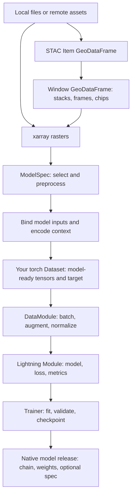

# How the library works

```python
import geosave as gs
from geosave.model.spec import ModelSpec

spec = ModelSpec.load("model_spec.yaml")
scene = gs.open_raster("optical.tif")
prepared = spec.preprocess({"optical": scene})
inputs = spec.model_inputs(prepared)
```

This fragment assumes the spec declares `rasters.optical` and its model inputs.
`prepared` maps names to selected rasters and preprocessing results. `inputs`
maps model argument names to raster objects and any encoded context. Neither
call runs the network, and `model_inputs` does not convert pixels to tensors.
The [model spec guide](../guides/model-spec.md) provides a complete example.

## From files to model results



These are composable steps. You can process a raster without making a model,
train from an existing torch Dataset without a catalog, or call a model
directly without Lightning or Prefect.

## What each step accepts and returns

| Step | Input | Output | Work performed |
| --- | --- | --- | --- |
| Open a raster | Path, URL, UPath, or supported sequence of files. | `xarray.Dataset` | Reads header and coordinates; pixels can remain lazy. |
| Describe saved files | Paths and optional collection/date information. | STAC Item `GeoDataFrame` | Opens headers and records footprints, dates, grids, and assets. |
| Cut windows | Item or parent sample table and cut settings. | Stack `GeoDataFrame` | Selects sources and layouts without reading pixels. |
| Read one window | A stack row. | `xarray.DataTree` | Opens, selects, and aligns sources onto the window grid. |
| `spec.preprocess` | Declared raster names mapped to Datasets. | Selected rasters and processing results by name. | Validates requirements and runs declared calls. |
| `spec.model_inputs` | Prepared rasters. | Pixel rasters and context by model argument name. | Resolves references; optional context reads metadata. |
| Convert pixels | Selected rasters; decode explicitly when physical values are needed. | NumPy arrays or torch tensors. | Materializes pixels; returns values without coordinate labels. |
| Train | Task-specific Dataset samples and a model configuration. | Fitted model, metrics, configured logs/checkpoints. | DataModule prepares batches; Module and Trainer run learning. |
| Save a release | ModelChain and optional ModelSpec. | Transformers-compatible release directory. | Saves constructor configuration and weights. |

Preprocessing can be lazy if its functions support lazy arrays. Arbitrary
declared calls can compute or have side effects. A spec validates its
declarations; it does not make an eager function lazy.

## Preparation and training own different work

`spec.load_rasters(anchor)` acquires declared rasters from STAC recipes on a
target grid. If you already have files, open them and call `preprocess` directly.
The optional Prefect ingestion flow saves acquired rasters and stops there.

`spec.prepare(raw, output, on="label")` reads catalog windows, runs raster
preprocessing, and saves the rasters referenced by model inputs, retained labels,
a catalog, and the spec. It computes pixels while writing. Frame and chip cuts
remain explicit operations; tensor transforms run later in the DataModule.

A torch Dataset supplies source-specific reading, splitting, target codes and
the model's tensor layout. GeoSave's DataModules consume those samples;
they do not infer train/validation splits or discover data sources.

## Inference must match the input contract

A direct chain call accepts its named tensors and returns its stage outputs.
For segmentation these are logits; interpreting class codes and confidence is
an explicit step. A release stores its optional spec beside the weights; load
and execute that spec separately. Its `forward` does not automatically run
the spec's tensor normalization.

Keep band order, temporal axes, units, missing-value handling, context encoding,
and normalization consistent with training. Preserve the reference raster to
place outputs back on its grid. See [pretrained models](../guides/pretrained.md),
[releases](../guides/release.md), and [training contracts](training.md).

## Where GeoSave fits

| Package | What it owns | Main dependency objects |
| --- | --- | --- |
| `geosave.geodata` | Metadata-aware I/O, accessors, transforms, STAC, windows. | xarray, GeoPandas, PySTAC, Dask. |
| `geosave.model` | Chain construction, stages, input specs, releases. | PyTorch; Transformers for releases. |
| `geosave.ml` | Tasks, data modules, builders, metrics, transforms. | Lightning, torchmetrics, Kornia. |
| `geosave_flows` | Optional acquisition jobs composing library APIs. | Prefect. |

Importing `geosave` registers the accessors without importing torch. Optional
dependencies load when their features are used. Model specs can be loaded
without a training stack. For contributor package boundaries, read
[Architecture](../contributing/architecture.md).
