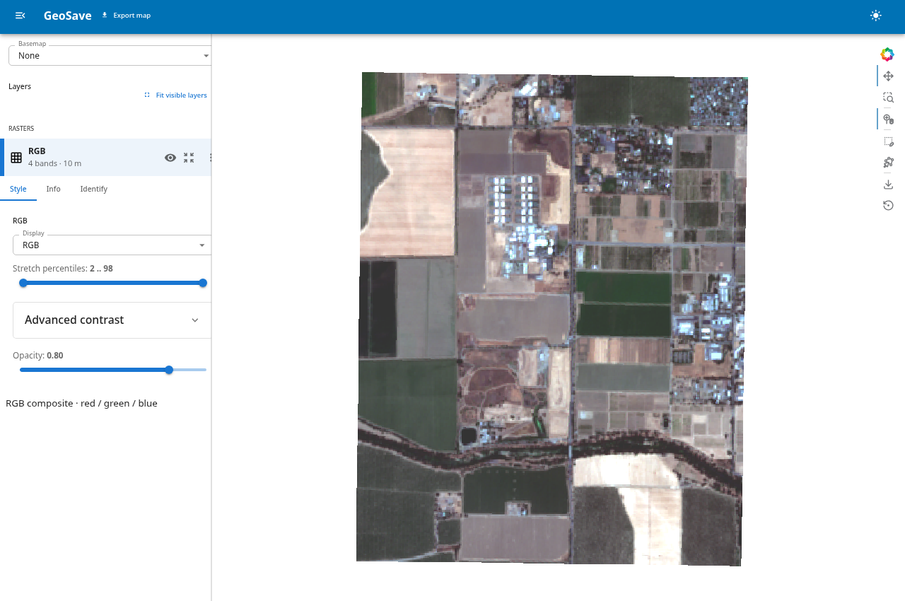

# Explorer controls and behavior

For a first map and a visual walkthrough, start with
[Explore imagery on a map](../basics/explore.md).

```python
scene.gs.explore(rgb=("red", "green", "blue"), basemap="None")
```



`explore` returns a native Panel Material UI app with a light/dark theme toggle.
The map fills the available page space and follows sidebar and browser resizing.
`height=600` sets the inline notebook page height; served pages fill the browser.
The header's menu button collapses or reopens the sidebar. **Export map** stays
available in the header while the sidebar is closed. It downloads
`geosave-map.html` with the current map, visible-layer legends and raster dates.
The file embeds its JavaScript and does not need the Explorer or a Python
session. It captures the current detail; zooming does not read new raster
pixels. Basemap tiles still need network access. Export is computed when the
button is clicked, so later downloads reflect changed display settings.
The compact sidebar groups rasters and vectors separately, with
visibility and zoom/remove actions on each layer. Style, Info and Identify tabs
contain the selected layer’s controls, legend and metadata.
The map sits beside it; a collapsible catalog or attribute table sits below
the map. Tables start with no selected rows and draw no footprints. Switching
tabs preserves each table's selection. A row's checkbox draws its geometry; a catalog's **raster** column
normally opens that row's raster. **Catalog pixel viewing is currently unavailable:**
`read_pixels` raises while catalog access is rebuilt. Open and combine assets
explicitly, then explore the resulting Dataset instead. Clicking the
map picks features without opening rasters. Column filters and date ranges
retain original row identity. Table guidance explains the two controls; checking
Raster again retries a failed load. **Fit visible layers** frames the layers
currently displayed, respecting date and comparison selection.

A raster opens with its declared RGB channels, otherwise its first spatial
band. Explicit `band` or `rgb` arguments take priority. The **Display** dropdown lists
each spatial band and **RGB** when a declared or explicit composite exists. Each raster
keeps its own choices, opacity and stretch. While a raster has dates, the
sidebar's **Date** slider steps the whole map by year, month or day: each dated
raster shows its last date in that period, rasters without one there are
hidden, and timeless rasters always show. **Color by** selects a vector
attribute. The optional comparison card switches between two open rasters.

The map uses Panel, HoloViews, GeoViews and Bokeh. Dense point, line and polygon layers
use Datashader for numeric, categorical and single-color rendering. The data layers
set the initial map extent and supply the values shown on hover. Imagery, light,
dark and OpenStreetMap basemaps provide the background and their providers'
attribution. Basemaps need network access; the explorer needs a
live notebook kernel or `panel serve`.

For a shareable map of the current view, capture a standalone HoloViews overlay:

```python
import holoviews as hv

snapshot = viewer.snapshot()
hv.save(snapshot, "map.html", backend="bokeh", resources="inline")
```

The snapshot retains the visible layers, selected date, colors, opacity and
extent in a fixed-size map frame. It remains usable after changing or closing
the Explorer. Exported
HTML supports pan, zoom and rendered hover information without Python, but
cannot fetch new raster detail. Sidebar controls, tables and drawn regions
are omitted. Inline resources embed the JavaScript; basemap tiles still need
network access. Choose `basemap="None"` before capture for a map without tile
requests. Capturing uncached pixels computes them; output dimensions do not
bound source reads.

For an xarray raster, the explorer computes the selected bands and reprojects
them to Web Mercator for display. When both the source and the projected scene
fit within 512 × 512 pixels, the browser receives one image for the selection.
Pan and zoom then reuse that image. The limit is 1 MiB of float32 pixels per
band before rendering. Larger rasters use padded viewport windows. A pan inside
the active window at the same zoom reuses the displayed pixels. A finer zoom
or a pan beyond the window requests detail. Dense vector layers resample when
their view changes.

Recent viewport windows share a 128 MiB pixel-cache budget per raster layer,
so returning to a retained zoom avoids another source read. Returning to a
zoom can still transfer an image to the browser. Changing bands, date, or
nonspatial axes invalidates those windows. The active image remains reusable
even when larger than the history budget; rendered arrays and the RGB overview
also occupy memory outside that budget. Removing a raster or closing the
explorer clears its caches. Set `layer.cache_bytes = 0` to retain only the active
window, or use `layer.clear_cache()` to release all its cached buffers.
Percentile sliders apply on release.
RGB stretches each channel separately using a cached scene overview of at most
256 × 256 pixels. Pan and zoom keep the same color mapping. Changing the RGB
bands, date or selected axis refreshes the overview; changing the percentile
slider reuses it. **Advanced contrast** sets one manual range for all channels.
The RGB overview samples the whole scene and can touch every source chunk of a
computed raster, while keeping the sampled array bounded.
Display choices do not mutate the source raster or its RGB metadata.

Pass configured layers and named tables separately:

```python
from geosave.geodata.viz.explore import Explorer, RasterLayer, VectorLayer

viewer = Explorer(
    layers=[RasterLayer(scene), VectorLayer(fields)],
    tables={"Observations": catalog},
)
```

Explicit layers display immediately. Tables create no raster layers until rows
are opened. `catalog.gs.explore()` creates a table-only viewer.
`scene.gs.explore() * RasterLayer(prediction)` combines independent layer settings.
Two explorers also compose; their table names must be distinct.
For local serving, put `scene.gs.explore().servable()` in a script and run
`panel serve explore.py`.

To launch directly from a notebook or Python script:

```python
server = catalog.gs.explore().serve()
```

This starts a local server at `http://localhost:5006`. In notebooks it runs in a
background thread, so the cell stays free, and opens a browser tab. Rerunning the
cell replaces the server the earlier explorer started on that port. In scripts it keeps the process
running until you press Ctrl+C. Google Colab uses its kernel-port proxy to
display the served explorer in an iframe; keep the Colab runtime connected.
Colab support requires its hosted frontend and is not a public deployment.

If another program holds the port, `.serve()` raises `OSError`; pass
`.serve(port=5007)`. Use `.serve(open=False)` to start
without opening a tab or iframe. Local connections accept both `localhost` and
`127.0.0.1`. For remote Jupyter kernels, forward the chosen port to your browser's
machine. Stop a notebook server with `explorer.stop()`.
