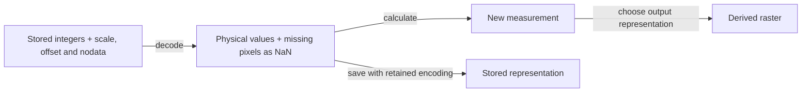

# Metadata and pixel meaning

A raster needs more than a CRS. Its values also need units, missing-data rules
and, for labels, class meanings. GeoSave keeps these on native xarray objects.

## Where meaning lives

| Information | Location |
| --- | --- |
| Grid and CRS | Spatial coordinates and their CRS coordinate. |
| Units, scaling, nodata and class legend | Each variable's attrs. |
| Dataset identity and provenance | Root attrs, including ACDD fields. |
| Observation period | `start_datetime` and `end_datetime` coordinates. |
| Source Collection | Root STAC metadata when provided by loading. |

Metadata groups read related attrs as one validated value. There is no second
metadata store. An absent group returns `None`; an invalid declaration raises.

Band metadata follows the variable because red reflectance and land-cover
codes have different meanings, even on the same grid. Dataset metadata instead
describes the observation or product as a whole.

The [value guide](../basics/attrs.md) uses real imagery and labels to show why
measurements and class codes must stay separate.

## Declaring meaning does not change pixels

Writing nodata, scaling or a legend describes existing values. It does not
replace pixels, recode classes or apply a physical conversion.

For example, declaring `255` as nodata means existing `255` pixels are missing.
It does not turn another code into `255`. The declaration must fit the dtype.

Metadata writers return a new object while sharing pixel data. Assign their
result when you want to keep a declaration.

## Stored values and decoded values

`.gs.mask_and_scale()` uses xarray's CF decoder. It leaves the source unchanged,
preserves lazy arrays, and moves consumed packing fields and storage dtype into
variable encoding. Writers can use that encoding to restore storage values.

Attrs describe how stored values should be interpreted; encoding records how
decoded values should be saved. After decoding, the values are already in
physical units. Retaining the storage recipe in encoding lets a writer pack
them without asking you to reverse the scale manually.

Arithmetic and reductions generally discard encoding. Choose the representation
for a derived result instead of assuming the source's integer encoding still
applies. Spectral indices already decode the bands they select.

NDVI, for example, is a new dimensionless ratio. The source red band's integer
scale is not automatically an appropriate storage choice for that result.

Dataset decoding also handles CF coordinates and relationships. A DataTree
keeps its Datasets separate; decode the node you need.

## Combining data

Align grids and check units, scaling and class meanings before combining pixels.
Matching shapes or compatible attrs alone do not establish compatible values.

Native xarray concatenation and merging use their own `combine_attrs` policy.
GeoSave's stacking conversions use `drop_conflicts`: conflicting keys are
dropped; a key present in only one input can remain. This policy does not check
whether two class codebooks mean the same thing.

Band stacking additionally checks active pixel declarations. Decode imagery
explicitly when inputs use different stored representations. Preserve
categorical targets separately.

A class code can mean trees in one dataset and water in another. Keeping the
first legend or dropping conflicting attrs cannot resolve that difference;
the project must establish one class mapping before combining the labels.

## Saving and loading

Metadata support varies by format. GeoTIFF uses band properties and tags;
Zarr and NetCDF use array metadata and CF encoding. Catalog Items describe
assets through STAC metadata. Loading selected STAC metadata does not preserve
every original Item field.

Time periods stay as start/end coordinates in memory. NetCDF represents them
as CF bounds. Operations that change the time axis do not automatically recover
the meaning of an observation's period.

When a derived product has different identity or units, describe the new
product before publishing. Check properties that matter through a save/reopen
round trip.

See [metadata reference](../reference/attrs.md) for groups and writers,
[raster reference](../reference/rasters.md) for time bounds, and
[I/O reference](../reference/io.md) for format behavior.
