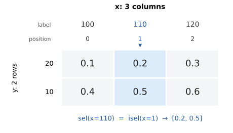

# DataArray, Dataset, and DataTree

GeoSave uses native xarray objects. A **DataArray** holds one labelled array;
a **Dataset** holds several named arrays; a **DataTree** groups Datasets.

Start with a small array so every position is visible. The previews below are
xarray's actual notebook displays: expand their sections to inspect values,
coordinates, indexes and attributes. The previews include xarray's default indexes.

## DataArray: one array with named axes

```python
from datetime import datetime

import xarray as xr

red = xr.DataArray(
    [[0.1, 0.2, 0.3], [0.4, 0.5, 0.6]],
    dims=("y", "x"),
    coords={
        "y": [20, 10],
        "x": [100, 110, 120],
        "column_name": ("x", ["west", "centre", "east"]),
        "time": datetime(2025, 6, 1),
    },
    name="red",
    attrs={"units": "1"},
)
red
```

<iframe class="gs-xarray-preview" src="../assets/xarray-dataarray.html" title="Interactive xarray DataArray display" loading="lazy"></iframe>

[Open the DataArray display separately](../assets/xarray-dataarray.html).

| Part | Meaning in this array |
| --- | --- |
| `data` | The six measurements, arranged in two rows and three columns. |
| `dims` | The axis names, in order: `("y", "x")`. |
| `sizes` | The length of each axis: `y=2`, `x=3`. |
| `coords` | Variables describing positions: `y`, `x`, `column_name` and `time`. |
| `attrs` | Descriptive metadata, here `{"units": "1"}`. |
| `indexes` | Lookup structures that connect coordinate labels to positions. |

The dimension name tells xarray **which axis** an operation concerns.
A coordinate supplies labels or other information along that axis.
A dimension can exist without coordinate values; it still has a length and
integer positions.

```python
print(red.dims)
print(dict(red.sizes))
print(red.data)
```

```text
('y', 'x')
{'y': 2, 'x': 3}
[[0.1 0.2 0.3]
 [0.4 0.5 0.6]]
```

Here `data` is a NumPy array. A raster opened from a file can instead carry
lazy Dask data; dimensions, coordinates and metadata still describe it.

## How a coordinate label becomes a position



For the `x` axis, the lookup is:

| Coordinate label | `100` | `110` | `120` |
| --- | --- | --- | --- |
| Integer position | `0` | `1` | `2` |
| Column name | west | centre | east |

`x(x)` is a **dimension coordinate**: its name matches its only dimension.
Xarray creates an index for it by default. In this example that index is a
pandas Index.

```python
position = red.indexes["x"].get_loc(110)
print(position)
```

```text
1
```

Selecting by label uses that lookup. Selecting by position goes directly to
the same column:

```python
selected = red.sel(x=110)
print(selected.values)
print(red.isel(x=position).values)
```

```text
[0.2 0.5]
[0.2 0.5]
```

Both select the second column and keep both rows. The result has dimension
`y`; `x=110` remains as a scalar coordinate. Use a list such as `x=[110]`
when you want to retain an `x` dimension of length one.

An **index** is the lookup structure; an integer **position** is a location
in the underlying array. The coordinate label `110` is not position 110.

## A coordinate can reference a dimension without indexing it

Read `column_name (x)` as “column names arranged along the x dimension.”
Its three entries follow the same positions as the three x labels:

```python
print(red.coords["column_name"].dims)
print(red.coords["column_name"].values)
print(list(red.indexes))
```

```text
('x',)
['west' 'centre' 'east']
['y', 'x']
```

`column_name` describes the columns, but it has no index by default because
its name differs from `x`. Referencing a dimension establishes the positional
relationship; it does not automatically create a label lookup.

To select by those names, explicitly give the coordinate an index:

```python
by_name = red.set_xindex("column_name")
print(by_name.sel(column_name="centre").values)
```

```text
[0.2 0.5]
```

Now `"centre"` also resolves to position 1 on `x`. The dimension remains
named `x`. Stars in xarray's printout mark indexed coordinates.

Coordinates can describe fewer axes than the data. Here `column_name(x)`
describes each column, while scalar `time` describes the whole array without
adding a time axis. A coordinate can also span several dimensions, such as
`latitude(y, x)`; it is not automatically a one-axis lookup.

## Dataset: several variables sharing dimensions and coordinates

```python
scene = xr.Dataset(
    {
        "red": red,
        "nir": (("y", "x"), [[0.5, 0.6, 0.7], [0.8, 0.9, 1.0]]),
        "cloud": ("x", [False, True, False]),
    },
    attrs={"title": "Teaching scene"},
)
scene
```

<iframe class="gs-xarray-preview gs-xarray-preview--dataset" src="../assets/xarray-dataset.html" title="Interactive xarray Dataset display" loading="lazy"></iframe>

[Open the Dataset display separately](../assets/xarray-dataset.html).

A Dataset has named **data variables** instead of one `data` array.
Here `red` and `nir` use `(y, x)`; `cloud` uses only `x`. They share the
coordinates that belong to their dimensions.
Axis order belongs to each variable, so a Dataset does not impose one global
array order. Use `sizes` to read the shared dimension lengths.

```python
print(list(scene.data_vars))
print(dict(scene.sizes))
print(scene["red"].dims)
print(scene.attrs)
print(scene["red"].attrs)
```

```text
['red', 'nir', 'cloud']
{'y': 2, 'x': 3}
('y', 'x')
{'title': 'Teaching scene'}
{'units': '1'}
```

`scene["red"]` is a DataArray. It keeps its measurements, applicable
coordinates and its own attrs. The Dataset's `title` describes the whole
scene; the band's `units` describes that variable.

| Question | DataArray | Dataset |
| --- | --- | --- |
| Where are the measurements? | `red.data` | In each variable, such as `scene["red"].data`. |
| Where are the variable names? | One `name`. | `scene.data_vars`. |
| Which axes exist? | `dims` gives their order; `sizes` gives lengths. | `sizes` gives lengths shared across variables. |
| What labels the data? | `coords`, with indexes where configured. | Shared `coords` and indexes. |
| Where is metadata? | `attrs` on the array. | Dataset `attrs` and each variable's own `attrs`. |

Xarray uses indexed labels to align data during labelled operations.
Attributes do not add axes or coordinate labels. GeoSave reads metadata such
as nodata and scaling from these native objects; see [metadata](metadata.md).

## DataTree: Dataset nodes with coordinate inheritance

```python
tree = xr.DataTree.from_dict(
    {
        "/": xr.Dataset(
            coords={"y": [20, 10], "x": [100, 110, 120]},
            attrs={"title": "Survey"},
        ),
        "/scene": xr.Dataset(coords={"time": datetime(2025, 6, 1)}),
        "/scene/image": xr.Dataset(
            {"red": (("y", "x"), [[0.1, 0.2, 0.3], [0.4, 0.5, 0.6]])}
        ),
    }
)
print(tree)
```

```text
<xarray.DataTree>
Group: /
│   Dimensions:  (y: 2, x: 3)
│   Coordinates:
│     * y        (y) int64 16B 20 10
│     * x        (x) int64 24B 100 110 120
│   Attributes:
│       title:    Survey
└── Group: /scene
    │   Dimensions:  ()
    │   Coordinates:
    │       time     datetime64[ns] 8B 2025-06-01
    └── Group: /scene/image
            Dimensions:  (y: 2, x: 3)
            Data variables:
                red      (y, x) float64 48B 0.1 0.2 0.3 0.4 0.5 0.6
```

Every node holds a Dataset, including nodes with children and nodes without
data variables. Paths identify nodes in this tree; they do not make parent
nodes mere folders. Children can use their parents' coordinates. Here, the
root supplies the grid labels, `scene` supplies the date, and `image` supplies
the pixels. A child's indexed dimensions must align with those of its parents.

```python
image = tree["scene/image"]
print(image.to_dataset(inherit="all_coords"))
```

```text
<xarray.Dataset> Size: 96B
Dimensions:  (y: 2, x: 3)
Coordinates:
  * y        (y) int64 16B 20 10
  * x        (x) int64 24B 100 110 120
    time     datetime64[ns] 8B 2025-06-01
Data variables:
    red      (y, x) float64 48B 0.1 0.2 0.3 0.4 0.5 0.6
```

| Conversion | Coordinates included |
| --- | --- |
| `image.to_dataset(inherit=False)` | Only those stored on `image` |
| `image.to_dataset()` | Also inherited indexed coordinates: `y`, `x` |
| `image.to_dataset(inherit="all_coords")` | Also inherited non-indexed coordinates: `time` |

Data variables and attrs belong to their own node; they do not inherit.
The result above has no `title`. Converting `tree["scene"]` gives its date
and inherited grid labels, with no data variables: `red` belongs to its child.
Combining children into one Dataset is a separate, explicit operation.

See xarray's [data structures](https://docs.xarray.dev/en/stable/user-guide/data-structures.html),
[indexing guide](https://docs.xarray.dev/en/stable/user-guide/indexing.html) and
[`set_xindex`](https://docs.xarray.dev/en/stable/generated/xarray.DataArray.set_xindex.html)
for the native contracts.
