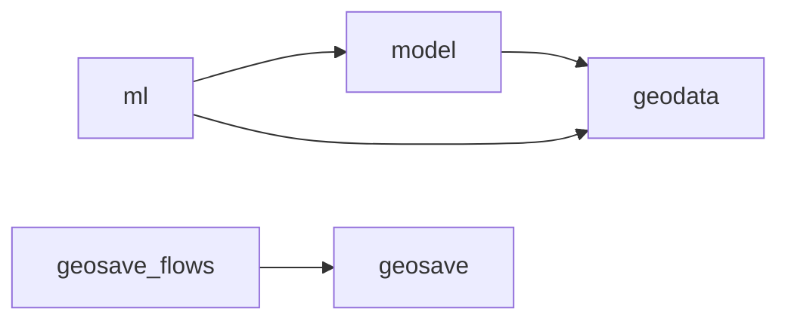

# Architecture

This page is for contributors. Start with the [practical guides](../index.md#find-your-task)
when learning to use GeoSave.

## Native objects and package boundaries

| Concern | Object or library |
| --- | --- |
| Raster data | xarray Dataset, DataArray, and DataTree |
| Vector data | GeoDataFrame |
| Model graph | PyTorch Module |
| Training | Lightning Module, DataModule, Trainer, and callbacks |
| Model publishing | Transformers and Hugging Face Hub |
| STAC | PySTAC, stac-geoparquet, rustac, and odc-stac |

GeoSave adds accessors and contracts around these objects. A separate wrapper
should own an invariant that the native object cannot represent cleanly.



| Package | Responsibility |
| --- | --- |
| `geodata` | Accessors, metadata, I/O, transforms, STAC, windows, benchmarks, and visualization. |
| `model` | Model chains, registry, stages, specifications, and native releases. |
| `ml` | Lightning tasks, data modules, metrics, builders, transforms, and callbacks. |
| `cli` | Workspace creation and optional file scaffolds. |
| `templates` | Source files copied into consumer workspaces. |

The model package does not import GeoSave's training package. Importing
`geosave` or `geosave.model.spec` does not load torch. Operations that need it,
such as `.gs.to_tensor()`, import it when called. Encoder libraries may load
additional dependencies when their modules are imported.

Prefect jobs live in `geosave_flows`, a second import package in the same
distribution, installed with `pip install "geosave[flows]"`. Those jobs compose
public GeoSave APIs; `geosave` imports neither `geosave_flows` nor Prefect.

## Data flow

```text
raster files -> item table -> windows -> Dataset samples -> Lightning -> release
```

Raster writers save pixels and return paths or file records. STAC describes
those files in an item table. Cuts describe model windows without reading their
pixels. A source-specific torch Dataset reads windows, converts pixels to
named tensors, and returns the task's sample contract. A DataModule batches and
prepares those samples; the Module owns training behavior.

`ModelSpec` owns raster requirements, preprocessing, input names, context, and
tensor transforms. Model stages own the network. A native release contains the
chain and optional spec; a Lightning checkpoint additionally holds training state.

## Implementation rules

- Keep raster work lazy where the operation supports it. Pixel reads and writes
  must be clear at the public interface.
- Preserve applicable CRS, coordinates, transform, nodata, dtype, and variable
  identity. Decoding, casting, resampling, and coordinate changes are explicit.
  See [metadata behavior](../concepts/metadata.md) for current encoding limits.
- Constructors and raster accessors use spatial dimensions `y, x`. CF coordinate
  metadata distinguishes projected coordinates from latitude and longitude.
- Keep internal helpers with the package that uses them. Share an implementation
  only when written callers need the same behavior.
- Generated workspaces compose library APIs. Edit `src/geosave/templates/` to
  change future starters; a generated workspace belongs to its user.

## Errors, warnings, and maintenance

Use TypeError for unsupported types, ValueError for invalid values or
incompatible data, and KeyError for missing mapping entries. Preserve dependency
exceptions; attach useful context and re-raise. Prefect and Lightning own retry
and run presentation.

Warnings describe an operation that continues with an assumption, lost metadata,
or incomplete coverage. Categories live in `geodata.warnings` and derive from
GeoSaveWarning. The [error reference](../reference/errors.md) lists them.

Tests mirror `src/geosave/`. Persistence tests check round trips; lazy operations
check deferred execution as well as computed values. Design proposals, open decisions and
maintenance records live beside this page: [open decisions](open-decisions.md),
the [maintenance ledger](maintenance-ledger.md) and [design specs](specs/index.md).
