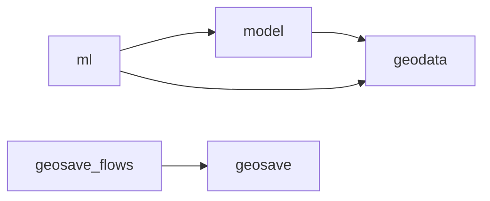

# Architecture

This page is for contributors. Start with the [practical guides](../activities.md)
when learning to use GeoSave.

## Native objects and package boundaries

| Concern | Object or library |
| --- | --- |
| Raster data | xarray Dataset, DataArray, and DataTree |
| Vector data | GeoDataFrame |
| Model graph | PyTorch Module |
| Training | Lightning Module, DataModule, Trainer, and callbacks |
| Model publishing | Transformers and Hugging Face Hub |
| STAC | PySTAC, stac-geoparquet, rustac, and odc-stac |

GeoSave adds accessors and contracts around these objects. A separate wrapper
should own an invariant that the native object cannot represent cleanly.

See [DataArray, Dataset, and DataTree](../concepts/xarray-structure.md) for
their dimensions, coordinates, indexes, and node inheritance, with printouts.



| Package | Responsibility |
| --- | --- |
| `geodata` | Accessors, metadata, I/O, transforms, STAC, sampling, and visualization. |
| `model` | Model chains, registry, stages, specifications, and native releases. |
| `ml` | Reusable metrics, builders, losses, transforms, CLI, and callbacks. |
| `cli` | Workspace creation and task templates. |
| `templates` | Project-owned Lightning Modules, DataModules, Datasets, configs, and scripts copied into consumer workspaces. |

The model package does not import GeoSave's training package. Importing
`geosave` or `geosave.model.spec` does not load torch. Operations that need it,
such as `.gs.to_tensor()`, import it when called. Encoder libraries may load
additional dependencies when their modules are imported.

Prefect jobs live in `geosave_flows`, a second import package in the same
distribution, installed with `pip install "geosave[flows]"`. Those jobs compose
public GeoSave APIs; `geosave` imports neither `geosave_flows` nor Prefect.

## Raster structure

`.gs` works on 2-D georeferenced rasters, as odc-geo does: one grid, optional
`time` observations, and a `band` axis only where `to_array` stacks
variables. In memory a raster has the structure ODC produces; the accessor finds
every part by name, as ODC does. Depth, ensembles and rotated poles are out of
scope; such layouts are renamed by the caller or belong to an extension.

```text
<xarray.Dataset>
Dimensions:  ([time], [band], y, x)      projected → y/x, geographic → latitude/longitude
Coordinates:
  * time            datetime64           "time" by name (odc-stac, wrap_xr)
    start_datetime  (time)               ┐ time cell: STAC period, composite bin
    end_datetime    (time)               ┘
    stac_properties (time)               STAC Item properties as JSON
  * y, x            ODC units, resolution
    spatial_ref     crs_wkt, GeoTransform
Data variables:  bands with attr groups (CFPacking, CFFlags with color_hints, CFDescription, EOBand)
Attributes:      StacCollection, ACDD, ACDDExtent (Item footprint), Display.rgb
```

GeoSave adds time cells, STAC metadata on the object, band attr groups and the
declared extent over ODC. Grid operations are ODC's; `gs.spatial_dims`,
`gs.geobox`, `gs.crs`, `gs.transform`, `gs.map_bounds()` and
`gs.output_geobox()` are shorthands for `.odc`. Place bare pixels with
`odc.geo.xr.wrap_xr`, declare a CRS with `.odc.assign_crs`. `gs.validate()`
requires a grid ODC recognizes, with a CRS; pixel operations (`to_numpy`,
`to_array`, `mask`) need only spatial dimensions.

CF is a file encoding, applied by `io/formats/cf.py`:

| Part | Zarr | netCDF | GeoTIFF/COG |
| --- | --- | --- | --- |
| time cell | `start_datetime`/`end_datetime` as stored | CF `time_bounds` (§7.1) | `TIFFTAG_DATETIME`, ACDD `time_coverage_*` |
| spatial axes | `axis`, `standard_name` (§4), no coordinate `_FillValue` | same | GeoTIFF keys |
| CRS link | `var:grid_mapping` attr | same | GeoTIFF keys |
| display | `rgb`, `color_hints` attrs | same | `Display.rgb` → red/green/blue colour interpretation, `CFFlags.color_hints` → colour table; `variable_name` band tag |
| ACDD | attrs | attrs | GDAL metadata; `tiff_tags=True` writes `title`, `summary`, `license`, `institution` as baseline TIFF tags |

Attr groups name the standard owning their keys: `CFDescription` (CF ch. 3),
`CFPacking` (CF §8.1 + §2.5.1: scale, offset, fill, valid range), `CFFlags`
(CF §3.5), `EOBand` (STAC eo), `ACDD`/`ACDDExtent`, `StacCollection`, and
GeoSave's own `Display`. Band metadata is per variable and constant along
`time`; Items whose packing differs are refused at load.

## Data flow

```text
raster files -> item table -> samples -> trees -> chips -> Dataset samples -> Lightning -> release
```

Raster writers save pixels and return paths. STAC describes
those files in an item table. `sample` groups its Items into samples, the
row positions of each, without reading pixels; a sample's rows `to_datatree` open
it as a lazy tree. The caller selects and aligns native Datasets or DataArrays
before `Chips` reads windows at the model's input size. A source-specific torch Dataset reads chips,
converts pixels to named tensors, and returns the task's sample contract. A DataModule batches and
prepares those samples; the Module owns training behavior.

Model stages own the network; `model/stages/registry.py` owns stage registration
and chain construction. `model/factory.py` owns `BuildSpec`, the name/class-path
selector shared by stage, optimizer, scheduler and loss builders. It is
independent of ModelSpec.

ModelSpec is disabled pending redesign. The old ingestion and raster-processing
helpers have been removed; geospatial template workflows depending on recipes
are paused. A native release contains registered chain construction and weights,
without a processing recipe. A Lightning checkpoint additionally holds training
state. Training Modules remain project-owned; Prefect orchestration stays outside
the model package.

## Implementation rules

- `core/raster` and `core/vector` own geospatial accessors and their operations,
  including raster `Chips`. DataArray owns one array, Dataset owns variable
  traversal, and DataTree owns node traversal. Ordinary array operations use
  native xarray; there is no public `transform/` package or parallel dispatcher.
  Keep short behavior on its accessor. `core/raster/transform` owns substantial
  pixel-changing operations such as padding and polygonization;
  they do not combine type dispatch, traversal and format policy.
  `core/raster/utils` owns grid placement, statistics and tensor conversion;
  `core/vector/utils` owns geometry checks and row membership planning.
  Dataset `expand` places variables under Item/asset nodes for publication. General independent helpers stay
  in `geodata/utils`; format and visualization helpers stay with their owners.
- `core/conventions.py` defines the shared raster layout and coordinate names
  consumed by accessors, I/O, STAC, features and visualization.
- `geodata/errors.py` owns public geodata exceptions.
- `io/paths.py` expands file path templates and formats grid node names
  (`r10m`).
  STAC collection/Item/asset paths are loader and publication conventions, not
  requirements on arbitrary native DataTrees. Aligning a tree's nodes always
  takes an explicit target, `how=`; no grid is chosen implicitly.
- Concrete Dataset and DataArray accessors own reading and assigning temporal
  coverage coordinates.
  These describe existing observations without changing their pixels. Date
  parsing and calendar calculations stay in `utils/datetime.py`. Accessor
  composites delegate reduction and optional gap interpolation to native xarray,
  then attach each resample bin as its output period. Ordinary concatenation
  uses native xarray directly.
- `GeoRegion.format` is the public location/time formatter used by STAC Item
  publication. An explicit `geobox=` supplies grid fields. STAC owns the Item's
  WGS84 union footprint, date selection and matching-grid validation.
- `stac/load.py` owns ODC band/alias resolution, grouping, fused property output and
  DataTree assembly. It checks selected source scale/offset compatibility before
  fusion, while ODC owns output nodata remapping. STAC modules interpret
  published metadata and combine attrs using native policies; `attrs/stamp.py` applies attribute groups. The
  loader places Collection metadata on the Dataset root or collection node,
  and per-observation properties follow ODC's actual grouped time axis.
- Rasters are built with xarray's own constructors and placed with ODC's `wrap_xr`;
  `xr.DataTree.from_dict` assigns explicit paths and parent attrs. Tree
  `gs.combine()` on a collection merges assets and stacks Items;
  `gs.reproject(geobox)` explicitly prepares mixed grids before combination.
  There is no `core/ctor`: no GeoSave constructor builds an xarray or pandas
  object. Item tables come from `to_catalog`, `StacClient.search`, a stac-geoparquet
  file or `stac.create_catalog`, and plain vector tables from native
  GeoDataFrame construction or `open_vector`.
- `core/register.py` registers all xarray and pandas `.gs` accessors. Raster
  accessors extend their corresponding xarray types. Every GeoDataFrame uses
  GeoCatalog and every row GeoCatalogItem. Each accessor validates its own container. Registration does
  not load torch or visualization.

- `core/vector/catalog.py` owns GeoCatalog coverage, drawing, validation,
  Item conversion and table persistence. Item tables follow stac-geoparquet,
  one Item per row. `item.py` owns GeoCatalogItem. Sampling, `GeoSamples`,
  vector rasterization and row pixel reads are paused. `stac/catalog.py`
  owns native Item/table conversion and `concat_catalogs`; conflicting
  Collection definitions raise. STAC encoding is selected by the frame's
  `stac-geoparquet` metadata at write time; damaged catalogs raise instead
  of falling back to ordinary feature encoding.
- `viz` makes two products and shares what both need: `colors.py` (how
  values become colours) and `shapes.py` (drawable geometry by type).
  `viz/plot` draws static figures for `.gs.plot`, one module per data kind;
  `viz/explore` is the interactive map for `.gs.explore`. The two never import
  each other. Inside `explore`, Explorer composes the page; page components
  consume layers and comparison state, with Explorer imports used only for typing.
  `layers/` is the model: each layer is a Parameterized holding its
  data and live display settings, draws its viewport, and returns its legend
  as plain values; a `VectorLayer` of catalog rows owns the rasters its
  raster column opens. Catalog pixels come from the row's `.gs.read_pixels`.
  `explorer.py` owns the sources, the derived shown layers, the selection and
  the basemap. `page/` is the view, one module per region of the screen: it
  binds widgets to that state by reference, and keeps a class (`Map`,
  `AttributeTables`, `LayerDetails`) only where a part holds state of its own.
  Each table and custom color selector owns and releases its subscriptions;
  removed layers leave the page's table and style caches. An Explorer retains
  one page per session. Identify shares the raster eligibility used for drawing,
  including comparison and date selection, and uses unique layer labels.
  Catalog load generations prevent obsolete results from changing current
  selections; removal unchecks pending rows while retaining opened rasters.
  `mercator.py` holds the web-map extents and `server.py` serving.
- `core/region.py` describes geometry and time independently of grids. Raster
  accessors expose exact grids through `.gs.geobox`; `.gs.region` exposes coverage.
  Frames and trees union their footprints and envelope dated members. A point
  names a location, not a raster window.
- `stac/catalog.py` owns native Item/table conversion, including `create_catalog`.
  `stac/item.py` interprets Item time and asset naming without file I/O.
  `stac/raster.py` translates Item metadata onto xarray coordinates and attrs.
  `stac/band.py` composes storage, spectral and classification attrs; extension
  modules translate native PySTAC bands and own `pystac.extensions` imports.
- `io/formats/` owns encoding-specific readers/writers. `io/rasterio.py` owns
  Rasterio reading, filesystem adaptation and environment configuration. `io/gdal_metadata.py` owns
  translation between GDAL properties/tags and raster metadata in both directions.
  `utils/geopandas.py` prepares
  GeoPandas engine options; `utils/stores.py` checks NetCDF/Zarr destinations.
- Dataset `expand` owns splitting dates into Items and variables into assets.
  DataTree `to_cog` writes each asset at its node path; `to_catalog` adds
  Item and Collection descriptions. Array writers take one explicit filename.
  Dataset GeoTIFF writing prepares encoded rasters separately from execution;
  batch writes validate all destinations before writing and recheck them when
  deferred execution starts. DataArray TIFF/COG accessors delegate directly to
  `.rio.to_raster` with native options, return values and overwrite behavior.
- `io/storage.py` turns a path or URL into a UPath once, at the public function
  (`create_upath`); nothing below takes a string path or `storage_options`, and
  no code asks whether a path is local. Each format reaches storage through the
  UPath: pyarrow through `path.fs`, Zarr through `str(path)` and
  `path.storage_options`, readers through `path.open()`. HDF5 and SQLite writers stage local files. GTiff writes use Rasterio
  with `opener=path.fs`; object stores that cannot seek in write mode stage
  locally. COG writes convert a temporary disk TIFF through GDAL to avoid
  Rasterio's full-raster memory buffer. GDAL reads supported URLs itself
  (`io.rasterio.read_gdal_address`); other paths and paths with filesystem
  options use the UPath filesystem opener. rioxarray opens one band array,
  then xarray splits it into named Dataset variables without reading pixels.
- `stac/publish.py` owns `StacItem.from_datatree`, raster asset descriptions,
  and `create_stac_collection`. Native Item/table conversion stays in
  `stac/catalog.py`; STAC GeoParquet persistence stays in its format module.
- `stac/search/` owns API/table discovery. `set_region` replaces spatial and time
  selectors. Selected Items feed `stac.load_dataset` or `stac.load_datatree` without
  another search. ODC owns raster reading, grouping, mosaicking and resampling;
  GeoSave preserves CF axes, band attrs and fused per-time properties.
- DataTree loading retains each Item asset's exact stated grid under
  collection/Item/asset nodes. Assets require Projection metadata. Dataset
  loading assembles one collection on a supplied GeoBox through ODC.

- `core/raster/chips.py` owns tile layout, flat/tuple indexing, and merging.
  Construction inspects metadata; indexing returns `gs.crop_to_grid(chips.geobox(key))`,
  a lazy chip whose concrete raster accessor preserves the exact grid and
  coordinates and clips the declared extent. Converting chips to arrays is the caller's step.
  Merger reconstructs NumPy arrays with native weighting and missing-tile behavior,
  allocating full output accumulators.
  Original sources remain accessible as `chips.xarray[i]`; callers construct
  xarray outputs. Keys are `(sample_index, tile_id)`; merge state is local to
  each call. Collection sampling and geographic regions do not choose a pixel
  grid implicitly.
- Loaders own open resources and transfer cleanup to native xarray objects.
  Native combination and accessor assembly do not take ownership of source
  resources; callers keep file-backed arrays open until lazy work completes.
- Keep raster work lazy where the operation supports it. Pixel reads and writes
  must be clear at the public interface.
- Preserve applicable CRS, coordinates, transform, nodata, dtype, and variable
  identity. Decoding, casting, resampling, and coordinate changes are explicit.
  See [metadata behavior](../concepts/metadata.md) for the CF representation
  lifecycle and native writer contracts.
- Keep internal helpers with the package that uses them. Share an implementation
  only when written callers need the same behavior.
- Generated workspaces compose library APIs. Edit `src/templates/` to
  change future starters; a generated workspace belongs to its user.

## Errors, warnings, and maintenance

Use TypeError for unsupported types, ValueError for invalid values or
incompatible data, and KeyError for missing mapping entries. Preserve dependency
exceptions; attach useful context and re-raise. Prefect and Lightning own retry
and run presentation.

Warnings describe an operation that continues with an assumption, lost metadata,
or incomplete coverage. Categories live in `geodata.warnings` and derive from
GeoSaveWarning. The [error reference](../reference/errors.md) lists them.

Tests mirror `src/geosave/`. Persistence tests check round trips; lazy operations
check deferred execution as well as computed values. Unsettled proposals live in
[open decisions](open-decisions.md).

### Explorer component ownership

`explore/explorer.py` owns layer membership, active selection, and temporal
state. Its public `period` and `freq` parameters stay on Explorer. The page
composes persistent child Viewers inside `pn.ui.Page`; `__panel__` returns their
existing components. LayerDetails uses named `@param.depends` display methods
and native Param references, detached on release without updating destroyed UI.

Each layer declares the parameters used by rendering, its legend, and its
summary. Map owns dynamic rendering subscriptions; LayerList owns navigation
subscriptions; LayerDetails owns each cached legend's subscriptions. There is
no global layer-change event. Map retains one DynamicMap and uses a native
HoloViews Counter to invalidate nested plot caches; coordinated date changes
batch into one redraw. AttributeTables reconciles membership separately from
selection and retains its table models.

`explore/comparison.py` contains comparison state; `page/comparison.py` builds
its controls. Explorer's `select_drawn_rasters()` remains the common eligibility
policy for drawing and Identify. `explore/server.py` owns the port registry and
server start/stop mechanics; Explorer owns independent session copies.

RasterLayer owns a byte-bounded LRU of viewport pixel windows, with a separate
active-window fast path for over-budget images. The 128 MiB default limits
retained pixel windows, not total process memory or rendering buffers. Catalog-backed
layers depend on the currently paused `row.gs.read_pixels` operation;
once restored, ODC owns reading on the viewport grid; ODC handles COG overviews and source windows. Dataset-only
layers mask, cast to float32 and `gs.reproject` onto the viewport grid.
Neither path changes the layer's viewport cache.

### Sampling and persistence availability

Catalog sampling and `GeoSamples` are paused pending redesign; they are not
part of current raster preparation. Select rows with GeoPandas, load a tree,
combine one collection, and construct Chips from the prepared raster.

Dataset/DataArray `to_item` and `to_catalog`, and Dataset `to_cog`, raise
`NotImplementedError`. Dataset `expand` builds a STAC tree; tree `to_cog`
writes its assets and tree `to_catalog` publishes Item rows. Array `to_cog`
and `to_gtiff` delegate to native rioxarray writing. Zarr and NetCDF writers preserve whole
Datasets or tree hierarchies in one destination.

Packing belongs to each concrete accessor. Dataset metadata writers require
a list of target variable names: None selects all variables, an empty list
selects none, and a bare string raises TypeError with a suggested list.
`write_packing` replaces the whole packing declaration; `write_nodata` changes
only the fill. The base declares contracts without type dispatch.
