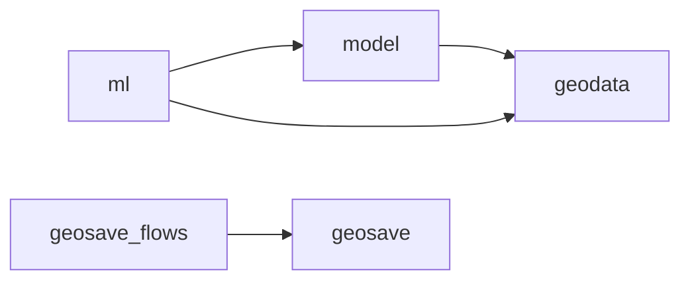

# Architecture

This page is for contributors. Start with the [practical guides](../activities.md)
when learning to use GeoSave.

## Native objects and package boundaries

| Concern | Object or library |
| --- | --- |
| Raster data | xarray Dataset, DataArray, and DataTree |
| Vector data | GeoDataFrame |
| Model graph | PyTorch Module |
| Training | Lightning Module, DataModule, Trainer, and callbacks |
| Model publishing | Transformers and Hugging Face Hub |
| STAC | PySTAC, stac-geoparquet, rustac, and odc-stac |

GeoSave adds accessors and contracts around these objects. A separate wrapper
should own an invariant that the native object cannot represent cleanly.



| Package | Responsibility |
| --- | --- |
| `geodata` | Accessors, metadata, I/O, transforms, STAC, sampling, and visualization. |
| `model` | Model chains, registry, stages, specifications, and native releases. |
| `ml` | Reusable metrics, builders, losses, transforms, CLI, and callbacks. |
| `cli` | Workspace creation and task templates. |
| `templates` | Project-owned Lightning Modules, DataModules, Datasets, configs, and scripts copied into consumer workspaces. |

The model package does not import GeoSave's training package. Importing
`geosave` or `geosave.model.spec` does not load torch. Operations that need it,
such as `.gs.to_tensor()`, import it when called. Encoder libraries may load
additional dependencies when their modules are imported.

Prefect jobs live in `geosave_flows`, a second import package in the same
distribution, installed with `pip install "geosave[flows]"`. Those jobs compose
public GeoSave APIs; `geosave` imports neither `geosave_flows` nor Prefect.

## Data flow

```text
raster files -> item table -> samples -> trees -> chips -> Dataset samples -> Lightning -> release
```

Raster writers save pixels and return paths. STAC describes
those files in an item table. `sample` groups its Items into samples, the
row positions of each, without reading pixels; a sample's rows `to_datatree` open
it as a lazy tree. The caller selects and aligns native Datasets or DataArrays
before `Chips` reads windows at the model's input size. A source-specific torch Dataset reads chips,
converts pixels to named tensors, and returns the task's sample contract. A DataModule batches and
prepares those samples; the Module owns training behavior.

`ModelSpec` version 1 owns recipe loading, dependency planning, and trusted
execution of named Python calls. Project functions own raster requirements,
preparation, context, model inference, and output interpretation. Model stages
own the network. A native release contains the chain and optional recipe;
a Lightning checkpoint additionally holds training state. Recipes do not package
or automatically install custom Python code. Training recipes live in templates,
not `ml/tasks`; Prefect orchestration stays outside the model package.

## Implementation rules

- `core/raster` and `core/vector` own geospatial accessors and their operations,
  including raster `Chips`. DataArray owns one array, Dataset owns variable
  traversal, and DataTree owns node traversal. Ordinary array operations use
  native xarray; there is no public `transform/` package or parallel dispatcher.
  Keep short behavior on its accessor. `core/raster/transform` owns substantial
  pixel-changing operations such as CF preparation, padding and polygonization;
  they do not combine type dispatch, traversal and format policy.
  `core/raster/utils` owns grid placement, statistics and tensor conversion;
  `core/vector/utils` owns geometry checks and row membership planning.
  `io/assets.py` splits rasters for publication. General independent helpers stay
  in `geodata/utils`; format and visualization helpers stay with their owners.
- `geodata/errors.py` owns public geodata exceptions.
- `io/paths.py` expands file path templates and formats grid node names
  (`r10m`).
  Collection/resolution paths are loader and publication conventions, not
  requirements on native DataTree structure. Aligning a tree's nodes always
  takes an explicit target, `how=`; no grid is chosen implicitly.
- `core/raster/utils/grid.py` owns spatial coordinates and grid metadata;
  concrete Dataset and DataArray accessors own reading and assigning temporal
  coverage coordinates.
  These describe existing observations without changing their pixels. Date
  parsing and calendar calculations stay in `utils/datetime.py`. Accessor
  composites delegate reduction and optional gap interpolation to native xarray,
  then attach observed periods from the original groups. Ordinary concatenation
  uses native xarray directly.
- `GeoRegion.format` is the public location/time formatter used by STAC Item
  publication. An explicit `geobox=` supplies grid fields. STAC owns the Item's
  WGS84 union footprint, date selection and matching-grid validation.
- `io/odc.py` owns ODC band/alias resolution, grouping, fused property output and
  DataTree assembly. It checks selected source scale/offset compatibility before
  fusion, while ODC owns output nodata remapping. STAC modules interpret
  published metadata and combine attrs using native policies; `attrs/stamp.py` applies attribute groups. The
  loader places Collection metadata on the Dataset root or collection node,
  and per-observation properties follow ODC's actual grouped time axis.
- Rasters are built with xarray's own constructors and placed with `write_grid`;
  `xr.DataTree.from_dict` assigns explicit paths and parent attrs. Tree
  `gs.to_dataset()` merges compatible same-grid nodes; `gs.align(how=...)`
  explicitly prepares mixed grids before conversion.
  There is no `core/ctor`: no GeoSave constructor builds an xarray or pandas
  object. Item tables come from `to_catalog`, `StacClient.search`, a stac-geoparquet
  file or `stac.create_catalog`, and plain vector tables from native
  GeoDataFrame construction or `open_vector`.
- `core/register.py` registers all xarray and pandas `.gs` accessors. Raster
  accessors extend their corresponding xarray types. Every GeoDataFrame uses
  GeoCatalog and every row GeoCatalogItem. Each accessor validates its own container. Registration does
  not load torch or visualization.

- `core/vector/catalog.py` owns GeoCatalog: place, drawing, query, writers,
  Item operations, and the public `sample` request. `vector/utils/sampling.py`
  computes footprint membership, temporal slot assignment and windows. An item table follows
  stac-geoparquet, one Item per row, and Item operations check their required
  columns when called. `item.py` owns GeoCatalogItem. `samples.py` owns
  GeoSamples, the item table plus each sample's row positions; samples may
  share rows, which a pandas GroupBy cannot hold. STAC encoding is
  selected at write time by `io/formats/geoparquet.write_geoparquet` from the frame's
  `stac-geoparquet` metadata. The same `to_geoparquet` method writes features;
  damaged catalogs raise instead of falling back to feature encoding.
- `viz` makes two products and shares what both need: `colors.py` (how
  values become colours) and `shapes.py` (drawable geometry by type).
  `viz/plot` draws static figures for `.gs.plot`, one module per data kind;
  `viz/explore` is the interactive map for `.gs.explore`. The two never import
  each other. Inside `explore`, Explorer composes the page; page components
  consume layers and comparison state, with Explorer imports used only for typing.
  `layers/` is the model: each layer is a Parameterized holding its
  data and live display settings, draws its viewport, and returns its legend
  as plain values; a `VectorLayer` of catalog rows owns the rasters its
  raster column opens. Pixels come from geodata's `.gs.read_pixels`.
  `explorer.py` owns the sources, the derived shown layers, the selection and
  the basemap. `page/` is the view, one module per region of the screen: it
  binds widgets to that state by reference, and keeps a class (`Map`,
  `AttributeTables`, `LayerDetails`) only where a part holds state of its own.
  Each table and custom color selector owns and releases its subscriptions;
  removed layers leave the page's table and style caches. An Explorer retains
  one page per session. Identify shares the raster eligibility used for drawing,
  including comparison and date selection, and uses unique layer labels.
  Catalog load generations prevent obsolete results from changing current
  selections; removal unchecks pending rows while retaining opened rasters.
  `mercator.py` holds the web-map extents and `server.py` serving.
- `core/region.py` describes geometry and time independently of grids. Raster
  accessors expose exact grids through `.gs.geobox`; `.gs.region` exposes coverage.
  Frames and trees union their footprints and envelope dated members. A point
  names a location, not a raster window.
- `stac/catalog.py` owns native Item/table conversion, including `create_catalog`.
  `stac/item.py` interprets Item time and asset naming without file I/O.
  `stac/raster.py` translates Item metadata onto xarray coordinates and attrs.
  `stac/band.py` composes storage, spectral and classification attrs; extension
  modules translate native PySTAC bands and own `pystac.extensions` imports.
- `io/formats/` owns encoding-specific readers/writers. `io/rasterio.py` owns
  Rasterio reading and environment configuration. `utils/geopandas.py` prepares
  GeoPandas engine options; `utils/stores.py` checks NetCDF/Zarr destinations.
- `io/assets.py` splits rasters into Items and assets; `io/paths.py` formats
  each asset's destination from its own scalar coordinates. Formatting never
  selects data. `io/storage.py` owns UPath conversion, credentials and staging.
  GeoTIFF writing validates all destinations before executing writes.
- `io/stac.py` reads native Item assets and inspects saved files through
  `create_stac_item`. `publish_items` validates the publication batch before
  writing pixels and returns native Items. `stac/catalog.py` converts those
  Items into an in-memory GeoDataFrame; `io/formats/stac_geoparquet.py`
  separately persists it with Collection definitions and portable hrefs.
- `stac/search/` owns API/table discovery. `set_region` replaces spatial and time
  selectors. Selected Items feed `io/odc.load_dataset` or `load_datatree` without
  another search. ODC owns raster reading, grouping, mosaicking and resampling;
  GeoSave preserves CF axes, band attrs and fused per-time properties.
- DataTree loading preserves relative resolution families: the finest family
  uses the requested grid and coarser families use scaled grids. Family discovery
  currently reads the first Item. Native asset opening preserves original grids.
- Model recipes retain their serialized load settings in `model/spec/stac.py`,
  fill missing search selectors, bypass region filters for explicit IDs, and
  pass the client signer to the standalone loader. Their exact grid is explicit.
- `core/raster/chips.py` owns tile layout, flat/tuple indexing, and merging.
  Construction inspects metadata; indexing returns `gs.crop_to_grid(chips.geobox(key))`,
  a lazy chip whose concrete raster accessor preserves the exact grid and
  coordinates and clips the declared extent. Converting chips to arrays is the caller's step.
  Merger reconstructs NumPy arrays with native weighting and missing-tile behavior,
  allocating full output accumulators.
  Original sources remain accessible as `chips.xarray[i]`; callers construct
  xarray outputs. Keys are `(sample_index, tile_id)`; merge state is local to
  each call. Collection sampling and geographic regions do not choose a pixel
  grid implicitly.
- Loaders own open resources and transfer cleanup to native xarray objects.
  Native combination and accessor assembly do not take ownership of source
  resources; callers keep file-backed arrays open until lazy work completes.
- Keep raster work lazy where the operation supports it. Pixel reads and writes
  must be clear at the public interface.
- Preserve applicable CRS, coordinates, transform, nodata, dtype, and variable
  identity. Decoding, casting, resampling, and coordinate changes are explicit.
  See [metadata behavior](../concepts/metadata.md) for the CF representation
  lifecycle and native writer contracts.
- Raster inspection and Chips discover spatial dimensions, including CF
  latitude/longitude axes. Some operations still require `y, x`; normalization
  is explicit. CF coordinate metadata distinguishes projected coordinates from
  latitude and longitude.
- Keep internal helpers with the package that uses them. Share an implementation
  only when written callers need the same behavior.
- Generated workspaces compose library APIs. Edit `src/templates/` to
  change future starters; a generated workspace belongs to its user.

## Errors, warnings, and maintenance

Use TypeError for unsupported types, ValueError for invalid values or
incompatible data, and KeyError for missing mapping entries. Preserve dependency
exceptions; attach useful context and re-raise. Prefect and Lightning own retry
and run presentation.

Warnings describe an operation that continues with an assumption, lost metadata,
or incomplete coverage. Categories live in `geodata.warnings` and derive from
GeoSaveWarning. The [error reference](../reference/errors.md) lists them.

Tests mirror `src/geosave/`. Persistence tests check round trips; lazy operations
check deferred execution as well as computed values. Open decisions and active design
proposals live beside this page: [open decisions](open-decisions.md) and
[design specs](specs/index.md).

### Explorer component ownership

`explore/explorer.py` owns layer membership, active selection, and temporal
state. Its public `period` and `freq` parameters stay on Explorer. The page
composes persistent child Viewers inside `pn.ui.Page`; `__panel__` returns their
existing components. LayerDetails uses named `@param.depends` display methods
and native Param references, detached on release without updating destroyed UI.

Each layer declares the parameters used by rendering, its legend, and its
summary. Map owns dynamic rendering subscriptions; LayerList owns navigation
subscriptions; LayerDetails owns each cached legend's subscriptions. There is
no global layer-change event. Map retains one DynamicMap and uses a native
HoloViews Counter to invalidate nested plot caches; coordinated date changes
batch into one redraw. AttributeTables reconciles membership separately from
selection and retains its table models.

`explore/comparison.py` contains comparison state; `page/comparison.py` builds
its controls. Explorer's `select_drawn_rasters()` remains the common eligibility
policy for drawing and Identify. `explore/server.py` owns the port registry and
server start/stop mechanics; Explorer owns independent session copies.

RasterLayer owns a byte-bounded LRU of viewport pixel windows, with a separate
active-window fast path for over-budget images. The 128 MiB default limits
retained pixel windows, not total process memory or rendering buffers. Pixel
reading remains in geodata I/O, including `read_scene_pixels`; no tile server,
global raster cache, or alternate reader was introduced.

### Sample ownership

`GeoSamples` groups source rows by position. Indexing returns a native
GeoDataFrame; its `.gs.to_datatree()` reads original observations. Optional slot
membership and founding footprints are inspectable grouping metadata, not hidden
execution settings. Explicit `.gs.composite()` reduces decoded observations;
its optional `interpolation` fills gaps in the reduced pixels through native
`.interpolate_na()` without inventing observation metadata. No GeoSample wrapper or grouper
loader exists.
