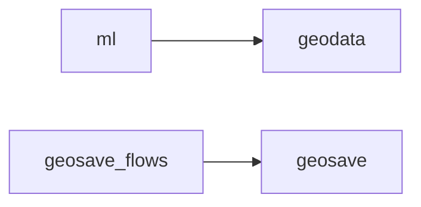

# Architecture

This page is for contributors. Start with the [practical guides](../advanced/index.md)
when learning to use GeoSave.

## Native objects and package boundaries

| Concern | Object or library |
| --- | --- |
| Raster data | xarray Dataset, DataArray, and DataTree |
| Vector data | GeoDataFrame |
| Model graph | PyTorch Module |
| Training | Lightning Module, DataModule, Trainer, and callbacks |
| Model publishing | Transformers and Hugging Face Hub |
| STAC | PySTAC, stac-geoparquet, rustac, and odc-stac |

GeoSave adds accessors and contracts around these objects. A separate wrapper
should own an invariant that the native object cannot represent cleanly.

See [DataArray, Dataset, and DataTree](../concepts/xarray-structure.md) for
their dimensions, coordinates, indexes, and node inheritance, with printouts.

`node.gs.to_dataset()` includes all inherited coordinates and merges Dataset
attrs from root to the selected node, with local attrs taking precedence.
Native xarray conversion is unchanged. GeoDataTree is independent of GeoRaster:
raster variables belong on leaves, grouping nodes carry metadata, and each leaf
may have its own grid and timeline. There are no tree-wide spatial or temporal
summary properties.

`ds.gs.to_tree(name="ds", groups=None)` wraps the whole Dataset; explicit groups
partition its variables with Dataset attrs on the source group. `node.gs.merge()`
combines all immediate raster children into a new leaf, requiring exact grids
and shared indexes, unique variable names and native attribute conflict handling.
`parent.gs.ungroup(name)` promotes one direct group's children, preserving
effective metadata and sibling order. These operations preserve lazy arrays.
`group(groups)` partitions variables; `split(dim=..., names=None)` separates
positions under a dimension group, preserving one static sibling. Names default
to labels and explicit names permit duplicates. `concat(dim=...)` requires matching
representations. Coordinates stay on each leaf; only shared Dataset attrs live on
the source group. The default `raster_leaves` validation policy requires leaf-owned
grids. Crop/reprojection use native tree mapping and never repair parent coordinates.
Crop-to-grid clips declared extents at their existing metadata owner. See the
[redesign specification](design/raster-tree.md) for the delivery ledger.



| Package | Responsibility |
| --- | --- |
| `geodata` | Accessors, metadata, I/O, transforms, STAC, sampling, and visualization. |
| `ml` | Model chains, components, processors, native releases, and reusable training support: builders, losses, metrics, transforms, CLI, and callbacks. |
| `cli` | Workspace creation and task templates. |
| `templates` | Project-owned Lightning Modules, DataModules, Datasets, configs, and scripts copied into consumer workspaces. |

The inference path of `ml` (chain, components, processing, release) does not
import its training support. Importing `geosave` or `geosave.ml` does not load
torch. Operations that need it,
such as `.gs.to_tensor`, import it when called. Encoder libraries may load
additional dependencies when their modules are imported.

`geosave_flows`, a second import package in the same distribution, installed
with `pip install "geosave[flows]"`, holds Prefect flows that run a released
pipeline through public GeoSave APIs, and their JSON region configs.
`geosave` imports neither `geosave_flows` nor Prefect.

## Raster structure

`.gs` works on 2-D georeferenced rasters, as odc-geo does: one grid, optional
`time` observations, and a `band` axis only where `to_array` stacks
variables. In memory a raster has the structure ODC produces; the accessor finds
every part by name, as ODC does. Depth, ensembles and rotated poles are out of
scope; such layouts are renamed by the caller or belong to an extension.

```text
<xarray.Dataset>
Dimensions:  ([time], [band], y, x)      projected → y/x, geographic → latitude/longitude
Coordinates:
  * time            datetime64           "time" by name (odc-stac, wrap_xr)
    start_datetime  (time)               ┐ time cell: STAC period, composite bin
    end_datetime    (time)               ┘
    eo_cloud_cover  (time)               example property, marked stac_property="eo:cloud_cover"
  * y, x            ODC units, resolution
    spatial_ref     crs_wkt, GeoTransform
Data variables:  bands with attr groups (CFPacking, CFFlags with color_hints, CFDescription, EOBand)
Attributes:      StacCollection, ACDD, ACDDExtent (Item footprint), Display.rgb
```

GeoSave adds time cells, STAC metadata on the object, band attr groups and the
declared extent over ODC. Grid operations are ODC's; `gs.spatial_dims`,
`gs.geobox`, `gs.crs`, `gs.transform`, `gs.map_bounds()` and
`gs.output_geobox()` are shorthands for `.odc`. Place bare pixels with
`odc.geo.xr.wrap_xr`, declare a CRS with `.odc.assign_crs`. `gs.validate()`
requires a grid ODC recognizes, with a CRS. Array/tensor conversion also
validates that grid; Dataset stacking additionally checks pixel meaning.

CF is a file encoding, applied by `io/raster/codecs/cf.py`:

| Part | Zarr | netCDF | GeoTIFF/COG |
| --- | --- | --- | --- |
| time cell | `start_datetime`/`end_datetime` as stored | CF `time_bounds` (§7.1) | `TIFFTAG_DATETIME`, ACDD `time_coverage_*` |
| spatial axes | `axis`, `standard_name` (§4), no coordinate `_FillValue` | same | GeoTIFF keys |
| CRS link | `var:grid_mapping` attr | same | GeoTIFF keys |
| display | `rgb`, `color_hints` attrs | same | `Display.rgb` → red/green/blue colour interpretation, `CFFlags.color_hints` → colour table; `variable_name` band tag |
| ACDD | attrs | attrs | GDAL metadata; `tiff_tags=True` writes `title`, `summary`, `license`, `institution` as baseline TIFF tags |

Attr groups name the standard owning their keys: `CFDescription` (CF ch. 3),
`CFPacking` (CF §8.1 + §2.5.1: scale, offset, fill, valid range), `CFFlags`
(CF §3.5), `EOBand` (STAC eo), `ACDD`/`ACDDExtent`, `StacCollection`, and
GeoSave's own `Display`. Band metadata is per variable and constant along
`time`; Items whose packing differs are refused at load.

## Data flow

```text
Item rows -> ODC Dataset -> prepared one-grid DataTree -> RasterChipper -> project Dataset -> Lightning
Dataset / tree leaves -> explicit Item + asset mapping -> COGs + native Item -> Item rows -> GeoParquet
trained chain + pipeline -> release -> load_pipeline -> predict / predict_to_zarr -> product Dataset / Zarr store
```

Raster writers save pixels and return paths. STAC describes those files in
an Item table. Select rows with GeoPandas; `rows.gs.to_dataset` or
`stac.load_dataset` reads selected Items onto a chosen grid. The caller prepares
one-grid DataTrees before RasterChipper cuts model-sized windows. Temporal `.gs.sample`
produces raster windows independently of spatial chips. A project-owned torch
Dataset reads pixels, converts them to tensors, and returns its sample contract.
A DataModule batches and prepares samples; the Module owns training behavior.

`ml/factory.py` owns `BuildSpec`, the name/class-path selector, and
`Registry`, the one mechanism every builder uses: components, sub-processors,
optimizers, schedulers and losses. A registry maps case-insensitive names to
constructors of one base type and imports the modules that register the
library's own entries on first lookup. A `class_path` reaches any importable
subclass of that type without registration. `get_spec` writes out every
constructor argument, defaults included, as a release stores it; `read_spec`
reads the same spec back from a built object.

Components own the network. `ml/components/registry.py` declares one registry
per stage (`ENCODERS`, `DECODERS`, `HEADS`, `MONOLITHS`); `build.py` builds a
chain from a recipe, filling `Published` values from earlier stages;
`catalog.py` lists what is registered and what connects.

`ml/processing/raster/` has one package per role: `ingestion`, `preprocessing`,
`prediction` and `postprocessing`. Each `base.py` declares an abstract
role and its registry. `pipeline.py` owns `RasterPipeline`, the orchestrator
of inference, and its `predict` and `predict_to_zarr` entry points. A
sub-processor is entered by `__call__`, which declares with `@chain_step()`
the values it takes and returns by name; the pipeline checks that they
connect when it is constructed and checks each value's type as it is handed
over. Sources and prepared pixel inputs are named DataTree nodes; the
predictor passes named tensors and requested context to the model and
returns its values undecoded; the postprocessor masks, decodes and builds the
product. The library provides `sentinel2_l2a` ingestion, `dense`
preprocessing and prediction, and `segmentation`/`regression` postprocessing.
Projects subclass a role for their own.

`ml/release/huggingface.py` holds `ChainConfig` and `ChainModel`, the
Transformers config and model of a `ModelChain`. `ChainModel.from_chain(chain)`
releases a chain alone; `ChainModel.from_pipeline(pipeline)` adds each
sub-processor's spec, read from the sub-processor (`ChainConfig.preprocessor`,
`predictor`, `postprocessor`, `ingestor`; format version 4). Both refuse a
component defined outside geosave. A library sub-processor is stored by name,
a project's own by class path, which rebuilds wherever the project's code is
installed. `AutoModel.from_pretrained` loads the model alone; `load_pipeline`
rebuilds the pipeline around the native chain. A different GeoSave version only warns; exact weight
keys guard the architecture. A Lightning checkpoint additionally holds
training state.

Each template method's `processing.py` holds its preprocessor. Shared pixel
preparation, including standardization, belongs in `preprocess`. Some template
DataModules still call a separate `normalize` hook and need migration to that
contract. Training Modules remain project-owned; Prefect orchestration stays
outside `ml`.

Data snapshots, experiment workspaces and model releases have separate
repositories and revision histories. See the [model-development guide](../mlops/index.md)
for their contents and provenance links. Lineage records remain project-owned.

## Implementation rules

- `core/raster` and `core/vector` own geospatial accessors and their operations,
  while `geodata/sampling` owns chip layout, cutting and merging. DataArray owns one array, Dataset owns variable
  traversal, and DataTree owns node traversal. Ordinary array operations use
  native xarray; there is no public `transform/` package or parallel dispatcher.
  Keep short behavior on its accessor. `core/raster/transform` owns substantial
  pixel-changing operations such as padding and polygonization;
  they do not combine type dispatch, traversal and format policy.
  `core/raster/utils` owns grid placement, statistics and tensor conversion.
  `core/raster/rules` owns validation-only callables grouped by native object:
  `common`, `dataarray`, `dataset` and `datatree`. Accessors run them through
  `.validate`; rules neither transform data nor construct results.
  `one_raster`, `splittable(dim)`, `compatible_merge` and `compatible_concat(dim)`
  check the selected node before DataTree restructuring. Value-returning
  members such as `tree.gs.common_geobox()` and variable partitioning stay with their
  accessor owner. STAC observation and
  publication checks stay in STAC.
  Statistics are public functions: `gs.summary(rasters)` accepts a Dataset,
  DataArray or iterable and returns a pandas table; `gs.class_percent(bands)`
  accepts a categorical DataArray or iterable and returns a Series. They compute
  pooled pixel summaries explicitly; selection and decoding belong to the caller.
  Neither is an accessor method.
  `core/vector/utils` owns geometry checks and row membership planning.
  STAC membership belongs to `stac.publish_item`. General independent helpers stay
  in `geodata/utils`; format and visualization helpers stay with their owners.
- `core/conventions.py` defines the shared raster layout and coordinate names
  consumed by accessors, I/O, STAC, features and visualization.
- `geodata/errors.py` owns public geodata exceptions.
  STAC Item/asset paths are publication conventions, not
  requirements on arbitrary native DataTrees. Aligning a tree's nodes always
  takes an explicit target, `how=`; no grid is chosen implicitly.
- Concrete Dataset and DataArray accessors own reading and assigning temporal
  coverage coordinates.
  These describe existing observations without changing their pixels. Date
  parsing and calendar calculations stay in `utils/datetime.py`. Accessor
  composites delegate reduction and optional gap interpolation to native xarray,
  then attach each resample bin as its output period. Ordinary concatenation
  uses native xarray directly.
- `GeoRegion.format` is the public location/time formatter used by STAC Item
  publication. An explicit `geobox=` supplies grid fields. STAC owns the Item's
  WGS84 union footprint, date selection and matching-grid validation.
- `stac/load.py` calls `odc.stac.load`, turns requested Item properties and
  each step's period into `(time,)` coordinates, applies `dtype`/`nodata` to
  bands only, then runs the named stamps. ODC owns band/alias resolution,
  grouping, fusion and output nodata remapping. `stac/stamps/` is a registry of
  named steps (`register_stamp`; defaults `raster`, `eo`, `classification`,
  `rgb`, `title`, `collection`) that write metadata read from the Items without
  reading pixels; the `raster` stamp refuses differing source scale/offset.
  `attrs/stamp.py` writes attribute groups onto variables.
- Rasters are built with xarray's own constructors and placed with ODC's `wrap_xr`;
  `xr.DataTree.from_dict` assigns explicit paths and parent attrs. `gs.reproject(geobox)` explicitly prepares mixed grids.
  `Dataset.gs.to_tree` provides named wrapping and exclusive variable grouping.
  There is no `core/ctor`. Item tables come from `create_catalog` over published Items, `StacClient.search`, a stac-geoparquet
  file or `stac.create_catalog`, and plain vector tables from native
  GeoDataFrame construction or `open_vector`.
- `core/register.py` registers all xarray and pandas `.gs` accessors. Raster
  accessors extend their corresponding xarray types. Every GeoDataFrame uses
  GeoCatalog and every row GeoCatalogItem. Each accessor validates its own container. Registration does
  not load torch or visualization.

- `core/vector/catalog.py` owns GeoCatalog coverage, drawing, validation,
  Item conversion and table persistence. Item tables follow stac-geoparquet,
  one Item per row. `item.py` owns GeoCatalogItem. Catalog sampling,
  vector rasterization and row pixel reads remain unavailable. `stac/catalog/`
  owns native Item/table conversion and `concat_catalogs`; conflicting
  Collection definitions raise. STAC encoding is selected by the frame's
  `stac-geoparquet` metadata at write time; damaged catalogs raise instead
  of falling back to ordinary feature encoding.
- `viz` makes two products and shares what both need: `colors.py` (how
  values become colours) and `shapes.py` (drawable geometry by type).
  `viz/plot` draws static figures for `.gs.plot`, one module per data kind;
  `viz/explore` is the interactive map for `.gs.explore`. The two never import
  each other. Inside `explore`, Explorer composes the page; page components
  consume layers and comparison state, with Explorer imports used only for typing.
  `layers/` is the model: each layer is a Parameterized holding its
  data and live display settings, draws its viewport, and returns its legend
  as plain values; a `VectorLayer` of catalog rows owns the rasters its
  raster column opens. Catalog pixels come from the row's `.gs.read_pixels`, which raises until rebuilt.
  `explorer.py` owns the sources, the derived shown layers, the selection and
  the basemap. `page/` is the view, one module per region of the screen: it
  binds widgets to that state by reference, and keeps a class (`Map`,
  `AttributeTables`, `LayerDetails`) only where a part holds state of its own.
  Each table and custom color selector owns and releases its subscriptions;
  removed layers leave the page's table and style caches. An Explorer retains
  one page per session. Identify shares the raster eligibility used for drawing,
  including comparison and date selection, and uses unique layer labels.
  Catalog load generations prevent obsolete results from changing current
  selections; removal unchecks pending rows while retaining opened rasters.
  `mercator.py` holds the web-map extents and `server.py` serving.
- `core/region.py` describes geometry and time independently of grids. DataArray
  and Dataset expose exact grids through `.gs.geobox`; `.gs.region` exposes coverage.
  STAC owns aggregation of asset footprints for the Items it publishes.
  GeoDataFrames union their footprints and envelope dated members. A point
  names a location, not a raster window.
- `stac/catalog/` owns native Item/table conversion, including `create_catalog`.
  `stac/publish.py` owns the publication layout and constructs Items and
  asset metadata; `stac/stamps/` applies source, Collection, band and
  property metadata on load. Extension modules translate native PySTAC bands.

- `io/raster/` persists a Dataset or tree and `io/vector/` a GeoDataFrame, one
  module per format. Every writer runs the same steps: locate, check the
  destination, encode, then write now or deferred (`storage.defer`); every
  reader runs them back. `io/raster/codecs/` holds the translations: a
  `Codec` pairs an `encode` with the `decode` that undoes it, a format lists
  its codecs (`zarr.CODECS`, `netcdf.CODECS`), and `codecs/gdal.py` stacks a
  Dataset into the band array rioxarray writes, with `EXTRA_WRITERS` for the
  properties rioxarray has no slot for. `geotiff.py` owns lazy
  rioxarray reading, Rasterio filesystem openers and backend handle lifetime. `io/gdal_env.py`
  retains the documented `configure_gdal` environment interface. Typed
  property snapshots survive closing the metadata reader; arbitrary GDAL tags
  remain string mappings. `vector/ogr.py` writes GeoJSON and GeoPackage
  through one pyogrio path; `openers.py` picks a reader from the suffixes
  each format module states. `open_raster` returns one Dataset, opening the
  root group or an explicit `group=` in Zarr and NetCDF. `open_raster_tree`
  returns the whole hierarchy as a DataTree, including root-only stores;
  `open_zarr_tree` and `open_netcdf_tree` own the format-specific tree reads.
- `stac.publish_item` writes an explicit asset mapping and returns a completed native Item. Array writers take one explicit filename.
  Dataset GeoTIFF writing prepares encoded rasters separately from execution;
  batch writes validate all destinations before writing and recheck them when
  deferred execution starts. DataArray TIFF/COG accessors delegate directly to
  `.rio.to_raster` with native options, return values and overwrite behavior.
- `io/storage.py` turns a path or URL into a UPath once, at the public function
  (`create_upath`); nothing below takes a string path or `storage_options`, and
  no code asks whether a path is local. Each format reaches storage through the
  UPath: pyarrow through `path.fs`, Zarr through `str(path)` and
  `path.storage_options`, readers through `path.open()`. HDF5, SQLite and
  GeoTIFF writers stage local files for non-local destinations; rioxarray's
  chunk writer reopens a GeoTIFF by name. COG writes convert a temporary disk TIFF through GDAL to avoid
  Rasterio's full-raster memory buffer. GDAL reads supported URLs itself
  (`io.raster.geotiff.read_gdal_address`); other paths and paths with filesystem
  options use the UPath filesystem opener. GeoSave opens one lazy band array
  and decodes it into Dataset variables; per-band metadata comes from typed
  GDAL property snapshots.
- `stac/publish.py` owns explicit observation publication: native Item metadata
  plus named Dataset assets, each on its own grid. `publish_item` validates
  scalar times/periods, representation and destinations before writing COGs,
  then associates actual returned hrefs with asset keys. It returns a clone;
  supplied Item geometry, properties and Collection links remain authoritative.
  `StacItem.from_region` and `add_raster_asset` remain native metadata builders.
  `RasterStac` and automatic Dataset catalog conversion have been removed.
  Native Item/table conversion stays in `stac/catalog/`; STAC GeoParquet
  persistence stays in its format module.
- `stac/search/` owns API/table discovery. `set_region` replaces spatial and time
  selectors. Selected Items feed `stac.load_dataset` or `stac.load_native_datasets` without
  another search. ODC owns raster reading, grouping, mosaicking and resampling;
  GeoSave preserves CF axes, band attrs and fused per-time properties.
- Dataset loading assembles selected Items through ODC. Native-grid loading
  returns Datasets. General DataTrees impose no STAC hierarchy.

- `sampling/layout.py` owns `ChipLayout`: grids, integer chip indices, pixel
  offsets and edge placement. `RasterChipper` holds prepared one-grid DataTrees and
  cuts them lazily with `crop_to_grid`; converting pixels is the caller's step.
  `RasterMerger(chipper.layout)` accumulates `(band, size, size)` predictions
  by chip index. It returns a DataArray on the source grid, with NaN where
  uncovered, and holds full output accumulators in memory. Sources remain
  accessible as `chipper.rasters`; chip positions as `chipper.layout.locate`.
  Catalog selection and geographic regions do not choose a pixel grid implicitly.
- `sampling/tensor.py` holds the tensor pair for a LightningModule step:
  `TensorChipper` cuts collated samples by `transform`/`crs` and keeps the
  batch structure; `TensorMerger` merges on the predictions' device. Both use
  the same `ChipLayout` and `create_chip_weights`, so a step simulates the
  release processor's `RasterChipper` -> model -> `RasterMerger`; tests hold
  the two pairs equal. Torch is imported only when they run.

- Loaders own open resources and transfer cleanup to native xarray objects.
  Native combination and accessor assembly do not take ownership of source
  resources; callers keep file-backed arrays open until lazy work completes.
- Keep raster work lazy where the operation supports it. Pixel reads and writes
  must be clear at the public interface.
- Preserve applicable CRS, coordinates, transform, nodata, dtype, and variable
  identity. Decoding, casting, resampling, and coordinate changes are explicit.
  See [metadata behavior](../concepts/metadata.md) for the CF representation
  lifecycle and native writer contracts.
- Keep internal helpers with the package that uses them. Share an implementation
  only when written callers need the same behavior.
- Generated workspaces compose library APIs. Edit `src/templates/` to
  change future starters; a generated workspace belongs to its user.

## Errors, warnings, and maintenance

Use TypeError for unsupported types, ValueError for invalid values or
incompatible data, and KeyError for missing mapping entries. Preserve dependency
exceptions; attach useful context and re-raise. Prefect and Lightning own retry
and run presentation.

Warnings describe an operation that continues with an assumption, lost metadata,
or incomplete coverage. Categories live in `geodata.warnings` and derive from
GeoSaveWarning. The [error reference](../reference/errors.md) lists them.

Tests mirror `src/geosave/`. Persistence tests check round trips; lazy operations
check deferred execution as well as computed values. Unsettled proposals live in
[open decisions](open-decisions.md).

### Explorer component ownership

`explore/explorer.py` owns layer membership, active selection, and temporal
state. Its public `period` and `freq` parameters stay on Explorer. The page
composes persistent child Viewers inside `pn.ui.Page`; `__panel__` returns their
existing components. LayerDetails uses named `@param.depends` display methods
and native Param references, detached on release without updating destroyed UI.

Each layer declares the parameters used by rendering, its legend, and its
summary. Map owns dynamic rendering subscriptions; LayerList owns navigation
subscriptions; LayerDetails owns each cached legend's subscriptions. There is
no global layer-change event. Map retains one DynamicMap and uses a native
HoloViews Counter to invalidate nested plot caches; coordinated date changes
batch into one redraw. AttributeTables reconciles membership separately from
selection and retains its table models.

`explore/comparison.py` contains comparison state; `page/comparison.py` builds
its controls. Explorer's `select_drawn_rasters()` remains the common eligibility
policy for drawing and Identify. `explore/server.py` owns the port registry and
server start/stop mechanics; Explorer owns independent session copies.

RasterLayer retains one projected display image for compact xarray scenes. Map
tracks navigation and requests a redraw when a visible raster needs a different
window or a dense vector layer needs resampling. For larger rasters RasterLayer
owns a byte-bounded LRU of viewport pixel windows, with a separate
active-window fast path for over-budget images. The 128 MiB default limits
retained pixel windows, not total process memory or rendering buffers. Catalog-backed
layers depend on the currently paused `row.gs.read_pixels` operation;
once restored, ODC owns reading on the viewport grid; ODC handles COG overviews and source windows. Dataset-only
layers mask, cast to float32 and `gs.reproject` onto the viewport grid.
Neither path changes the layer's viewport cache.

### Sampling and persistence availability

Catalog sampling is unavailable. Select rows with GeoPandas, load through
`rows.gs.to_dataset` or `stac.load_dataset`, and construct RasterChipper from prepared
one-grid trees. `GeoSamples` and the old `Chips` class have been removed.

`stac.publish_item(item, assets=..., root=...)` publishes one observation;
`stac.create_catalog(items)` composes the returned Items. Array `to_cog` and
`to_gtiff` delegate to rioxarray; `io.write_cog` writes one prepared Dataset.
Obsolete raster `to_item`/`to_catalog` and Dataset `to_cog` stubs are removed.
Packing belongs to each concrete accessor. Dataset metadata writers require
a list of target variable names: None selects all variables, an empty list
selects none, and a bare string raises TypeError with a suggested list.
`write_packing` replaces the whole packing declaration; `write_nodata` changes
only the fill. The base declares contracts without type dispatch.

Tensor conversion returns `(pixels, context)` without a model-input name.
DataArray and Dataset pixels are tensors; DataTree pixels are dictionaries keyed
by node path. Context is a separate dictionary of tensors (empty by default).
Tree pixel tensors can have independent grids. Shared grid/centroid context and
chipping require one GeoBox; temporal context and sampling require identical
dated-leaf timelines, preserving axis order and repeated labels. Context is
checked before pixel conversion. Numerical representation changes remain separate.
Callers assemble named model samples, for example `{"image": pixels, **context}`.

STAC search sources have explicit entry points: `StacClient.open(url)` opens
an API without provider-specific signing; `planetary_computer()`, `cdse()` and
`element84()` configure built-in providers. `StacTable(path, duckdb=...)` owns
local or remote GeoParquet search. Opening an API never dispatches to a table.
