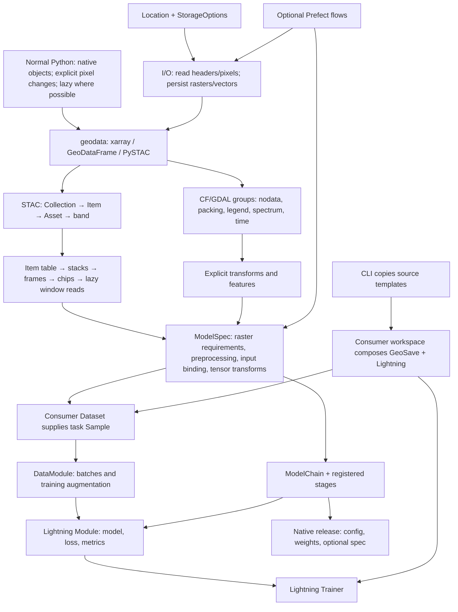

# Source and test cleanup — 2026-10-13

> Audit snapshot. Findings, paths, and check counts describe the working tree
> reviewed in this record and may be superseded by later changes. Consult
> the [current guides](../../activities.md) and [API reference](../../reference/index.md)
> for supported behavior.

The review follows the current working tree, preserving edits present at its
start. Public exports, accessor registration, configuration imports, and
dependency callbacks count as callers. A missing local call alone is not
evidence that an API is obsolete. Uncertain findings stay in code and go into
`TODO.txt`; unimplemented features are recorded there rather than implemented.

## Review plan

- [x] Read every source and test file, including package exports and templates.
- [x] Trace files → native objects → metadata/transforms → catalog windows →
  model specifications → source datasets → Lightning → native releases.
- [x] Run behavioral smoke checks before choosing deletions.
- [x] Remove only obsolete implementations whose callers and replacement path
  have been checked; preserve intentional unsupported cases.
- [x] Consolidate uncertain findings and deferred features in `TODO.txt`.
- [x] Reconcile the file inventory with per-file review records and run final
  tests, lint, import/package checks, and diff checks.

## Coverage ownership

| Review | Source and test scope |
| --- | --- |
| [Geodata](2026-10-13-geodata.md) | Core, attrs, transforms, features, utils, benchmarks, visualization, conventions, errors, and warnings. |
| [Geodata tests](2026-10-13-geodata-tests.md) | Core/transform tests, spatial conventions, and shared geodata fixtures. |
| [I/O and STAC](2026-10-13-io-stac.md) | All I/O and STAC modules and corresponding tests. |
| [Models and training](2026-10-13-model-ml.md) | All model and ML modules and corresponding tests. |
| [CLI, flows, cuts](2026-10-13-cli-flows-cuts.md) | CLI, templates, optional flows, cuts, root exports, root tests, notebook test runner, and binary test fixture. |

## Project map

Dependencies run toward geodata: `ml → model → geodata`, with optional flows
depending on GeoSave. Import registration and lazy exports are part of the
data flow, not dead code. Generated workspaces are consumers, not alternate
library implementations. The package reviews recorded below check this map
against actual callers.

## Final results

All **346 original code/data files** were covered: **345 remain**, and the
removed model-chain test support file is recorded in its ledger. The inventory
includes package initializers, source README/YAML/text templates, the common
`.env`, all test helpers, and the GeoTIFF fixture (header inspection for the
binary). Each text file was read in full. Inventory reconciliation found no
missing entries or duplicate ownership; an independent reviewer repeated it.
Ignored bytecode and Ruff cache artifacts are not implementation files.
Notebook contents were neither read nor executed, as instructed.

### Changes

- Removed unused metadata test builders, reader scene writer, cut-group
  constant, and old vector-test sample persistence helper. The vector
  provenance test now calls the ordinary public COG writer directly.
- Deleted unused model-chain toy declarations; the one live class-path test
  reuses its existing release-test head. No behavioral assertion was removed.
- Removed the obsolete optional-viz skip now that visualization is a core
  dependency. Strengthened the old tensor-layout test with three dates and
  two bands so it distinguishes the current axis order.
- Removed the model README's absent prediction/writer walkthrough and
  corrected current input/context calls, lazy accessor-registration text,
  COG path-result example, and a moved decision-document link.
- Reworked `TODO.txt` around checked live contracts: intentional stubs,
  retained uncertain fragments, reproduced problems, ownership suggestions,
  and unimplemented features. The original pipeline-serialization idea now
  acknowledges the implemented ModelSpec YAML round trip.

No production function/class was confidently both unused and obsolete, so no
public runtime API was deleted. Empty initializers, native format compatibility,
Pydantic/Lightning/Transformers hooks, lazy exports, unsupported writer refusals,
and public utilities with no local callers were retained with their usage
explained. The independent review confirmed all preexisting tracked diffs were
preserved byte-for-byte.

### Validation

Commands use `.venv/bin` to avoid environment synchronization. Fresh bytecode
under `/tmp` avoids ignored cache filenames from the earlier checkout path.
Local socket access was required for Zarr's async synchronization and localhost
tests; the restricted hang was reproduced and isolated before retrying.

| Check | Result |
| --- | --- |
| Default pytest suite | **1,929 passed, 33 deselected, 4 xfailed**; 161.02 seconds. |
| Local slow tests, `-m 'slow and not integration' --ignore=tests/examples` | **9 passed, 1,953 deselected**; 67.27 seconds. |
| Ruff, `check src tests` | Passed. |
| `git diff --check` | Passed. |
| Offline uv source/wheel build into `/tmp/geosave-audit-dist` | Passed: GeoSave 0.3.0 source distribution and wheel. |
| Wheel contents | Both packages and common templates included; no retired namespace, test files, or bytecode shipped. |
| Zensical documentation build | Passed; 18.81 seconds, including the audit pages. |
| BasedPyright with repository configuration | **407 errors, 2 warnings**: 20 source errors and 387 test errors; not clean. |
| Full file inventory reconciliation | 345 current files covered; deleted fixture accounted for; no missing files. |

The type diagnostics include native-object/accessor declaration mismatches,
reader kwargs forwarding, test double inference, and invalid-input cases.
Reported diagnostics in cleanup-touched files are on unchanged statements;
the audit does not claim a clean type baseline. This remains a TODO rather
than a speculative typing or runtime redesign.

External service integration and notebook execution were excluded. Expected
failures remain the explicit starter Dataset placeholder and three narrowly
scoped ODC lazy numerical limitations. They are documented limitations, not
deleted tests to produce a green suite. Detailed pre/post smokes and retained
risks appear in the package ledgers and root TODO.
