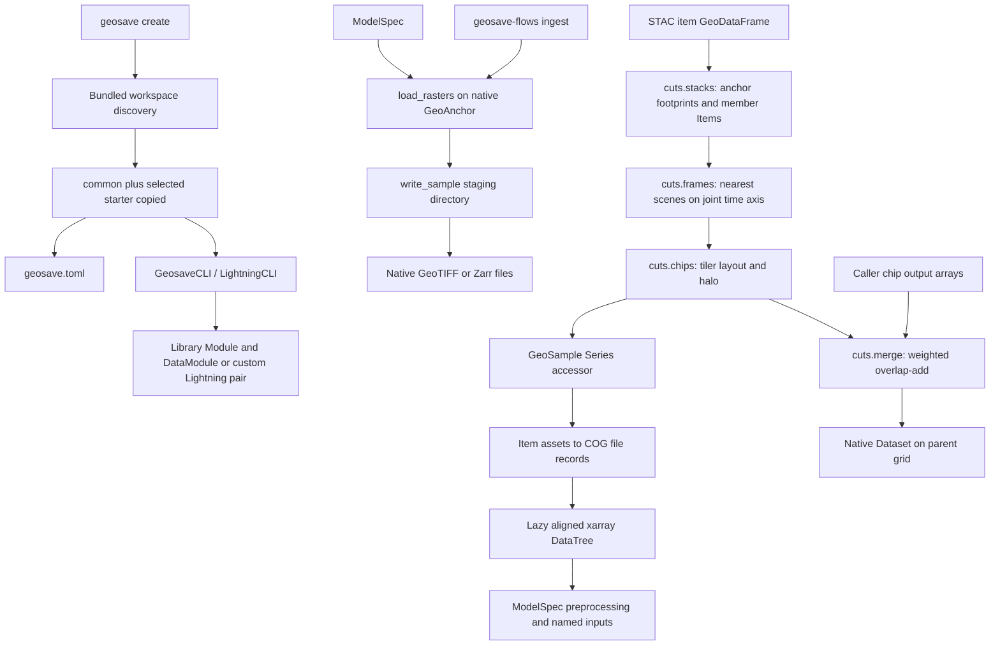

# CLI, templates, flows, cuts and shared test audit

> Audit snapshot. Findings, paths, and check counts describe the working tree
> reviewed in this record and may be superseded by later changes. Consult
> the [current guides](../../activities.md) and [API reference](../../reference/index.md)
> for supported behavior.

Date: 2026-10-13. All 66 assigned files were read in full, except the single
binary fixture, whose raster header was inspected. Notebook contents were
excluded as requested. Searches below excluded `*.ipynb`. Existing edits in
`cuts/sample.py`, flow anchor/label docstrings, and starter READMEs were retained.

## Data flow and philosophy

Native objects remain the public boundaries: GeoDataFrames for window plans,
xarray objects for rasters, ordinary Lightning classes for training. `GeoSample`
owns the window-row invariant; `ConfigModel` owns serializable validated flow
inputs. These are live seams, not obsolete wrappers. `layout` is shared by
cutting and merging and is also called by `ChipsSpec.layout`; do not remove it
because only cuts uses `tiler`. `ModelSpec.prepare` consumes `cuts.stacks` and
`row.gs.to_stack`; `FramesSpec` and `ChipsSpec` call the matching cutters.

Root imports register raster/vector accessors while cuts is lazy. Importing cuts
registers `Series.gs`; a subprocess test verifies this without loading torch.
The stale root docstring claiming cuts-row registration at initial import was
corrected. Runtime aliases to native xarray/GeoPandas classes and TYPE_CHECKING
declarations in `geodata/__init__.py` are intentional accessor typing.

CLI discovery and copy use files without importing template modules. Description
files populate selection prompts and are deliberately excluded from copies.
`__main__.py`, both script entry points in pyproject, and YAML `class_path` / `!ref`
bindings were traced rather than treated as unreachable Python definitions.
The supervised starter Dataset paths are intentional placeholders. The custom
Lightning starter implements its in-memory Dataset and both steps completely.

## Changes and findings

Removed `GROUPS` from `tests/geodata/cuts/conftest.py`: it had exactly one
repository occurrence, its declaration; fixtures directly build the same group
mapping. No production symbol or test was removed. The strict expected failure
for a missing per-source Dataset remains, with its stale `planning/` reference
corrected to `docs/contributing/open-decisions.md`.

Retained and proposed for TODO:

- `geosave_flows/tasks/labels.py`: neither `find_labels` nor `read_labels` has an
  executable caller beyond its test module. The current API reference and STAC
  design explicitly expose them, so absence of internal calls is insufficient
  to delete this public helper. Its folder-ID restrictions belong to an older
  label-ingestion path, and the new `ingest` receives one anchor, not labels.
  A real 4x4 dated GeoTIFF smoke proved that `read_labels(directory)` returns a
  table without a `collection` column; `cuts.stacks(rows, on="label")` then raises
  `KeyError('collection')`. Resolve its intended contract/ownership before
  adopting it as catalog preparation or deleting it.
- `geosave make` / `get_scaffolds`: the distribution contains no
  `templates/scaffolds/` files. The command is registered and its only behavior
  test synthesizes a temporary scaffold. AGENTS explicitly permits optional
  scaffolds, so retain and flag the missing bundled content and empty-selection
  behavior instead of deleting an uncertain extension seam.
- Supervised segmentation/regression starters: `datasets.MyDataset` is unbuilt
  consumer code; both README files explain it. Their inability to start training
  unchanged is deliberate and one parser smoke has a strict xfail. Keep the
  per-source Dataset work on TODO, not as a duplicate library data abstraction.
- `templates/common/.env`: all starters, including blank/custom Lightning, copy
  CDSE-specific endpoint settings and placeholder AWS credentials. The CLI loads
  the copied environment, so this is active configuration rather than unused
  text. Flag provider-specific startup configuration for review; do not silently
  delete environment settings that an existing workflow might rely on.
- `cuts/stacks.py` directly imports `pystac.extensions.projection`, contrary to
  the stated ownership rule that only `stac/extensions` imports extension APIs.
  `_grid` is live and necessary, so flag moving its schema access behind the
  existing projection extension module; do not delete grid extraction.
- `tests/test_packaging.py::_module_level` only examines top-level statements;
  imports inside import-time conditionals/classes are not checked by the
  declaration check. The separate layering scanner does traverse such nodes.
  Flag strengthening the packaging check rather than interpreting a passing
  test as complete dependency coverage.
- `tests/examples/test_notebooks.py` has external download/kernel behavior;
  retained without executing notebooks. It checks the current four notebook
  filenames and observable output artifacts, not a deprecated library module.

`pass` in collision handling accepts an overwrite; `pass` in the HTTP fixture
suppresses server logging. Empty package initializers and `tasks.__all__` declare
package boundaries. None is an unimplemented feature. No `NotImplementedError`
stub remains in this assigned source scope. Existing tests checking removed CLI
arguments and absent old config files protect the current public boundary.

## Verification

- Before edits: restricted baseline stopped at first Zarr sample round trip.
  An isolated run with a 15-second faulthandler showed the main thread waiting in
  `zarr.core.sync.sync`, with the `zarr_io` thread in the asyncio selector;
  no GeoSave assertion failed. Local socket access resolved it.
- Before edits: CLI/cuts/shared test and non-Zarr flow subset:
  `137 passed, 11 deselected, 1 xfailed` in 62.37 seconds.
- Before edits: `pytest tests/flows -q` with local socket access:
  `46 passed, 1 deselected` in 3.53 seconds, including real STAC localhost
  acquisition and both GeoTIFF/Zarr sample persistence.
- After edits: chip smoke, all root tests, and workspace tests:
  `12 passed, 1 deselected, 1 xfailed` in 13.78 seconds.
- Scoped Ruff on all assigned Python source/tests/templates: passed.
- `git diff --check`: passed.
- Fixture header: 5,849-byte GeoTIFF, 510x510, one uint8 band, EPSG:32627,
  10-metre pixels, no declared nodata or band description. `dw_tif_path` is
  consumed by geodata tests. Fixture contents were not changed.

## Every-file coverage

| File | Disposition and data-flow evidence |
| --- | --- |
| `src/geosave/__init__.py` | Retained public reexports/lazy loaders; corrected stale row-registration statement. |
| `src/geosave/__about__.py` | Retained Hatch version source and author metadata. |
| `src/geosave/geodata/__init__.py` | Retained native runtime aliases, accessor typing and lazy subpackages. |
| `src/geosave/cli/__init__.py` | Retained empty package initializer. |
| `src/geosave/cli/__main__.py` | Retained `python -m geosave.cli` entry point. |
| `src/geosave/cli/main.py` | Retained registered create/make commands and dotenv callback. |
| `src/geosave/cli/commands/create.py` | Retained starter selection, description prompts and TOML creation. |
| `src/geosave/cli/commands/make.py` | Retained registered optional scaffold command; flagged empty bundled scaffold set. |
| `src/geosave/cli/core/copy.py` | Retained recursive collision state and exclusions used by create/make. |
| `src/geosave/cli/core/prompts.py` | Retained all three prompt helpers; concrete create/make callers. |
| `src/geosave/cli/core/templates.py` | Retained dynamic starter/scaffold discovery; flagged absent scaffold content. |
| `src/geosave/cli/core/toml.py` | Retained metadata writer, creates marker make checks. |
| `src/geosave/cli/core/workspace.py` | Retained shared/starter copy, required directories and cache exclusions. |
| `src/geosave/templates/common/.env` | Retained copied environment; flagged global CDSE settings. |
| `src/geosave/templates/common/main.py` | Retained generated GeosaveCLI entry point. |
| `src/geosave/templates/workspaces/custom_lightning/description.txt` | Retained interactive discovery description. |
| `src/geosave/templates/workspaces/custom_lightning/configs/train.yaml` | Retained runnable native Lightning task/data bindings. |
| `src/geosave/templates/workspaces/custom_lightning/modules/data.py` | Retained implemented deterministic Dataset, DataModule, loaders. |
| `src/geosave/templates/workspaces/custom_lightning/modules/task.py` | Retained implemented Lightning forward/loss/steps/optimizer. |
| `src/geosave/templates/workspaces/segmentation/description.txt` | Retained interactive discovery description. |
| `src/geosave/templates/workspaces/segmentation/README.md` | Read fully, preserved pre-existing edits; explicit Dataset/release workflow. |
| `src/geosave/templates/workspaces/segmentation/configs/model_spec.yaml` | Retained active spec and optional commented feature/context examples. |
| `src/geosave/templates/workspaces/segmentation/configs/train.yaml` | Retained model/task configuration; flagged explicit Dataset placeholder. |
| `src/geosave/templates/workspaces/segmentation/scripts/prepare_example.py` | Retained runnable native raster/spec sample; small computation for display. |
| `src/geosave/templates/workspaces/segmentation/scripts/publish.py` | Retained explicit checkpoint/release/Hub workflow and upload allowlist. |
| `src/geosave/templates/workspaces/regression/description.txt` | Retained interactive discovery description. |
| `src/geosave/templates/workspaces/regression/README.md` | Read fully, preserved pre-existing edits; current sample/target contract. |
| `src/geosave/templates/workspaces/regression/configs/model_spec.yaml` | Retained raster preparation/input binding/normalization config. |
| `src/geosave/templates/workspaces/regression/configs/train.yaml` | Retained current regression head/task configuration; flagged Dataset placeholder. |
| `src/geosave_flows/__init__.py` | Retained only public implemented ingest export. |
| `src/geosave_flows/cli.py` | Retained JSON validation and public flow invocation. |
| `src/geosave_flows/ingest.py` | Retained live ModelSpec acquisition to atomic sample writer. |
| `src/geosave_flows/configs/__init__.py` | Retained config exports consumed by CLI and tests. |
| `src/geosave_flows/configs/anchor.py` | Read fully, preserved pre-existing edits; all variants open native anchors. |
| `src/geosave_flows/configs/base.py` | Retained shared validation invariant for deployable config inputs. |
| `src/geosave_flows/tasks/__init__.py` | Retained package boundary with explicit owning-module imports. |
| `src/geosave_flows/tasks/labels.py` | Retained documented public helper; flagged no flow caller and collection mismatch. |
| `src/geosave_flows/tasks/sample.py` | Retained ingest caller, native writers and atomic local publication invariant. |
| `src/geosave/geodata/cuts/__init__.py` | Retained exports and Series accessor registration import. |
| `src/geosave/geodata/cuts/stacks.py` | Retained covering-footprint join and source snapshots; flagged projection ownership. |
| `src/geosave/geodata/cuts/frames.py` | Retained joint-time matching and stride/frame helpers; all helpers called. |
| `src/geosave/geodata/cuts/chips.py` | Retained Tiler layout, halo/window plans, public shared layout. |
| `src/geosave/geodata/cuts/sample.py` | Read fully, preserved pre-existing edits; lazy COG records/read/pad flow. |
| `src/geosave/geodata/cuts/merge.py` | Retained public implemented weighted logit reconstruction and validity coverage. |
| `tests/cli/commands/test_create.py` | Retained starter/copy/TOML/optional scaffold behavior checks. |
| `tests/cli/core/test_templates.py` | Retained discovery/cache-filter behavior; temporary scaffold does not prove bundled content. |
| `tests/cli/core/test_workspace.py` | Retained current configs/CLI pair; corrected stale xfail document path. |
| `tests/flows/conftest.py` | Retained slow Prefect harness fixture, used by real flow test. |
| `tests/flows/test_cli.py` | Retained runnable command/options/JSON/failure checks. |
| `tests/flows/test_ingest.py` | Retained localhost STAC/persistence and ModelSpec ownership tests. |
| `tests/flows/configs/test_anchor.py` | Retained concrete native grid/time smokes for three anchor variants. |
| `tests/flows/tasks/test_labels.py` | Retained tests for documented helper pending disposition; lacks cuts-collection check. |
| `tests/flows/tasks/test_sample.py` | Retained grid/atomic failure/encoding/persistence/time-axis tests. |
| `tests/geodata/cuts/conftest.py` | Removed unused GROUPS only; retained actual raster/item fixtures. |
| `tests/geodata/cuts/test_stacks.py` | Retained spatial join, properties, href, duplicate and collection behavior. |
| `tests/geodata/cuts/test_frames.py` | Retained frame-to-lazy-stack behavior and drop/warn contracts. |
| `tests/geodata/cuts/test_frames_labels.py` | Retained metadata-only time matching/stride/gap fixtures, not obsolete pixel API. |
| `tests/geodata/cuts/test_chips.py` | Retained layout/grid/footprint/padding/empty tables and overlap checks. |
| `tests/geodata/cuts/test_sample.py` | Retained lazy row reads/persistence/registration and catalog metadata restoration. |
| `tests/geodata/cuts/test_merge.py` | Retained weighted reconstruction/order/invalid pixels and COG round trip. |
| `tests/conftest.py` | Retained all fixtures after checking consumers, localhost STAC and memory storage. |
| `tests/test_packaging.py` | Retained dependency/extras checks; flagged scanner traversal limitation. |
| `tests/test_layering.py` | Retained architecture/import-cost/registration checks, including import scanner tests. |
| `tests/test_root.py` | Retained actual root public API/import-cost/native constructor checks. |
| `tests/examples/test_notebooks.py` | Read Python test fully; retained network/notebook integration tests, not executed. |
| `tests/data/dw_-22.7491991582_15.9791703445-20190223.tif` | Inspected binary header only; retained active shared fixture. |

Referenced `examples/00_basics.ipynb`, `examples/01_model.ipynb`,
`examples/02_inputs.ipynb` and `examples/03_sources.ipynb` were not opened or
executed, as requested. Supporting reads traced `model/spec/cuts.py`,
`model/spec/model.py`, STAC creation and contributor design docs; these were not
edited by this audit.
