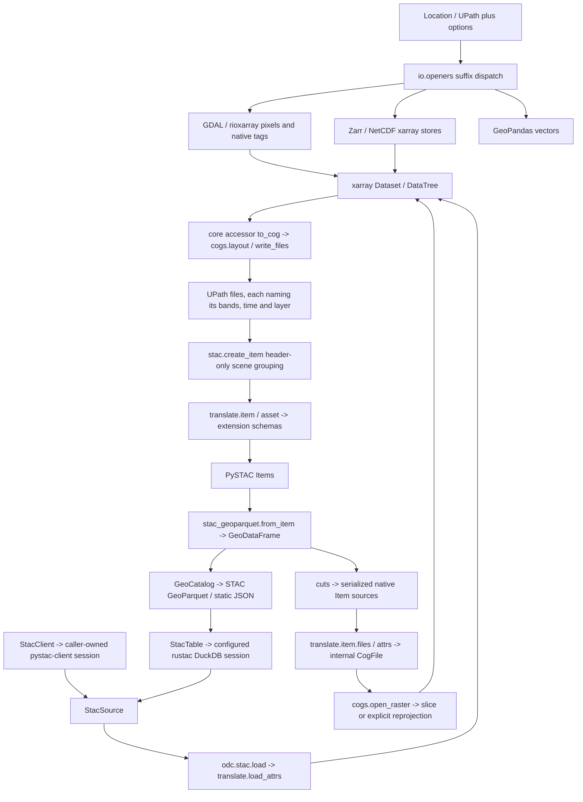

# I/O and STAC stale implementation audit — 2026-10-13

> Audit snapshot. Findings, paths, and check counts describe the working tree
> reviewed in this record and may be superseded by later changes. Consult
> the [current guides](../../activities.md) and [API reference](../../reference/index.md)
> for supported behavior.

Scope: every Python file in `src/geosave/geodata/io`,
`src/geosave/geodata/stac`, `tests/geodata/io`, and `tests/geodata/stac`.
All 35 source files and 34 test files were read in full, including package
initializers and fixtures (11,848 lines before this audit's removal).
Existing dirty implementation and documentation edits were preserved.

## Data flow and ownership

This follows the native-object philosophy: STAC describes saved files;
xarray owns pixels and laziness; GeoDataFrame owns item rows; existing
dependencies own search and persistence. `CogFile` remains an internal
catalog-reading record required for unnamed external raster bands. It is
not the return type of `to_cog`, which returns UPaths. Removing it would
break `cuts/sample.py -> translate.item.files -> cogs.open_raster`.

Registration and deferred imports count as live data flow. The xarray
backend is registered in `pyproject.toml` under
`project.entry-points."xarray.backends"`. `io.vector.__getattr__` lazily
loads STAC formats so ordinary vector reads avoid PySTAC and rustac.
Extension registration through `extensions.ASSET` is intentional.

The STAC structure design document is historical evidence, not the current
API: live code/tests use `create_collection(id, description=...)` and
`create_item(files)`; its earlier ACDD builder and `create_items` proposal
are absent. No compatibility wrappers were inferred from the old document.

## Removed

- `tests/geodata/io/test_readers.py::write_scenes`: an unused hand-written
  scene/band persistence helper predating the direct `scene.gs.to_cog(...)`
  test flow. Repository-wide `rg -n write_scenes . --glob '!*.ipynb'
  --glob '!uv.lock'` found only its definition. It was neither a fixture
  nor a registered plugin. No test called it. Removed its now-unused
  xarray import as well. No public or production behavior changed.

## Retained flags and TODO proposals

1. **SAFE is an intentional stub.** `io/raster/safe.py::read` and
   `open_stack` always raise `NotImplementedError`; `openers.py` explicitly
   dispatches `.safe` to them and documents that result. The maintenance
   ledger confirms the advertised SAFE export was removed but internal
   dispatch deliberately retained. TODO: implement product-tree naming,
   resolution grouping and XML-to-CF metadata, or explicitly drop product
   dispatch in a separately chosen API change. Do not classify this as
   unused old implementation.
2. **Nested GeoTIFF creation options are inert.**
   `GeoTIFFWriteOptions.creation_options` is declared/documented but `_write`
   forwards the nested mapping as a single GDAL keyword rather than
   unpacking its entries. `cogs.split_keywords` also recognizes it as a
   driver option. TODO: decide whether to implement this option or remove
   it from the supported option schema; smoke-test the intended driver
   setting before that decision. Retained because it is an exposed typed
   option, not proven dead internal code.
3. **Fixed Zarr 3 exposes unsupported dependency options.**
   `ZarrOpenOptions.synchronizer`, `chunk_store`, and
   `ZarrWriteOptions.synchronizer` are documented as unimplemented by Zarr 3;
   the writer fixes format 3. TODO: align declared supported options with
   actual backend capabilities and add a smoke for any retained option.
   Retained because readers can open external stores and these are exposed
   option contracts, not silently removable helpers.
4. **STAC table credentials are a deliberate unfinished seam.**
   `StacTable` shares one caller-configured DuckDB session between item search
   and Collection metadata reads. TODO: evaluate translating typed storage
   options into DuckDB secrets as already recorded in open decisions.
   The existing separate `duckdb=` interface is live and tested.
5. **Header reader ownership merits a focused follow-up.**
   The iterable branch of `open_stack` calls `open_raster(path).gs.acdd`
   without closing that header Dataset; the mapping branch correctly uses
   `ExitStack` and installs a tree closer. TODO: add a closer-observing smoke
   for iterable stack header scans and multi-file `cogs.open_raster` failure paths,
   then settle resource ownership. This is an active path; no deletion made.

Both STAC 1.0 extension band listings and STAC 1.1 core `bands` remain
necessary input formats from native external catalogs. Their side-by-side
translation is format support, not a legacy GeoSave compatibility layer.

## Source coverage

Each row records a full read and the traced reason to retain the file.

| File | Disposition and flow evidence |
| --- | --- |
| `io/__init__.py` | Keep: module-qualified public format exports and option types. |
| `io/backend.py` | Keep: xarray entry-point registration, Dataset/DataTree opening. |
| `io/openers.py` | Keep: native format dispatch and stacks; flag SAFE and iterable closer ownership. |
| `io/storage.py` | Keep: typed UPath resolution and single-file staging, used by every writer. |
| `io/raster/__init__.py` | Keep: five current raster format modules; SAFE deliberately unadvertised. |
| `io/raster/cogs.py` | Keep: accessor layouts/writes and cuts recovery; internal CogFile is live. |
| `io/raster/gdal.py` | Keep: native band identity/metadata reading, explicit remote GDAL configuration. |
| `io/raster/geotiff.py` | Keep: CF repacking and native GDAL header writing; flag nested options. |
| `io/raster/netcdf.py` | Keep: local reading and staged local/remote writing, deliberate delayed local path. |
| `io/raster/safe.py` | Retain intentional wired stub; TODO implementation or explicit removal decision. |
| `io/raster/tags.py` | Keep: validated root TIFF tags, exact time and physical map-scale metadata. |
| `io/raster/zarr.py` | Keep: format-3 storage, fill encoding and restored variable order; flag unsupported options. |
| `io/vector/__init__.py` | Keep: eager ordinary formats and lazy STAC formats. |
| `io/vector/geojson.py` | Keep: GeoPandas reads/writes; shared driver_read_options used by GeoPackage. |
| `io/vector/geopackage.py` | Keep: explicit layer selection and staged single-layer writing. |
| `io/vector/geoparquet.py` | Keep: UPath filesystem reads and ordinary vector writes, separate from Items. |
| `io/vector/stac_geoparquet.py` | Keep: native Item/row conversion, href resolution and stored Collections. |
| `io/vector/stac_json.py` | Keep: PySTAC native static catalog writes through UPathStacIO. |
| `stac/__init__.py` | Keep: current public builders, clients, source and table conversion exports. |
| `stac/create.py` | Keep: header-only file grouping, caller-named assets, actual live create_item API. |
| `stac/extensions/__init__.py` | Keep: ordered ASSET schema registry consumed by translate.asset.write. |
| `stac/extensions/classification.py` | Keep: Legend to native RasterBand classes and reverse translation. |
| `stac/extensions/eo.py` | Keep: named spectral bands and CF descriptions. |
| `stac/extensions/projection.py` | Keep: explicit GeoBox metadata written onto data assets. |
| `stac/extensions/raster.py` | Keep: stored dtype/fill/packing/unit declarations and selected reverse fields. |
| `stac/search/__init__.py` | Keep: package marker; avoids circular re-exports by design. |
| `stac/search/api.py` | Keep: caller-owned transport, provider signing at load, source construction. |
| `stac/search/query.py` | Keep: immutable validated search values and CQL2 composition. |
| `stac/search/table.py` | Keep: configured rustac search and Collection metadata on one session. |
| `stac/source.py` | Keep: explicit query/configuration and lazy anchor-grid ODC loading. |
| `stac/translate/__init__.py` | Keep: shared source metadata, authoritative loader fields, Collection ACDD. |
| `stac/translate/asset.py` | Keep: core/extension band normalization, names/attrs/fields and file writes. |
| `stac/translate/band.py` | Keep: composes Raster, EO and Classification schemas once. |
| `stac/translate/collection.py` | Keep: Collection ACDD reads and row-derived extents for both writers. |
| `stac/translate/item.py` | Keep: scene grouping/building and cuts source recovery. |

## Test coverage

| File | Disposition and substantive contract inspected |
| --- | --- |
| `io/test_backend.py` | Keep: xarray named-engine round trips, lazy reads, drops, and tree opening. |
| `io/test_public_surface.py` | Keep: internal CogFile excluded from broad public exports. |
| `io/test_readers.py` | Remove orphan write_scenes only; retain suffix, folder, ownership, href and layer contracts. |
| `io/test_reference.py` | Keep: plain reference rows remain plain and ungeoreferenced stores work. |
| `io/test_remote.py` | Keep: optional S3/HF integration, service credentials and cleanup; not a stub. |
| `io/test_storage.py` | Keep: protocol/options resolution, staging, failed writes and overwrite. |
| `io/raster/test_cogs.py` | Keep: path templates, native UPaths, metadata identity, windows and catalog band records. |
| `io/raster/test_gdal.py` | Keep: process GDAL config, native band metadata, block chunks and option replacement. |
| `io/raster/test_geotiff.py` | Keep: pixel/grid/time/native GDAL metadata, CF fill/packing and palette round trips. |
| `io/raster/test_netcdf.py` | Keep: local/read-remote/write policy, deferred writes and foreign spatial names. |
| `io/raster/test_zarr.py` | Keep: dtype/metadata/fill/order/deferred/remote/foreign-grid round trips. |
| `io/raster/test_zarr_stack.py` | Keep: child grid/time references and stacked-band attr round trips. |
| `io/vector/test_geojson.py` | Keep: native mappings, remote upload and driver-option collisions. |
| `io/vector/test_geopackage.py` | Keep: layer naming, overwrite, remote upload and read options. |
| `io/vector/test_geoparquet.py` | Keep: spatial filtering, empty/null rows, remote failure and staging behavior. |
| `io/vector/test_stac_geoparquet.py` | Keep: native Items/hrefs/Collections, relocation, lazy reads and dependency boundaries. |
| `io/vector/test_stac_json.py` | Keep: native static catalog, Collections, relocation and remote UPathStacIO. |
| `stac/conftest.py` | Keep: real local multiband catalog and aliases used by source/dataflow tests. |
| `stac/test_create.py` | Keep: actual saved-file create_item semantics, schema metadata, identifiers and header-only reads. |
| `stac/test_dataflow.py` | Keep: real pixels -> STAC -> source -> index -> lazy persisted Dataset flow. |
| `stac/test_namespace.py` | Keep: current exports and absent obsolete table-client names. |
| `stac/test_native_items.py` | Keep: external Items without GeoSave fields, native band identities and relocation. |
| `stac/test_source.py` | Keep: query selectors, validated ODC options, lazy/eager arrays and source metadata. |
| `stac/extensions/test_classification.py` | Keep: schema ordering, legends/colors and explicit bitmask omission. |
| `stac/extensions/test_eo.py` | Keep: variable identity, spectral metadata and reverse CF description. |
| `stac/extensions/test_projection.py` | Keep: EPSG/WKT regular-grid declarations and unplaced rejection. |
| `stac/extensions/test_raster.py` | Keep: stored dtype/fill/packing and no pixel computation. |
| `stac/search/test_api.py` | Keep: transport, missing-collection semantics and deferred signing. |
| `stac/search/test_table.py` | Keep: rustac query/metadata/session behavior and custom endpoint test. |
| `stac/translate/test_asset.py` | Keep: STAC core precedence and external extension-listing support. |
| `stac/translate/test_band.py` | Keep: selected CF attrs, no redundant nodata/dtype translation. |
| `stac/translate/test_collection.py` | Keep: ACDD reads and native Item extent. |
| `stac/translate/test_item.py` | Keep: scene grouping, internal catalog records and core-band facts. |
| `stac/translate/test_load_attrs.py` | Keep: metadata agreement, authoritative loader fields and import boundaries. |

## Checks

- Before removal: focused GDAL, STAC extensions, translation and namespace
  suite: **76 passed** in 2.30 s. The two reader forwarding smokes also
  passed before removal.
- After removal: the same two reader forwarding smokes: **2 passed**;
  `ruff check tests/geodata/io/test_readers.py` and scoped `git diff --check`
  passed.
- Scope collection: **416 selected / 436 total**, 20 integration-marked
  tests deselected by the default marker policy.
- Broad reader/backend baseline was interrupted after stalling in Zarr.
  A second reader run's faulthandler trace locates the wait at
  `zarr/core/sync.py:151 -> xarray.to_zarr -> io/raster/zarr.py::write`,
  with its `zarr_io` thread waiting in the asyncio selector. This is not
  evidence that the tests or writer are stale; runtime access needs to be
  checked before product changes.

No production API was deleted. Exposed options and uncertain resource
ownership findings remain explicitly flagged for a later focused decision.
