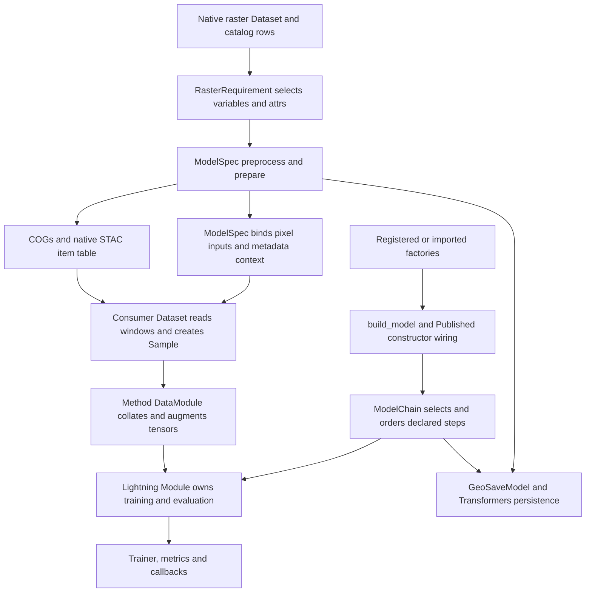

# Model and ML cleanup audit — 2026-10-13

> Audit snapshot. Findings, paths, and check counts describe the working tree
> reviewed in this record and may be superseded by later changes. Consult
> the [current guides](../../activities.md) and [API reference](../../reference/index.md)
> for supported behavior.

Scope: every repository file under `src/geosave/model`, `src/geosave/ml`,
`tests/model`, and `tests/ml`, including empty initializers and README. All 119
original files were read in full (34 model source, 39 ML source, 26 model test,
20 ML test); 118 remain after one obsolete test-support file was deleted.
Existing modified source was preserved. This is a caller/dataflow audit, not
an assertion that every supported parameter combination works.

## Philosophy and flow map

Native objects own pixels, arrays, network modules and orchestration. GeoSave
owns the binding invariants: ordered metadata requirements, inert portable
calls, named network dataflow, Sample contracts and reproducible release
recipes. No import into `geosave.ml` was found in model source. Existing public
exports, registry decorators, Pydantic validators, Lightning hooks and
Transformers hooks are live usage even when ordinary text callers are absent.

## Removals and retained concerns

- Deleted `tests/model/chain/conftest.py`: its Encoder was unused; its Head was
  only a class-path target for the release rejection test. That test now uses
  its existing PeriodicHead. No fixtures, public interfaces or runtime behavior
  were removed.
- Removed the model README's obsolete `Trainer.predict`/absent `ChipWriter`
  walkthrough. Current tasks expose no prediction step; the old merge example
  did not meet the current required `bands` argument. Repaired the moved
  architecture link and replaced the absent standalone `model_inputs` helper
  and row-based context recipe with current `spec.model_inputs(rasters)` calls.
- Kept test stubs elsewhere: they are real Dataset/class-path targets or
  deliberately invalid networks exercising errors. Old schema rejection tests
  describe the current `extra=forbid` API boundary.
- Kept separate implemented classification, MIM, regression, Mean Teacher,
  segmentation and FixMatch methods. Similar DataModules are live code with
  different target/validity handling, not removable old implementations.

TODO proposals for integration into the repository TODO:

1. Define and test empty supervised batches. A smoke of all-NaN regression
   targets returns NaN loss; all-invalid Mean Teacher unlabeled data also
   returns NaN through MSELoss on empty selections. Keep current modules;
   implement an explicit zero/skip/error policy in a focused change.
2. Check strong-view validity and geometry in FixMatch/Mean Teacher.
   `strong, _ = self._finish(...)` discards invalid pixels introduced by strong
   transforms. Geometric strong transforms are not rejected, and their
   independent per-input draws can move multiple rasters differently. Their
   declared contract requires matching geometry; intersect
   finite validity and prove multiple input behavior before changing it.
3. Rework calibration ownership after a native save/load smoke. Thresholds
   live in the Lightning module, while release exports `task.model`; thresholds
   therefore do not survive native release. The callback is implemented, so
   retain it. Existing calibration tests check argmax and absence of automatic
   registration, not a successful threshold sweep/checkpoint round trip.
4. Add focused OHEM forward coverage and settle `min_kept=0`. The implemented
   threshold mask is inside `if self.min_kept > 0`, so with zero the loss equals
   ordinary CE even for confident pixels above `thresh`; smoke confirmed this.
   Registry exposure alone is not loss validation. Include empty/ignored and
   device behavior in that work.
5. Revisit model registry's eager imports and monolith construction. Even a
   native segmentation-head build imports all encoders and the biomass module;
   its `terratorch.tasks.PixelwiseRegressionTask` brings Lightning into native
   construction. The upstream PrithviModelFactory deprecation appears in the
   real monolith test. Migrate only after recipe/state/output parity with the
   current checkpoint is proved; this is active code, not deletable legacy.
6. Resolve the architecture rule that only ML tasks import sibling concerns:
   `ml/builders/criterion.py` imports the owned OHEM criterion. Both sides are
   active; decide the ownership rule rather than deleting the loss.
7. Tighten metrics and shape contracts in follow-up work: MulticlassMetrics
   advertises AUROC micro in `modes` but upstream rejects it (the test asserts
   rejection); decoder/encoder pyramid lengths, MIM mask bounds and matching
   chip/context geometry lack complete direct forward coverage. Avoid adding
   speculative general validation during cleanup.
8. Prediction persistence, source-specific Datasets and whole-raster
   evaluation remain explicitly deferred in open decisions; no production
   stubs for these remain in the audited packages. Do not reinstate the
   removed README example until a runnable end-to-end public flow exists.
9. Clarify remaining pipeline portability/migration requirements in the old
   TODO requesting a `data_pipeline` parser for `config.yaml`. No such current
   API remains: ModelSpec already preserves ordered preprocessing calls,
   nested literals and `!ref` paths, inputs, context and transforms in
   `model_spec.yaml`. Keep any unresolved implementation rework tied to that
   tested contract rather than introducing another parser.

## Verification

- Before edits: `PYTHONPYCACHEPREFIX=/tmp/geosave-audit-model-cache
  .venv/bin/python -m pytest tests/model tests/ml -q`: **501 passed,
  1 deselected**, 39 warnings, 35.18 seconds. Default markers exclude the
  fresh-process release test (`slow`).
- Initial unprefixed collection failed because ignored bytecode retained
  `/home/uwu/Projects/geosave-engine` source filenames and `inspect.getsource`
  could not read them. Recompiling under a fresh `/tmp` prefix resolved it;
  no runtime compatibility workaround was introduced.
- After focused edits: same cache prefix, pytest `tests/model/chain
  tests/model/release -q`: **119 passed, 1 deselected**, 17.27 seconds.
- `.venv/bin/ruff check src/geosave/model src/geosave/ml tests/model tests/ml`:
  **all checks passed**.
- Fresh-process release check: same cache prefix, pytest
  `tests/model/release/test_huggingface.py -m slow -q`: **1 passed,
  14 deselected**, 28.43 seconds.
- Exact corrected README conversion/caching smoke: real georeferenced raster,
  two acquisition times and Prithvi context produce tensor pixels and preserve
  cached temporal tensors; passed.
- Native-head construction import smoke: `lightning` loaded, `geosave.ml`
  absent; confirms the dependency concern in proposal 5.
- Behavioral concern probes: all-unknown regression loss `nan`; all-invalid
  Mean Teacher loss `nan`; OHEM `min_kept=0` loss `0.3465963`, identical to CE.
- `git diff --check` scoped to owned files: clean after removing a trailing
  blank line in the README.

## Complete per-file coverage

Every entry was read in full before disposition; tests were traced to current
APIs and Python class-path lookup. An initializer is an intentional import or
namespace boundary, not an unfinished feature merely because it is empty.

| File | Evidence and disposition |
| --- | --- |
| `src/geosave/ml/__init__.py` | Retain: current package boundary and public re-exports; actual exported targets reviewed below. |
| `src/geosave/ml/builders/__init__.py` | Retain: current package boundary and public re-exports; actual exported targets reviewed below. |
| `src/geosave/ml/builders/criterion.py` | Retain; flag sibling import policy: active criteria registry resolves CE/OHEM and native torch classes. |
| `src/geosave/ml/builders/optimizer.py` | Retain: each task builds trainable exact-child groups; overlap/frozen/direct-parameter tests. |
| `src/geosave/ml/builders/scheduler.py` | Retain: each task forwards scheduler metadata to Lightning; plateau-monitor and scheduler tests. |
| `src/geosave/ml/cli.py` | Retain: workspace main imports this LightningCLI subclass; explicit logger and YAML Dataset construction tests. |
| `src/geosave/ml/criterion/__init__.py` | Retain: current package boundary and public re-exports; actual exported targets reviewed below. |
| `src/geosave/ml/criterion/ohem.py` | Retain; flag min_kept=0 threshold behavior and missing forward coverage; builder exports implemented loss. |
| `src/geosave/ml/metrics/__init__.py` | Retain: current package boundary and public re-exports; actual exported targets reviewed below. |
| `src/geosave/ml/metrics/multiclass.py` | Retain; flag advertised AUROC micro mode rejected upstream: actively used by segmentation/classification. |
| `src/geosave/ml/metrics/regression.py` | Retain: native torchmetrics collection used by both regression methods; known-value score tests. |
| `src/geosave/ml/tasks/__init__.py` | Retain: current package boundary and public re-exports; actual exported targets reviewed below. |
| `src/geosave/ml/tasks/classification/__init__.py` | Retain: current package boundary and public re-exports; actual exported targets reviewed below. |
| `src/geosave/ml/tasks/classification/supervised/__init__.py` | Retain: current package boundary and public re-exports; actual exported targets reviewed below. |
| `src/geosave/ml/tasks/classification/supervised/data.py` | Retain: classification/supervised Sample/Views contract, native Dataset loaders and batch preparation; paired data and module tests. |
| `src/geosave/ml/tasks/classification/supervised/module.py` | Retain: classification/supervised Lightning lifecycle and criterion/metric flow; paired real Trainer smoke and step tests. |
| `src/geosave/ml/tasks/pretraining/__init__.py` | Retain: current package boundary and public re-exports; actual exported targets reviewed below. |
| `src/geosave/ml/tasks/pretraining/mim/__init__.py` | Retain: current package boundary and public re-exports; actual exported targets reviewed below. |
| `src/geosave/ml/tasks/pretraining/mim/data.py` | Retain: pretraining/mim Sample/Views contract, native Dataset loaders and batch preparation; paired data and module tests. |
| `src/geosave/ml/tasks/pretraining/mim/module.py` | Retain: pretraining/mim Lightning lifecycle and criterion/metric flow; paired real Trainer smoke and step tests. |
| `src/geosave/ml/tasks/regression/__init__.py` | Retain: current package boundary and public re-exports; actual exported targets reviewed below. |
| `src/geosave/ml/tasks/regression/mean_teacher/__init__.py` | Retain: current package boundary and public re-exports; actual exported targets reviewed below. |
| `src/geosave/ml/tasks/regression/mean_teacher/data.py` | Retain: regression/mean_teacher Sample/Views contract, native Dataset loaders and batch preparation; paired data and module tests. |
| `src/geosave/ml/tasks/regression/mean_teacher/module.py` | Retain: regression/mean_teacher Lightning lifecycle and criterion/metric flow; paired real Trainer smoke and step tests. |
| `src/geosave/ml/tasks/regression/supervised/__init__.py` | Retain: current package boundary and public re-exports; actual exported targets reviewed below. |
| `src/geosave/ml/tasks/regression/supervised/data.py` | Retain: regression/supervised Sample/Views contract, native Dataset loaders and batch preparation; paired data and module tests. |
| `src/geosave/ml/tasks/regression/supervised/module.py` | Retain: regression/supervised Lightning lifecycle and criterion/metric flow; paired real Trainer smoke and step tests. |
| `src/geosave/ml/tasks/segmentation/__init__.py` | Retain: current package boundary and public re-exports; actual exported targets reviewed below. |
| `src/geosave/ml/tasks/segmentation/calibrate.py` | Retain; flag missing successful calibration round trip: importable Lightning callback updates task thresholds. |
| `src/geosave/ml/tasks/segmentation/callbacks.py` | Retain: importable TensorBoard/MLflow callback observes step outputs; image/callback/skip tests. |
| `src/geosave/ml/tasks/segmentation/fixmatch/__init__.py` | Retain: current package boundary and public re-exports; actual exported targets reviewed below. |
| `src/geosave/ml/tasks/segmentation/fixmatch/data.py` | Retain: segmentation/fixmatch Sample/Views contract, native Dataset loaders and batch preparation; paired data and module tests. |
| `src/geosave/ml/tasks/segmentation/fixmatch/module.py` | Retain: segmentation/fixmatch Lightning lifecycle and criterion/metric flow; paired real Trainer smoke and step tests. |
| `src/geosave/ml/tasks/segmentation/supervised/__init__.py` | Retain: current package boundary and public re-exports; actual exported targets reviewed below. |
| `src/geosave/ml/tasks/segmentation/supervised/data.py` | Retain: segmentation/supervised Sample/Views contract, native Dataset loaders and batch preparation; paired data and module tests. |
| `src/geosave/ml/tasks/segmentation/supervised/module.py` | Retain: segmentation/supervised Lightning lifecycle and criterion/metric flow; paired real Trainer smoke and step tests. |
| `src/geosave/ml/transforms/__init__.py` | Retain: current package boundary and public re-exports; actual exported targets reviewed below. |
| `src/geosave/ml/transforms/augmenter.py` | Retain: all DataModules consume native Kornia pipelines; joint geometry, YOLO/native boxes and temporal tests. |
| `src/geosave/ml/transforms/mixing.py` | Retain: supervised segmentation CutMix boxes; rectangle/probability and joint-paste tests. |
| `src/geosave/model/README.md` | Cleaned: removed prediction and absent ChipWriter walkthrough; corrected native context calls and architecture link. |
| `src/geosave/model/__init__.py` | Retain: lazy public exports preserve torch-free spec imports; export and layering tests exercise lookup. |
| `src/geosave/model/chain/__init__.py` | Retain: current package boundary and public re-exports; actual exported targets reviewed below. |
| `src/geosave/model/chain/chain.py` | Retain: PyTorch routing, native terminal returns and release recipe invariants; chain and release tests. |
| `src/geosave/model/chain/published.py` | Retain: construction wiring used by registry; explicit arguments and ambiguity tests. |
| `src/geosave/model/chain/routing.py` | Retain: chain selects and sorts steps; inherited methods, cycles and end-to-end tests. |
| `src/geosave/model/chain/step.py` | Retain: chain decorators and runtime contracts are used by all split stages; inference and explicit-output tests. |
| `src/geosave/model/factory.py` | Retain: BuildSpec resolves stage, criterion, optimizer and scheduler selectors; model/ML builder tests exercise it. |
| `src/geosave/model/registry.py` | Retain; flag eager built-in discovery: registered decorators, Published construction and release recipes have active callers. |
| `src/geosave/model/release/__init__.py` | Retain: current package boundary and public re-exports; actual exported targets reviewed below. |
| `src/geosave/model/release/huggingface.py` | Retain: Transformers registration and persistence hooks; real save/load, exact-key and nonpersistent-buffer tests. |
| `src/geosave/model/spec/__init__.py` | Retain: current package boundary and public re-exports; actual exported targets reviewed below. |
| `src/geosave/model/spec/base.py` | Retain: strict Pydantic base and aliases shared by all portable declarations. |
| `src/geosave/model/spec/call.py` | Retain: inert Ref/CallSpec parsed by YAML, consumed by StageSpec and context; call/execution tests. |
| `src/geosave/model/spec/cuts.py` | Retain: active native cuts adapter and taper validation; cut/layout tests and DataModule chip shape consumption. |
| `src/geosave/model/spec/model.py` | Retain: declaration validation, lazy preprocessing, COG catalog prepare, inputs/context, YAML round trips. |
| `src/geosave/model/spec/rasters.py` | Retain: native Dataset selection and metadata requirements used by acquisition/preprocess; lazy requirement tests. |
| `src/geosave/model/spec/stac.py` | Retain: native STAC query/config adapter and endpoint fallbacks; acquisition and serialization tests. |
| `src/geosave/model/spec/stage.py` | Retain: ordered call dataflow consumed by preprocessing; missing/forward-reference and rebinding tests. |
| `src/geosave/model/stages/__init__.py` | Retain: current package boundary and public re-exports; actual exported targets reviewed below. |
| `src/geosave/model/stages/decoder/__init__.py` | Retain: current package boundary and public re-exports; actual exported targets reviewed below. |
| `src/geosave/model/stages/decoder/dpt.py` | Retain: registered decoder; real encoder-to-decoder-to-head build smoke uses all three encoders. |
| `src/geosave/model/stages/decoder/unet.py` | Retain: registered implemented decoder used by model examples/configuration; suggest direct forward coverage. |
| `src/geosave/model/stages/encoder/__init__.py` | Retain: current package boundary and public re-exports; actual exported targets reviewed below. |
| `src/geosave/model/stages/encoder/clay.py` | Retain: registered TerraTorch encoder, hooks and explicit context; local checkpoint, context and registry tests. |
| `src/geosave/model/stages/encoder/dinov3.py` | Retain: registered timm backbone and native intermediates; registry smoke and workspace templates use it. |
| `src/geosave/model/stages/encoder/prithvi.py` | Retain: registered backbones, temporal layouts and metadata context; band preservation, context and release tests. |
| `src/geosave/model/stages/head/__init__.py` | Retain: current package boundary and public re-exports; actual exported targets reviewed below. |
| `src/geosave/model/stages/head/classification.py` | Retain: registered pooling/projection head with class identity and PyTorch gradient path. |
| `src/geosave/model/stages/head/dense.py` | Retain: concrete shared parent of written regression/segmentation heads, including direct forward and resize path. |
| `src/geosave/model/stages/head/regression.py` | Retain: registered DenseHead specialization owns variable identity and units. |
| `src/geosave/model/stages/head/segmentation.py` | Retain: registered DenseHead specialization owns class identity and count. |
| `src/geosave/model/stages/monolith/__init__.py` | Retain: current package boundary and public re-exports; actual exported targets reviewed below. |
| `src/geosave/model/stages/monolith/ibm_granite_biomass.py` | Retain; flag upstream deprecated task/factory and training imports: real monolith forward is covered. |
| `tests/ml/builders/test_builders.py` | Retain: active collected behavioral tests (10 functions); resolve rejects invalid specs; build spec resolves registered names. |
| `tests/ml/metrics/test_multiclass.py` | Retain: active collected behavioral tests (5 functions); aggregations and class labels exclude ignored pixels; clones prefix classwise results and keep independent state. |
| `tests/ml/metrics/test_regression.py` | Retain: active collected behavioral tests (2 functions); regression metrics score flat values; regression metrics refuse unknown names. |
| `tests/ml/tasks/classification/supervised/test_data.py` | Retain: active collected behavioral tests (1 functions); training batches move pixels and validity together. |
| `tests/ml/tasks/classification/supervised/test_module.py` | Retain: active collected behavioral tests (3 functions); defaults and class count; a last stage without a class count is refused. |
| `tests/ml/tasks/pretraining/mim/test_data.py` | Retain: active collected behavioral tests (2 functions); training batches are augmented then transformed; non finite pixels become zero and invalid. |
| `tests/ml/tasks/pretraining/mim/test_module.py` | Retain: active collected behavioral tests (6 functions); patch masks hide whole patches in the given share; patch masks crop patches reaching past the edge. |
| `tests/ml/tasks/regression/mean_teacher/test_data.py` | Retain: active collected behavioral tests (2 functions); labeled values and unlabeled views are finished together; evaluation batches are supervised ones. |
| `tests/ml/tasks/regression/mean_teacher/test_module.py` | Retain: active collected behavioral tests (5 functions); the consistency weight ramps up then holds; views the teacher agrees with add no loss. |
| `tests/ml/tasks/regression/supervised/test_data.py` | Retain: active collected behavioral tests (2 functions); target values move with the pixels; values an augmentation invents are unknown not zero. |
| `tests/ml/tasks/regression/supervised/test_module.py` | Retain: active collected behavioral tests (5 functions); only known pixels are scored; the last stage names its variables. |
| `tests/ml/tasks/segmentation/fixmatch/test_data.py` | Retain: active collected behavioral tests (5 functions); strong views perturb the weak view without moving it; labeled chips are finished as in supervised training. |
| `tests/ml/tasks/segmentation/fixmatch/test_module.py` | Retain: active collected behavioral tests (4 functions); unconfident pseudo labels add no loss; confident pseudo labels train the strong view over valid pixels. |
| `tests/ml/tasks/segmentation/supervised/test_data.py` | Retain: active collected behavioral tests (14 functions); loaders collate samples into batches; the test split needs its dataset. |
| `tests/ml/tasks/segmentation/supervised/test_module.py` | Retain: active collected behavioral tests (23 functions); task defaults; the module takes no data shaped arguments. |
| `tests/ml/tasks/segmentation/test_calibrate.py` | Retain: active collected behavioral tests (1 functions); top class and its confidence leave logits unchanged. |
| `tests/ml/tasks/segmentation/test_callbacks.py` | Retain: active collected behavioral tests (4 functions); max steps training preserves explicit callbacks; interval must be positive. |
| `tests/ml/test_cli.py` | Retain: active collected behavioral tests (2 functions); default artifacts use tensorboard only; mlflow logger requires explicit tracking uri. |
| `tests/ml/transforms/test_augmenter.py` | Retain: active collected behavioral tests (12 functions); yaml configuration builds native joint augmentation; nested yaml configuration and default crop size. |
| `tests/ml/transforms/test_mixing.py` | Retain: active collected behavioral tests (3 functions); each box is one rectangle within the area bounds; probability decides which samples get a box. |
| `tests/model/chain/conftest.py` | Deleted: Encoder had no consumers; sole Head class_path consumer now uses existing PeriodicHead in its own release test. |
| `tests/model/chain/test_chain.py` | Retain: active collected behavioral tests (37 functions); a linear chain runs encoder then decoder then head; declaration order does not decide call order. |
| `tests/model/chain/test_published.py` | Retain: active collected behavioral tests (16 functions); only marked attributes are published; a subclass inherits its base marks. |
| `tests/model/chain/test_step.py` | Retain: active collected behavioral tests (38 functions); inputs come from parameters; outputs pair return names with types. |
| `tests/model/release/test_huggingface.py` | Retain; cleaned sole old conftest reference. Native artifact round trips, Hub mock, exact weights and version boundaries. |
| `tests/model/spec/test_acquisition.py` | Retain: active collected behavioral tests (5 functions); a recipe loads with its own query and load settings; an unavailable endpoint falls back to the next. |
| `tests/model/spec/test_call.py` | Retain: active collected behavioral tests (14 functions); call invokes imports bound methods and nested references; call selects only referenced roots. |
| `tests/model/spec/test_context.py` | Retain: active collected behavioral tests (3 functions); context recipe round trips; context reads only declared rasters. |
| `tests/model/spec/test_cuts.py` | Retain: active collected behavioral tests (8 functions); a square size names both sides; a size that names no tile is refused. |
| `tests/model/spec/test_examples.py` | Retain: active collected behavioral tests (2 functions); shipped model spec round trips as inert declarations; walkthrough runs without model or external service. |
| `tests/model/spec/test_execution.py` | Retain: active collected behavioral tests (6 functions); stage runs declarations in order; stage returns only results without mutating inputs. |
| `tests/model/spec/test_model.py` | Retain: active collected behavioral tests (22 functions); prediction fields are rejected; python and yaml round trip preserves references and literals. |
| `tests/model/spec/test_prepare.py` | Retain: active collected behavioral tests (4 functions); prepared pixels are the preprocessed raw pixels; pixels stay lazy until they are written. |
| `tests/model/spec/test_rasters.py` | Retain: active collected behavioral tests (16 functions); persisted raster requirements need no acquisition identity; exactly one nonempty raster selector is required. |
| `tests/model/spec/test_stac.py` | Retain: active collected behavioral tests (7 functions); stac recipe preserves priority and native settings; stac recipe accepts named providers with url fallbacks. |
| `tests/model/spec/test_stage.py` | Retain: active collected behavioral tests (5 functions); stage is an ordered mapping with plain dump shape; stage validates external inputs and order. |
| `tests/model/stages/encoder/test_clay.py` | Retain: active collected behavioral tests (2 functions); local checkpoint needs no published model source; unpublished variant without local checkpoint is rejected. |
| `tests/model/stages/encoder/test_context.py` | Retain: active collected behavioral tests (12 functions); encoder model context reads the raster it encodes; prithvi context preserves frame order and calendar values. |
| `tests/model/stages/encoder/test_prithvi.py` | Retain: active collected behavioral tests (2 functions); named bands keep their pretrained patch embedding; default bands are the pretrained six. |
| `tests/model/stages/head/test_classification.py` | Retain: active collected behavioral tests (5 functions); one logit vector comes back per sample; the deepest level is the one projected. |
| `tests/model/stages/head/test_regression.py` | Retain: active collected behavioral tests (4 functions); the variables fix the channel count; no variables are refused. |
| `tests/model/stages/head/test_segmentation.py` | Retain: active collected behavioral tests (7 functions); the classes fix the channel count; logits are resized to the input size. |
| `tests/model/stages/monolith/test_ibm_granite_biomass.py` | Retain: active collected behavioral tests (1 functions); the monolith runs alone in a chain and names its variable. |
| `tests/model/test_exports.py` | Retain: active collected behavioral tests (2 functions); model exports the chain and its builder; model refuses a name it does not export. |
| `tests/model/test_factory.py` | Retain: active collected behavioral tests (1 functions); imported factory preserves missing attribute error. |
| `tests/model/test_registry.py` | Retain: active collected behavioral tests (18 functions); build model builds serializable stages and wires published values; explicit arguments override published values. |
