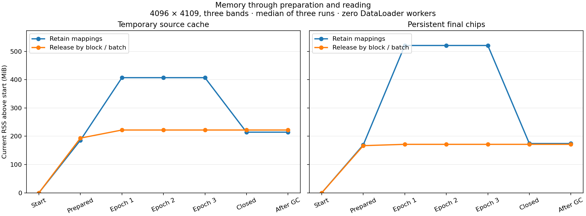

# Chip mapping lifetime experiment

> Historical: chip caching, saving and the separate disk-backed reader were
> removed on 2026-11-07. Examples and benchmark scripts below describe the
> removed implementation. Storage is deferred until model-context ownership
> is settled; see the [current Chips contract](../../specs/2026-11-06-chips.md).

This report records the original isolated prototype and the subsequent adoption
for persistent chips. The historical measurements below retain their original
policies; see the production validation section for the implemented behavior.

## Compared policies

```python
# Existing reader behavior, conceptually:
chips = read_copies(indices)  # mappings stay open until the store closes

# Prototype reader behavior:
try:
    chips = read_copies(indices)
finally:
    close_source_mappings()  # chips own their pixels independently
```

The prototype writer uses the production block/batch plan. It flushes and closes
its output mapping after each source block, or each bounded final-chip batch,
and reopens the file for the next write. The historical baseline writer closes once per
source file. Neither changes values, dtype, layout, padding or source scheduling.
The prototype reader closes maps after copying a complete batch; it does not
close maps between individual chips in that batch.

The experiment installs these policies only inside benchmark subprocesses. It
is not a new public option or a production abstraction. No forced garbage
collection, allocator trimming or OS-wide cache eviction is added to reads.
A final garbage collection is measured separately as a diagnostic.

The historical writer is frozen in benchmark-local `baseline.py`; reader policies
are installed only in subprocesses. `--policies production` exercises the live
library without either patch.

## Reproduce

```bash
.venv/bin/python docs/contributing/benchmarks/2026-11-07-chip-memory/benchmark.py
```

Small smoke: `--sizes 512 --epochs 2 --repeats 1 --output <disk>/smoke.json`.
Spawned worker probe: `--worker-counts 2 --repeats 1 --output <disk>/workers.json`.
The worker probe needs local multiprocessing sockets for PyTorch tensor transfer.

## Method

- Local SSD fixture; 2048 × 2061 and 4096 × 4109, three uint16 TIFF bands,
  512² Dask chunks, 32 MiB GDAL cache and four preparation threads.
- Same lazy float32 arithmetic and nodata replacement as the prior storage
  benchmark. 256² tiles, overlap 64, reflect padding, batch size 16.
- Three shuffled epochs in a fresh process per policy/layout/repeat. The same
  index order repeats each epoch to expose retained memory. Three repetitions
  alternate policy order. Filesystem caches are not cleared.
- Every chip is compared with a coordinate-derived oracle after reading; shapes,
  dtype, nodata and padding must match. Digests agree across policies/layouts.
- Record parent RSS, anonymous/file-backed RSS and historical peak before work,
  after preparation, after each epoch, after closing the reader and stopping
  workers, after exiting source/cache contexts, and after final garbage collection.
- Record proportional set size (PSS) for the parent and descendants at each
  checkpoint. PSS apportions shared pages; summing RSS would double-count them.
  Worker checkpoints include Python's small multiprocessing resource tracker.
- These are checkpoints, not continuous sampling of worker peaks. Parent peak
  RSS comes from the kernel high-water mark and cannot decrease after cleanup.
- Zero-worker timings include DataLoader collation and fetches, excluding imports,
  fixture writes, verification and checkpoint sampling. With subprocess workers,
  verification overlaps prefetch: worker timing is consumer wait plus startup,
  not a standalone throughput measurement. The worker probe focuses on memory.
- A model, accelerator, augmentation, remote inputs, multiple source files and
  cold disk are outside this experiment. Two dataset sizes cannot establish a
  universal process-memory bound; allocation and upstream computations remain.

## Results

Three-repeat medians. Memory columns are MiB above the same process before setup; peak deltas use the historical peak baseline. Current RSS columns use current RSS, not the historical peak.

| Size | Layout | Policy | Prepare s | Epoch s | Preparation peak | Overall peak | RSS after epoch 3 | RSS after close |
| --- | --- | --- | ---: | ---: | ---: | ---: | ---: | ---: |
| 2048 | cache | retain | 0.739 | 0.048 | 146.5 | 170.3 | 170.5 | 122.2 |
| 2048 | cache | release | 1.024 | 0.081 | 145.4 | 168.3 | 121.2 | 121.2 |
| 2048 | saved | retain | 0.978 | 0.037 | 228.2 | 232.9 | 233.1 | 142.4 |
| 2048 | saved | release | 0.927 | 0.049 | 168.1 | 168.1 | 145.2 | 145.2 |
| 4096 | cache | retain | 2.970 | 0.181 | 378.8 | 407.3 | 406.9 | 214.3 |
| 4096 | cache | release | 3.434 | 0.423 | 236.3 | 358.4 | 221.9 | 221.9 |
| 4096 | saved | retain | 5.820 | 0.125 | 515.9 | 520.5 | 520.7 | 174.2 |
| 4096 | saved | release | 5.894 | 0.164 | 198.0 | 198.0 | 171.3 | 171.3 |

The larger fixture contains four times as many pixels. Saved-chip peak memory grew from about 233 to 521 MiB under retention, compared with 168 to 198 MiB under release. This is a useful improvement, but is not a general proof of constant memory.

Source caches behave differently: block release reduces preparation peak, but a randomly sampled read batch still touches many scattered pages across the source planes. Overall peak improves less, and reopening maps more than doubles epoch fetch time in this fixture. Persistent final chips have contiguous per-chip storage and a smaller observed penalty.

Closing retained mappings removes approximately the source/store file size from RSS: 193 MiB for the large source cache and 347 MiB for its final-chip store. The release policy has already removed those mappings at each batch boundary, so explicit close produces little additional reduction. The anonymous remainder persists after scope exit and diagnostic garbage collection; these measurements do not distinguish allocator retention from backend caches.

The result supports releasing completed write mappings and batch read mappings, particularly for persistent chips. It does not support adding gc.collect() to each batch or promising that RSS returns to its starting value. Source-cache read overhead should be weighed explicitly before choosing a production default.

## Checks

- Smoke: four policy/layout combinations, two epochs each, all pixels verified.
- Main: 24 isolated runs, 72 epochs, two sizes, three repeats per comparison. Digests match for each size.
- Ruff and formatting checks passed. The original experiment modified no library code.
- Production tests were not rerun for the original benchmark-only experiment; adoption checks are recorded below.


## Two-worker probe

One isolated run per size/layout/policy, three epochs each. This is exploratory worker memory evidence, not repeated throughput timing. Values below are current combined parent/descendant PSS in MiB, which apportions shared pages.

| Size | Layout | Policy | After epoch 1 | After epoch 3 | After worker shutdown and close |
| --- | --- | --- | ---: | ---: | ---: |
| 2048 | cache | retain | 1555.0 | 1554.8 | 635.7 |
| 2048 | cache | release | 1586.4 | 1586.5 | 771.2 |
| 2048 | saved | retain | 1716.4 | 1716.4 | 812.1 |
| 2048 | saved | release | 1619.0 | 1619.0 | 811.0 |
| 4096 | cache | retain | 1861.4 | 1861.5 | 861.0 |
| 4096 | cache | release | 1699.2 | 1699.3 | 891.2 |
| 4096 | saved | retain | 1995.8 | 1995.8 | 841.8 |
| 4096 | saved | release | 1666.2 | 1666.3 | 858.5 |

All eight spawned-worker runs passed pixel equality and matching per-size digests. Workers were kept alive across epochs, then stopped before maps and temporary directories were closed. Releasing mappings lowers between-batch mapped residency in workers, but each spawned worker also carries Python, Torch and allocator memory. This policy does not remove that process overhead.

## Current RSS lifecycle



The plotted values are current parent RSS above start, not peak RSS. The historical peak remains unchanged when memory is released. Reproduce the plot with `.venv/bin/python docs/contributing/benchmarks/2026-11-07-chip-memory/plot.py`.

## Production validation

Persistent chips now release completed write mappings before the next batch
computation, and release read mappings after each copied batch or single chip.
Temporary source caches retain their previous behavior: the prototype's larger
read penalty did not justify changing their default. There is no new API option.

Three fresh 4096 × 4109 production runs, three epochs each, zero DataLoader
workers, all pixels checked against the coordinate oracle:

| Policy | Prepare (s) | Epoch (s) | Added peak RSS (MiB) | Added RSS after epoch 3 (MiB) |
| --- | ---: | ---: | ---: | ---: |
| Historical retained mappings | 5.820 | 0.125 | 520.1 | 520.7 |
| Current production | 5.648 | 0.167 | 197.6 | 171.2 |

Values are medians across three runs; epoch timing first takes each run's median.
Added memory subtracts starting current RSS (earlier tables subtract starting
peak for peak deltas). The historical baseline was measured earlier, not
interleaved with these adoption runs. All production digests match that baseline.
Peak fell approximately 62%; cached epoch reads take about 42 ms longer.
Preparation differences at this scale should not be interpreted as a speedup.

Reproduce current production:

```bash
.venv/bin/python docs/contributing/benchmarks/2026-11-07-chip-memory/benchmark.py   --sizes 4096 --repeats 3 --epochs 3 --policies production --layouts saved   --output docs/contributing/benchmarks/2026-11-07-chip-memory/production.json
```

Raw results: [production.json](production.json). The six-combination
[adoption smoke](adoption-smoke.json) also checks frozen baseline, prototype,
and production policies for both layouts over two epochs.

Focused storage, Chips and model-processing tests: **76 passed, 22 warnings**,
including spawned DataLoader reads. Regressions verify mapping closure before
the next export computation, independent returned copies, and cleanup on failed
batch reads. Targeted Ruff, formatting, basedpyright and whitespace checks passed.
An independent code review found no defects in the scoped change.

This releases file mappings, not all process memory. Dask/backend caches,
allocator retention, copied batches and worker processes still consume memory;
the change neither caps RSS nor fixes full-raster merge accumulators (C5).
