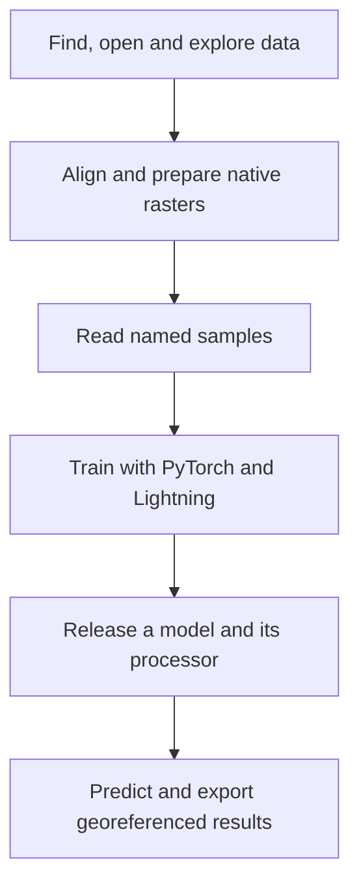

# Contributing

GeoSave aims to make geospatial ML feel like normal Python: native objects,
preserved metadata and explicit computation. Read the
[architecture](architecture.md) for package ownership and contracts.

## Project direction

Each part should also work independently. Keep xarray, GeoPandas, ODC and
PyTorch objects usable outside GeoSave.

| Area | Current focus |
| --- | --- |
| Data | Preserve grid, values and metadata through I/O, preparation and sampling. |
| Models | Share input preparation between training and released inference. |
| Training | Finish recipe/sample integration and migrate older notebooks. |
| Scale | Improve streamed output, source identity and reproducible data/experiment records. |

[Open decisions](open-decisions.md) tracks implementation gaps and unresolved
contracts. [Design notes](design/direction.md) explain the reasoning. They carry
no delivery dates.

## Make a change

1. Trace the caller, native input and expected output.
2. Use a dependency's public operation where it fits; reproduce any gap.
3. Keep changes with their owner and preserve unrelated work.
4. Check values, grids, metadata and execution. Check persistence with a round trip.
5. Update the guide and API docstring; show code followed by its output.

See [documentation maintenance](documentation.md) for example and site checks,
and [contributor guidance](agent-reference.md) for area-specific details.

For layouts of projects *using* GeoSave, see [MLOps](../mlops/index.md).
