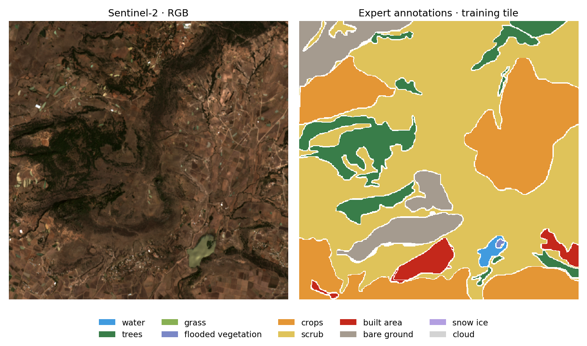

# Examples

Start with a small task, inspect its output, then adapt it to your own data.
The first examples work offline after downloading their small sample files.

## Small complete tasks

| Example | You produce | What you need |
| --- | --- | --- |
| [Your first vegetation map](basics/first-raster.md) | NDVI plot and a GeoTIFF | Base package; 752 KiB image. |
| [Images and labels to chips](basics/training-chips.md) | Image/label plots and named tensors | ML extra; about 520 KiB for the pair. |
| [Run a training workspace](advanced/training.md) | Run configuration and checkpoint | ML extra; supplied Lightning boilerplate. |
| [Compare vegetation by area](advanced/vegetation-zones.md) | Zone summary, CSV and raster | Base package; the vegetation-map sample. |
| [Read overlapping training chips](advanced/overlapping-chips.md) | Aligned image/label samples and a plot | ML extra; the training pair. |
| [Store imagery as a catalog](basics/catalog.md) | Named COG assets and an observation index | Base package; the vegetation-map sample. |

*Reference annotations, not model predictions. Tait et al. (2021),
[Dynamic World training dataset](https://doi.org/10.1594/PANGAEA.933475), CC BY 4.0.
Contains modified Copernicus Sentinel data (2019).*

## Real land-cover project

The notebooks develop one land-cover project using a pinned teaching dataset
with 200 individual expert labels for training, 50 for validation and 50 expert
consensus labels for testing. Same-day Sentinel-2 L2A imagery and scene
classification (SCL) are available for 296 of the 300 scenes. The notebooks
download about 840 MB and select four of the nine reflectance bands for the
models (B02, B03, B04 and B08). [Pinned Dynamic World 300 dataset card](https://huggingface.co/datasets/fatmur/dynamicworld-300/blob/99e1222862a8100eecd8193210cb09b1b61b6c24/README.md).

The expert archive contains all 7,056 original expert annotations across 4,492
scenes. Its label catalog assigns 3,606 individual expert labels to training,
409 sampled expert labels to validation and 409 `_consensus.tif` labels to test.
Same-day imagery is available for 3,554 training, 404 validation and 399 test
scenes. Each dataset assigns its splits independently from the original
Dynamic World workbooks.
[Dynamic World Expert dataset card](https://huggingface.co/datasets/fatmur/dynamicworld-expert).

| Notebook | Focus |
| --- | --- |
| [0 · Basics](https://github.com/weedkat/geosave/blob/main/examples/00_basics.ipynb) | Inspect image/label pairs and train a baseline. |
| [1 · Model](https://github.com/weedkat/geosave/blob/main/examples/01_model.ipynb) | Compose network modules and compare runs. |
| [2 · Find a Sentinel-2 Item](https://github.com/weedkat/geosave/blob/main/examples/02_sources.ipynb) | Compare natural color and NDVI over Jakarta, then save the NDVI crop as a GeoTIFF. |
| [3 · Fine-tune Prithvi on image chips](https://github.com/weedkat/geosave/blob/main/examples/03_inputs.ipynb) | Train on random crops, evaluate merged logits on held-out scenes, and save the trained chain and legend. |
| [4 · Map land cover with the trained model](https://github.com/weedkat/geosave/blob/main/examples/04_pipeline.ipynb) | Build a pipeline stage by stage around lesson 3’s release, map a forest through two dry seasons, and publish the dated maps as COGs with STAC Items. |

Run notebooks from `examples/` with a fresh kernel and the development
environment from `uv sync`. Lessons 0 and 1 compare models on the same tiles.
Lesson 2 runs independently against Microsoft Planetary Computer. Run lesson 3
before lesson 4 so the mapping pipeline can load the trained weights and class
legend from `data/landcover_release/`.

These short runs teach a workflow. Evaluate on independent geography or periods
before making claims about model quality or land-cover change.

## Organize your project

Use [MLOps](mlops/index.md) for repository layouts and MLOps,
[Advanced](advanced/index.md) for larger workflows, and
[Contributing](contributing/index.md) for the library's direction and open work.
