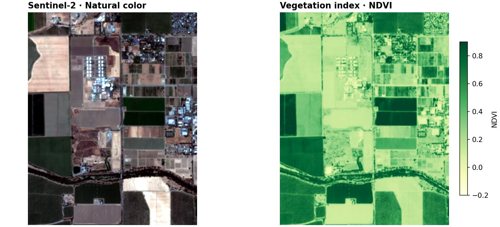
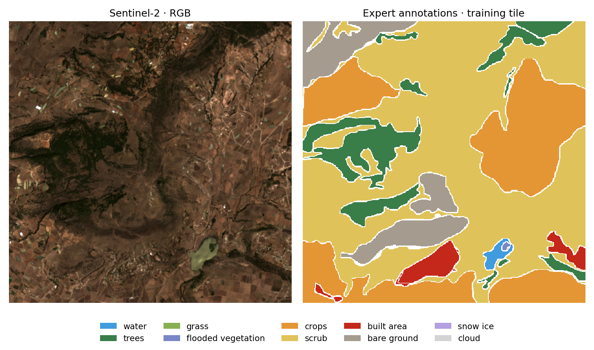
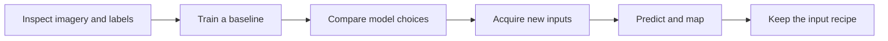

# Examples and projects

Choose a small processing task or follow a complete land-cover project.
Start with the output you want; you do not need to learn model development to
use GeoSave for imagery.

<div class="grid cards" markdown>

-   **Map vegetation in a satellite scene**

    Open a small real Sentinel-2 crop, calculate NDVI, and export a GeoTIFF.
    Base installation; one 752 KiB sample; no GPU or account.

    [Run the vegetation tutorial →](first-raster.md)

-   **Compare vegetation between zones**

    Summarize NDVI and valid coverage from real imagery. Export a map, CSV,
    GeoTIFF, and demonstration polygons. Offline; base installation.

    [Run the zone analysis →](guides/vegetation-zones.md)

</div>



## Real land-cover project



*One paired training tile, not a prediction. Expert labels: Tait et al. (2021),
[Dynamic World training dataset](https://doi.org/10.1594/PANGAEA.933475),
CC BY 4.0. Contains modified Copernicus Sentinel data (2019).*

The notebook series below uses real satellite image/label pairs to explore a
larger workflow. Its teaching dataset is roughly 400 MB, so start with the
small tutorials above if you only want to try the API.



Build a land-cover map from satellite images using ordinary PyTorch Datasets
and Lightning modules.

| Notebook | What you do |
| --- | --- |
| [0 · Basics](https://github.com/weedkat/geosave/blob/main/examples/00_basics.ipynb) | Explore images and labels, train a small model, and plot a prediction. |
| [1 · Model](https://github.com/weedkat/geosave/blob/main/examples/01_model.ipynb) | Swap model parts and compare training runs. |
| [2 · Build a dataset](https://github.com/weedkat/geosave/blob/main/examples/02_sources.ipynb) | Fetch images for labels and a forest outline, then save the files and catalogs. |
| [3 · Train and predict](https://github.com/weedkat/geosave/blob/main/examples/03_inputs.ipynb) | Train on the acquired pairs, join predictions into forest maps, and save the trained model. |
| [4 · Keep the input recipe](https://github.com/weedkat/geosave/blob/main/examples/04_recipe.ipynb) | Reuse that trained model with identical preparation and make a review map for another forest observation. |

The [teaching dataset](https://huggingface.co/datasets/fatmur/dynamicworld-300)
is about 400 MB. Later notebooks reuse that download. Notebook 2 also needs
Planetary Computer access; notebook 3 uses the files it saves. Notebook 4
uses notebook 3's trained-model handoff in `data/landcover/`; it needs no new
download or training run.

The targets are **expert-annotated training labels**, not the automated Dynamic
World product. The subset has ten classes (including cloud), nodata 255, and
four ordered bands: B02, B03, B04, B08. Each notebook pins the dataset snapshot.

Split complete tiles before chipping; inspect overlap between geographic
footprints before claiming generalization. Notebooks 0 and 1 use complete,
prepared pairs. Notebook 2 acquires imagery on each label's grid. Notebook 3
prepares missing coverage before constructing its Dataset and uses matching
image/label chips. Evaluation chips do not overlap, so each original pixel is
counted once; padding is ignored. Overlap and merging belong to the forest
prediction workflow.

The short runs demonstrate the workflow, not operational accuracy. Forest-map
differences can reflect clouds, season, or model errors rather than actual
land-cover change. For a no-download test of training mechanics, use the
explicitly [synthetic chip tutorial](quickstart.md) and
[CPU training smoke test](guides/training.md).

This learning path follows practical concerns illustrated by
[TorchGeo's surface-water tutorial](https://docs.torchgeo.org/en/stable/tutorials/earth_surface_water.html):
paired imagery and labels, preprocessing, evaluation, and geographic output.

## Run the notebooks

```bash
git clone https://github.com/weedkat/geosave.git
cd geosave
uv sync
```

Open a notebook in `examples/`. Select the repository's `.venv` as the kernel
and use `examples/` as the working directory. Run cells in order with a fresh
kernel for each notebook. Later lessons reuse earlier files. Read each
notebook's prerequisites before starting downloads or training.

Each notebook ends with project extensions rather than quizzes.

## Next steps

| I want to… | Read |
| --- | --- |
| Start with pretrained weights. | [Pretrained models](guides/pretrained.md) |
| Run an editable Lightning starter. | [Workspaces](guides/workspaces.md) |
| Save training settings in a project. | [Workspaces](guides/workspaces.md) |
| Declare a model's data requirements. | [ModelSpec](guides/model-spec.md), an Alpha API |
| Prepare spatial and temporal windows. | [Catalogs and cuts](guides/catalogs-and-cuts.md) |
| Publish a model. | [Model releases](guides/release.md) |
