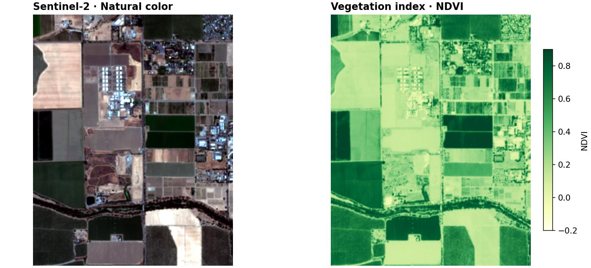

# Your first vegetation map

Open a real satellite image, calculate a vegetation index, and save a result
that you can open in a GIS. No model, catalog, or GPU is needed.

**You need:** the [base installation](install.md) and a small sample download.
The processing steps work offline after downloading the file.



## Open the sample

[Download sample-scene.tif](assets/sample-scene.tif){ .md-button .md-button--primary }

Save this file in the directory where you run Python or your notebook. It is a
752 KiB crop of Sentinel-2 imagery near Davis, California, acquired on
June 27, 2025. It contains four bands on a 10 metre grid.
[Data source and attribution](assets/README.md).

```python
import geosave as gs

scene = gs.open_raster("sample-scene.tif")
list(scene.data_vars), (scene.sizes["y"], scene.sizes["x"])
```

```text
(['red', 'green', 'blue', 'nir'], (337, 267))
```

`scene` is an xarray Dataset. Each variable is one band; `x` and `y` locate the
pixel centres. Opening the file reads its metadata and prepares lazy pixel
reads. You do not need to construct a grid for an already georeferenced file.

## See the image

```python
scene.gs.plot(rgb=("red", "green", "blue"), xlabel="")
```

In a notebook, the final expression displays a natural-color image. In a Python
script, save a plot with `holoviews.save(plot, "scene.png", backend="matplotlib")`,
where `plot` is the returned object. `xlabel=""` avoids a place-name lookup, so
this example stays offline.

## Calculate NDVI

```python
ndvi = gs.features.ndvi(scene, nir="nir", red="red").rename("ndvi")
ndvi.gs.plot(cmap="YlGn", clim=(-0.2, 0.9), xlabel="")
```

NDVI compares near-infrared and red reflectance: `(nir - red) / (nir + red)`.
Higher values often indicate green vegetation. It is an index, not a land-cover
classification; clouds, water, soil, and season affect interpretation.
GeoSave decodes the bands' declared nodata and scale/offset before calculation.
Plotting reads pixels; the calculation itself can remain lazy.

## Save and reopen

```python
files = ndvi.gs.to_cog("output", format_paths="ndvi.tif")
result = gs.open_raster(files[0])
list(result.data_vars), result.gs.geobox == scene.gs.geobox
```

```text
(['ndvi'], True)
```

The Cloud Optimized GeoTIFF at `output/ndvi.tif` keeps the source pixel grid.
You can open it in QGIS or another Python process. Writing computes the result.
GeoSave refuses an existing destination; use `overwrite=True` when intentionally
rerunning the write.

```python
result.close()
scene.close()
```

## Use your own data

Replace `"sample-scene.tif"` with your path. Inspect `list(scene.data_vars)` and
pass your red and near-infrared band names to `ndvi`. A file may use names such
as `B04` and `B08`, or generic names such as `band_1`. Identify their meaning
from the data provider before renaming them. An ordinary RGB photo has no
near-infrared band and cannot supply this NDVI example.

**Next:** [download imagery for your area](guides/download-imagery.md),
[explore this scene on a map](guides/explore.md), or
[crop and prepare your own files](guides/ingest-files.md).
