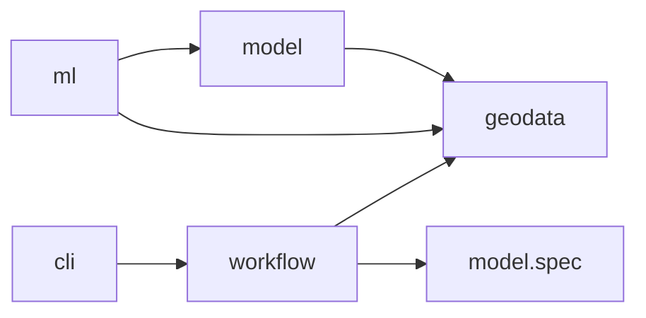

# Package ownership

```python
from geosave_engine import geodata as gs
from geosave_engine.geodata.benchmarks import dynamic_world
from geosave_engine.ml.segmentation import supervised
from geosave_engine.model.spec import ModelSpec
from geosave_engine.workflow.flows import prepare_dense_data
```

GeoSave composes native ecosystem objects. Raster readers return xarray objects;
vector readers return GeoDataFrames; training classes are Lightning classes.

| Package | Owns |
| --- | --- |
| `geodata` | Raster/vector accessors, metadata, public `io`, transforms, STAC, benchmark downloads, visualization. |
| `model` | Chain composition, registry, encoders, decoders, heads, model specifications, native releases. |
| `ml` | Lightning training behavior, task/method datasets and DataModules, builders, augmentation, training callbacks. |
| `workflow` | Serializable runtime configs, complete Prefect flows, reusable tasks. |
| `cli` | Command arguments, workspace creation, optional scaffolds. |
| `templates` | Files copied into generated consumer workspaces. |

Dependencies point from training toward model and data:



Importing geodata, model.spec, or workflow flows does not load torch. Model has
no dependency on ml. Some third-party encoder libraries load Lightning internally;
GeoSave's core chain, heads, registry, and release do not require it.

## Errors and warnings

```python
import warnings

from geosave_engine.geodata.errors import AnchorFetchError
from geosave_engine.geodata.warnings import GeoSaveWarning

warnings.simplefilter("error", GeoSaveWarning)
```

Use `TypeError` for unsupported object types, `ValueError` for invalid values
or incompatible data, and `KeyError` for missing mapping entries. Pydantic
validators raise `ValueError` so malformed specifications remain native
`ValidationError`s. `AnchorFetchError` identifies an empty STAC search separately
from transport and asset failures. `CollectionNotFoundError(LookupError)` lets
recipes try another catalog without swallowing a malformed response's `KeyError`.

Preserve dependency exceptions. Add context with `error.add_note(...)` and
re-raise the same exception. Cleanup handlers also re-raise after closing their
resources. Workflows and Lightning own retry and presentation policy.

Warnings describe operations that continue with data loss, an assumption, or
an incomplete result. Categories live in `geodata.warnings` and inherit from
`GeoSaveWarning`, including Lightning's incomplete validation warning. Emit
geodata warnings with Python's `skip_file_prefixes` set to GeoSave's package
paths so they point to the caller through accessors and nested transforms.

## Data and I/O

```python
from geosave_engine.geodata import io

scene = io.open_raster("scene.tif")
catalog = io.open_vector("samples.parquet")
```

Use format modules such as `io.geotiff`, `io.zarr`, and `io.geoparquet` for
format-specific options. Native `.gs` accessors preserve the fluent write APIs.
Raster operations remain lazy where possible; compute, reprojection, and
coordinate changes are explicit. Reader selection and assembly live in
`geodata.io.readers`; format modules own their file encodings, and
`geodata.io.raster.gdal` owns GDAL configuration. Dimension and coordinate names
live in `geodata.conventions`. Helpers shared across contexts, including
spatial Dask mapping in `utils/dask_mapping.py` and datetime handling, stay
in `geodata.utils`.

Raster features select named bands from one Dataset. Spectral indices decode
packing and nodata metadata on their selected bands before calculating:
variables without storage metadata are treated as reflectance.

```python
from geosave_engine.geodata import features

scene = scene.assign(
    ndvi=features.ndvi(scene, nir="B08", red="B04"),
    evi2=features.evi2(scene, nir="B08", red="B04"),
)
```

Cloud-mask functions expect decoded reflectance; prepare their inputs with
`scene.gs.mask_and_scale()`. Already decoded bands also work with spectral
indices, so one prepared Dataset can be shared across features.

The Dataset owns shared indexes. Features return unnamed DataArrays retaining
their grid and coordinates; assignment names the derived variable. Neighborhood
kernels use native Dask overlap and chunk alignment through `utils/dask_mapping.py`,
with an eager NumPy path for in-memory inputs.

Tensor conversion sits beside NumPy conversion on the accessors:

```python
image = scene[["red", "nir"]].gs.to_tensor(dtype="float32")
layers = sample.gs.to_tensor()  # DataTree group names mapped to tensors
```

Geodata imports no Torch at import time; `to_tensor` imports it when called.
It preserves pixel dtypes by default and reads NumPy-unsupported Torch dtypes
through float32. Model input assembly and target loading use the same
conversion.

Raster format modules own pixel writes and return records of the files they
wrote. STAC Items are built from those records, each file opened once for its
header, kept as a table, and read back through the same format readers:

```python
from geosave_engine.geodata import GeoVector, stac, stack

# A Collection exists on its own; Items are created into it.
forest = stac.create_collection("forest", description="Forest samples")

# The writer returns its files; each record states the file's bands and time.
files = image.gs.to_cog("samples/forest_{time:%Y%m%d}.tif")   # one file per date
rows = stac.create_items(files, collection=forest)             # item table, one row per scene

# An item table is stored as one stac-geoparquet file, Collections in its metadata.
rows.gs.to_geoparquet("samples/catalog.parquet", collections=[forest])

# Data kept over time is a catalog: a suffix-less path writes a folder with one
# file per Collection, so replacing one Collection rewrites only its file.
rows.gs.to_geoparquet("samples/catalog", collections=[forest])
rows = open_vector("samples/catalog")                          # one table again

# Rows are an ordinary GeoDataFrame: filter while reading, then with pandas or `gs`.
rows = open_vector("samples/catalog.parquet", bbox=bounds).gs.query(aoi)
collections = stac.get_collections("samples/catalog.parquet")

# A new batch is concatenated like any vector and the table written again.
more = stac.create_items(new_files, collection=forest)
GeoVector.concat([open_vector("samples/catalog.parquet"), more]).gs.to_geoparquet(
    "samples/catalog.parquet",
    collections=collections.values(),
    overwrite=True,
)

# A stack's files name their collection; each collection is one Item per instant.
sample = stack({"optical": optical, "label": label})
saved = sample.gs.to_cog("samples/s0/{collection}_{time:%Y%m%d}.tif")
rows = stac.create_items(saved, id="s0")
```

`to_cog` returns one `CogFile` record per file the call wrote, stating its
`href`, `bands`, `datetime` and `collection`; files already in the
destination are not listed. Zarr and NetCDF writes return the store's `Path`;
a store is not catalogued as an Item. Writers take no catalog argument.

The records a writer returned are the one source an Item is built from.
`stac.create_items` groups the files sharing a collection, an instant and a
grid into one Item, one asset per file; `stac.create_item` builds one Item
whose assets the caller names. PySTAC builds it, and the modules of
`stac.extensions` write its fields, one module per schema, each through that
schema's PySTAC class: Projection for the grid, Raster and EO for the bands,
Classification for a legend. An Item's id is its identity in the table and
defaults to the saved file's name; `create_items(files, id="{lat:.2f}N_{start:%Y%m%d}")`
fills a `GeoAnchor.format` template per Item instead, and for files naming
their collections `id` is a prefix. `rows.gs.to_geoparquet(..., collections=[...])`
stores Collections in the file's metadata with the extent their rows cover.

A table is also searchable like a STAC API. `StacClient.open` on a Parquet
file or a folder of them returns a table client, which runs the same `StacQuery`
through rustac's DuckDB search, returns an item table from `search`, and builds
the same `StacSource`:

```python
client = stac.StacClient.open("samples/catalog")
rows = client.search(stac.StacQuery(collections=["forest"]).set_filter("eo:cloud_cover <= 10"))
cube = client.source("forest").set_config(bands=["red", "nir"]).load(anchor)
```

Remote tables are read directly by rustac, including their stored Collection
metadata. For an S3-compatible endpoint, configure a native DuckDB session and
pass it to `StacClient.open`:

```python
import rustac

session = rustac.DuckdbClient()
session.execute("""
    CREATE SECRET (
        TYPE s3,
        KEY_ID 'your-access-key',
        SECRET 'your-secret-key',
        ENDPOINT 'localhost:9000',
        URL_STYLE 'path',
        USE_SSL false
    )
""")
client = stac.StacClient.open("s3://samples/catalog.parquet", duckdb=session)
```

DuckDB owns the [S3 secret configuration](https://duckdb.org/docs/stable/core_extensions/httpfs/s3api).
The table client adds no filesystem configuration or local copy of the table.
Asset loaders still use their own native storage configuration.

A source regrids through odc-stac, which does not read STAC 1.1 `bands`: over
a GeoSave table it loads `float32` with the fill value masked, and a
multi-band asset needs `stac_cfg` aliases. A window row's `gs.to_stack()`
reads a GeoSave table's files as they were stored.

PySTAC owns Items, Assets and their extension fields; stac-geoparquet owns the
Arrow conversion and the file format. Item properties become columns and asset
metadata stays nested under `assets`. `table.write` stores asset hrefs relative
to the table and `open_vector` makes them absolute again, so a catalog moved
with its assets still opens. `table.write` also takes a table that was read and
edited, for example with a column of predictions.

GeoVector is a GeoDataFrame with an active geometry column and a CRS. It
requires no column and adds none: a file reads back with the columns it holds.
`gs` offers `crs`, `footprint`, `query`, `rasterize`, `concat`,
`from_geometry` and the format writers. `query` filters by space, and also by
time only where the target has a timespan and the frame carries `datetime`,
`start_datetime` or `end_datetime`; undated rows stay selectable. An anchor is
built by its own constructor,
`GeoAnchor.from_geometry(plots.gs.footprint, resolution=10)`, and
`prediction.gs.vectorize()` turns a flag raster into polygons.

An item table is a GeoVector that happens to carry `id`, `datetime` and
`assets`. A row is one Item: the files of one collection at one instant on one
grid. Windows over the table read themselves as stacks:

```python
rows = open_vector("samples/catalog.parquet")
tree = cuts.stacks(rows, on="label").iloc[0].gs.to_stack()
```

`open_vector` reads any GeoParquet file; one stating `stac_version` is an item
table, and its stored relative hrefs are made openable. STAC
ItemCollection JSON is read with PySTAC and `table.from_items`.

A window reads only its own pixels: each file is sliced onto the row's grid
where it already lies on it, and reprojected otherwise. Sources holding one
variable twice at one instant raise instead of being merged. Close the
returned DataTree to release its source files.

Writers accept an fsspec URL in place of a local path. Zarr and GeoParquet go
through fsspec directly; COG and NetCDF are written locally and uploaded. A
write returns a UPath: a `PosixUPath`, which is a `pathlib.Path`, for a local
file, or the remote UPath carrying its `storage_options`. Every reader accepts
either, so a written result opens as it is. GDAL takes its keys from its own
environment (`configure_gdal`), never from `storage_options`.

```python
forest.gs.to_zarr("hf://buckets/me/samples/forest.zarr")
paths = forest.gs.to_cog(
    "s3://bucket/samples/forest_{time:%Y%m%d}.tif", storage_options=options
)
```

TIFFs are read with GDAL's own remote access (`s3://`, `gs://`, `az://`,
`https://`), set up with `configure_gdal`. A TIFF on a Hugging Face bucket is
read through the bucket's S3 gateway. That needs S3 keys generated from the HF
token (the login token itself is not accepted) and this setup, once per process:

```python
configure_gdal(
    aws_access_key_id="HFAK...",
    aws_secret_access_key="...",
    aws_default_region="us-east-1",
    aws_s3_endpoint="s3.hf.co",
    aws_virtual_hosting=False,
    gdal_disable_readdir_on_open="EMPTY_DIR",   # no listing, no sidecar probes
)
forest = open_raster("hf://buckets/me/samples/forest/forest_20250601T103031.tif")
```

The endpoint is process-wide, so TIFFs on AWS S3 and on a Hugging Face bucket
cannot be read in one process. NetCDF is read from local files only, and a
folder of COGs is scanned only locally.

The [catalog loop design](../superpowers/specs/2026-10-06-catalog-loop-design.md)
and the [remote storage design](../superpowers/specs/2026-10-06-remote-storage-design.md)
record these rules and their smoke tests.

`Palette` and `parse_color` are shared by metadata, persistence, visualization,
and training, so they live in `geodata.utils.color`. Workspace copying
lives in `cli.core.copy`; GDAL configuration owns its private omitted-value
sentinel. There is no root `utils` package.

## Attrs: plain mappings, a few validated groups

xarray keeps attrs through operations, so GeoSave keeps no copy of them. An
attr group is the few keys GeoSave decides on or translates at a format
boundary, validated by one pydantic class in `geodata/attrs/`:

| Group | Keys | Lives on |
| --- | --- | --- |
| `Nodata` | `_FillValue` (reads odc's `nodata` too) | a variable |
| `Packing` | `scale_factor`, `add_offset` | a variable |
| `Legend` | `flag_values`, `flag_masks`, `flag_meanings`, `color_map` | a variable |
| `Spectral` | `common_name`, `center_wavelength`, `full_width_half_max` | a variable |
| `GDALBand` | `variable_name`, `colorinterp` | a variable |
| `TimeSpec` | `time_freq`, `time_closed`, `time_label`, `time_origin`, `time_offset` | the `time` coordinate |

```python
band.gs.nodata                        # 0
band = band.gs.write_nodata(0)        # every key of the group replaced, validated against the dtype
ds["label"].gs.legend.classes         # {0: 'bg', 1: 'palm'}
ds = ds.gs.write_legend({0: "bg", 1: "palm"}, target="label")

attrs.parse(band, attrs.Packing)      # what library code calls; gs properties call it too
xr.concat(rasters, dim="time", combine_attrs=attrs.combine)
```

`gs` properties parse lazily, and `gs.write_*` stamps a group through
`attrs.stamp`. A group reads GDAL's text spelling (`"[0, 1]"`, `"0"`) as the
native value it spells. Every other key, such as `units`, `long_name` or ACDD's
`title`, is a plain attr. Joins pass `combine_attrs=attrs.combine`: a group or
key is kept where every object states it alike; a differing `Nodata`,
`Packing`, `Legend`, `units`, `standard_name` or `cell_methods` refuses the
join; other differences drop with a `DroppedAttrsWarning`.

`to_array` keeps the attrs every band states alike, and `to_raster` gives each
band the array's attrs; attrs only some bands carry are not kept.

The STAC boundary translates in both directions: `stac.extensions` writes
Raster, EO and Classification fields from the groups, and `StacSource.load`
writes the fields every matched Item publishes alike back as CF attrs, the
loader's own attrs winning. The GeoTIFF boundary writes each group into the
band property GDAL keeps for it, and `GeoTIFFTags` the dataset tags.

Zarr I/O records and restores Dataset variable order using the storage attr
`zarr_variable_order`. Model raster requirements name attr keys directly
(`attrs: {data_vars: {"*": {required: [scale_factor]}}}`) and select named
variables in their declared order, independently of storage order.

Raster factories require explicit dimensions: `raster({"red":
(("time", "y", "x"), pixels)}, grid, time=labels)` or
`array(pixels, grid, dims=("time", "y", "x"), time=labels)`. The reference is
a GeoBox, or an xarray object whose coordinates on the variables' dimensions
pass on as-is; keyword coordinates add or replace non-spatial ones.
Constructors use `y, x` for every CRS, with CF coordinate metadata describing
latitude/longitude or projected coordinates. Loaded objects keep their spatial
dimension names. Coordinates label dimensions independently of their order.
Native xarray construction checks ranks and shared lengths, and an exact join
refuses pixels off the reference's coordinates; GeoSave adds grid placement.

Format writers own pixels and return paths. `stac.create_items` turns those
paths into an item table: the private `stac._item` builds PySTAC objects,
`stac.extensions` writes each schema's fields onto them, and the private
`stac._table` owns the Parquet encoding behind `GeoCatalog.to_geoparquet`. COG
scenes are one Item each; datacube stores are not catalogued.

`statistics()` returns a pandas DataFrame for both Dataset and DataArray.
Datasets have one row per variable; arrays with a `band` axis have one row per
labeled band. A single-band array uses its name as the row index, or None when
unnamed. Statistics eagerly read present pixels, excluding NaN and each
variable's nodata value. The shared implementation in `utils/statistics.py`
computes every variable's reductions together, so a common Dask source is read
once rather than once per band.

## Training and model release

A training setup keeps its Lightning Module and DataModule together, task
first, then method:

```text
ml/
├── inputs.py          # model_inputs: a sample's rasters to named tensors
├── metrics.py         # MulticlassMetrics, RegressionMetrics
├── builders/          # criterion, optimizer, scheduler
├── criterion/         # losses the library owns (OHEM)
├── transforms/        # ImageAugmenter, cutmix_boxes
├── segmentation/
│   ├── callbacks.py  calibrate.py  transforms.py
│   ├── supervised/    # module.py, data.py
│   └── fixmatch/      # subclasses supervised: weak view labels the strong view
├── regression/
│   ├── supervised/    # mirrors segmentation; the regression head replaces the segmentation head
│   └── mean_teacher/  # subclasses supervised: EMA teacher's weak view supervises the strong view
├── classification/supervised/
└── pretraining/mim/   # masked image modelling
```

Each task's `data.py` holds its own `Dataset` and a plain `LightningDataModule`
that opens prepared catalogs and finishes batches in `on_after_batch_transfer`.
A method subclasses its task's supervised pair and
changes only its training step; validation, testing and prediction stay the
supervised ones. A Module builds `model_chain` into one `ModelChain`, split
stages or a lone end-to-end model alike, calls `self.model(**model_inputs)`,
computes the loss and updates the metrics; the network graph stays in `model`.
The module producing the result names what it predicts, `classes` or
`variables`, which the Module reads to size its metrics.

Segmentation and regression share the encoder and decoder; only the head
differs. Both merge chip outputs per raster in validation and test and score
each raster whole against its original target.

Batch layouts per task:

| Task | Batch |
|---|---|
| segmentation | `(model_inputs, target (B, y, x), ids, valid)` |
| regression | `(model_inputs, target (B, variable, y, x) with NaN unknown, ids, valid)` |
| classification | `(model_inputs, target (B,), ids, valid)` |
| semi-supervised training | `{"labeled": ..., "unlabeled": (weak, strong, valid)}` |
| pretraining | `(model_inputs, ids, valid)` |

Default training configs live in `templates/workspaces/<task>/configs/`.

The segmentation logger lives beside segmentation behavior because it renders
class masks and argmax logits. Method-specific datasets own targets and batches;
they do not live in model. The GeoVector tile-reference factory owns geometry metadata. Native Tiler and
Merger own pixel tiler and assembly; the training method owns validity and scoring.

ModelSpec owns raster requirements, preprocessing, frames, chips, named raster
inputs, a context recipe over the read rasters, and tensor transforms. Lightning configs own training settings and
augmentation. Scene validation/test reconstruct logits before scoring complete
rasters. Head-owned interpretation and the Panel explorer remain future work.

## Prepare: not settled

`ModelSpec.prepare` raises `NotImplementedError` until the notebook examples
settle the flow. A prepared catalog is, for now, the model inputs saved with
`to_cog` and catalogued with `stac.create_items`, beside the spec as
`model_spec.yaml`. The segmentation `Dataset` reads it and preprocesses
nothing.

Two more parts of the spec keep their YAML fields but raise
`NotImplementedError` until they are redesigned: STAC acquisition
(`ModelSpec.load_rasters`, `StacRecipe.load_raster`; read rasters from a
catalog through `cuts.stacks` and `row.gs.to_stack()` instead) and positional
`channels` selection (declare `variables` by name).

## Cuts: frames and chips as a table of windows

```python
from geosave_engine.geodata import cuts

items = open_vector("data/train")
windows = cuts.stacks(items, on="label")                  # one window per label item
windows = cuts.frames(windows, 4, tolerance="10D")        # split in time
windows = cuts.chips(windows, 224, overlap=32)            # split in space
chip = windows.iloc[0].gs.to_stack()                      # lazy DataTree
```

A cut takes a table and returns one, opening no file. `stacks` lists one
window per item of the `on` collection, joined by the items of every other
collection covering it. Each row is one model input: `anchor` names the item
it was cut around, `parent` the position of the window it was cut from,
`sources` its member Items as JSON, `start_datetime` and `end_datetime` what
they span, `proj:code`, `proj:transform` and `proj:shape` its own grid, and,
for a chip, `chip` its number in its parent's layout, `halo`, `overlap` and
`mode` the layout, and `pad` its pixels past the parent. Footprints use
EPSG:4326. A chip fills past its parent by `reflect`, `edge` or `constant`;
it reads only its own pixels, so it cannot wrap.

The window table is a plain GeoDataFrame derived from the item table and the
model spec. Hrefs are absolute and `sources` is text, so a table written with
`gs.to_geoparquet` reads the same pixels in another process. `ModelSpec`
declares the cuts: `spec.frames.cut(windows)` and `spec.chips.cut(windows)`.

Partition item tables as separate train and validation catalogs. GeoSave does
not generate a `split` column.

Keep positions beside tensors. A dataset returns each chip's row position in
its `windows` table beside the tensors; `windows.iloc[position]` is the row.

ModelChain composes native terminal results: a single result stays bare; multiple
results return under stage names. A terminal can be a Tensor or a native list,
dict, or tuple. This result contract adds no universal decoding or merging policy.

## Import migration

| Previous path | Current path |
| --- | --- |
| `geodata.utils.io` | `geodata.io` |
| `utils.file_ops.safe_copy` | `cli.core.copy.safe_copy` |
| `utils.colorize.Palette`, `parse_color` | `geodata.utils.color` |
| `ml.callbacks.DensePredictionLogger` | `ml.segmentation.callbacks.DensePredictionLogger` |
| GeoSave `Tiles`, `TileMerger` | Native `tiler.Tiler`, `tiler.Merger` |
| `Tiles.reference(...)`, `chip_windows(...)` | `cuts.chips(windows, size, overlap=...)` |
| `stack_frames(tree, ...)`, `FramesSpec.cut(tree)` | `cuts.frames(windows, ...)`, `FramesSpec.cut(windows)` |
| `crop_record(parent, row)` | `window.gs.to_stack()` |
| `ChipsSpec.tiler(shape)` | `ChipsSpec.layout(shape)`, `cuts.layout(...)` |

The table's paths are relative to `geosave_engine`. Top-level geodata readers
remain available. Old paths have no compatibility aliases.


Saved chip outputs merge back with `cuts.merge`: an item table of chip COGs,
each on its chip's grid, with a `chip` column holding the chip's row position:

```python
merged = cuts.merge(dataset.frames, dataset.windows, predictions, taper=spec.chips.window)
```

How predictions are written is not settled: what an output becomes depends
on the head (a raster per chip, a column per window, or boxes), so
`ChipWriter` raises `NotImplementedError` for now. Validation inside the
training loop merges live to score each raster whole, on one device.

A layout is rebuilt, not stored: `cuts.layout(shape, size, overlap=..., mode=...)`
returns the same Tiler and halo every time, so a merge uses what a cut used.
Pixel slicing, halo padding, and coordinate restoration live in
`transform.crop.window`, which accepts native xarray data and pixel bounds
independently of a catalog.

Overlapping chips sit over a halo around their parent; the merger rebuilds
the same layout to unpad it. The segmentation method tracks completion and accumulates masked
logits plus coverage through native Merger with the same taper. Invalid values
do not dilute valid neighbours; uncovered output is excluded from scoring.
Parent-sized buffers are released when a scene completes.

Supervised batches are `(model_inputs, target, ids, valid)`, with `ids` the
chips' positions in `windows`. Validation/test blend logits and read original
categorical labels from each completed frame; labels never pass through
numeric blending. Prediction batches and Lightning
`predict_step` remain `(model_inputs, ids)` and `(logits, ids)`.


Encoder `model_context(raster)` functions encode the time labels and grid of
the raster they receive. `ModelSpec.context` declares the function used in
training and inference, referencing rasters as inputs do
(`kwargs: {raster: !ref image}`);
`ml.inputs.model_inputs(spec, rasters, context=...)`
converts rasters and optional explicit cached context to tensors.

`ImageAugmenter` builds native Kornia pipelines from YAML `name`/`init_args`
entries, including nested pipelines and default crop sizes. Supply `data_keys`
when calling it with multiple tensors; a single image defaults to `input`.
Its `DataKey` type lists image, mask, box, keypoint, and class keys. `bbox_xyxy`
uses Pascal VOC pixel corners, `bbox_xywh` uses COCO pixel origin/size, and
`bbox_yolo` uses normalized
center/size. YOLO boxes are converted to pixel corners for Kornia and normalized
using the augmented image dimensions afterward; class IDs travel separately
under `class` or `label`. Training methods own box clipping and filtering. The
supervised DataModule owns when to apply them and how to keep temporal images
and targets aligned. Validation/test currently require a single device: ordinary
distributed tile sampling cannot complete each scene on one rank.

```python
from geosave_engine.ml.transforms import ImageAugmenter

augmenter = ImageAugmenter(
    [{"name": "RandomHorizontalFlip", "init_args": {"p": 0.5}}], size=256
)
pixels = augmenter(image)
pixels, moved_boxes = augmenter(image, boxes, data_keys=["input", "bbox_yolo"])
pixels, moved_mask = augmenter(image, mask, data_keys=["input", "mask"])
```
