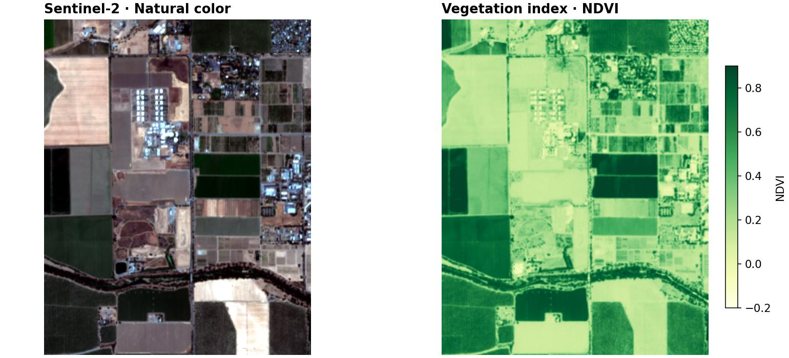

# Download satellite imagery for an area

Find Sentinel-2 imagery, load four bands over a small area, and save a local
GeoTIFF. This example uses agricultural fields near Davis, California.

**You need:** the [base installation](../install.md) and internet access.
This Earth Search example uses public HTTPS assets and needs no account.
Other providers may require credentials. The area is roughly 3 × 3 km;
network transfer includes source raster blocks and can exceed the output size.



## Find observations

```python
import geosave as gs
from geosave.geodata import stac

bbox = (-121.82, 38.52, -121.79, 38.55)
client = gs.StacClient.open("element84")
query = gs.StacQuery(
    collections=["sentinel-2-l2a"],
    bbox=bbox,
    datetime="2025-06-27T00:00:00Z/2025-06-27T23:59:59Z",
    max_items=10,
)
items = client.search_items(query)
if not items:
    raise ValueError("No scenes found; widen the dates or change the area")
item = min(items, key=lambda item: item.properties.get("eo:cloud_cover", 100))
item.id, item.properties.get("eo:cloud_cover")
```

The bounding box is `(west, south, east, north)` in longitude/latitude degrees.
Search retrieves metadata, not imagery. Each STAC Item describes an observation
and the files containing its bands. We select the least cloudy of the returned
Items; `max_items` caps the candidates, and the cloud estimate covers the full
source scene, not just this crop.

## Read a bounded region

```python
from odc.geo.geobox import GeoBox
from odc.geo.geom import BoundingBox

# The grid is an explicit choice: this bbox at 10 m in UTM zone 10N.
grid = GeoBox.from_bbox(
    BoundingBox(*bbox, crs="EPSG:4326").to_crs("EPSG:32610"), resolution=10
)
scene = stac.load_dataset(
    [item], grid,
    bands=["red", "green", "blue", "nir"],
    collection=client.collection("sentinel-2-l2a"),
).isel(time=0)
# Earth Search's COG conversion has already applied the offset for this Item.
if item.properties.get("earthsearch:boa_offset_applied"):
    scene = scene.gs.write_scale_offset(1e-4, 0)
scene.gs.plot(rgb=("red", "green", "blue"), xlabel="")
```

The result is an xarray Dataset on a 10 metre UTM grid. Selecting `time=0`
removes the one-date axis. Loading builds lazy reads; plotting retrieves the
pixels needed for the view. The requested bounds are snapped to the output
pixel grid. Preview the image before using it: a low scene-wide cloud score
does not guarantee a clear crop.

For this Earth Search Item, `earthsearch:boa_offset_applied` is true: its COG
pixels have already had the additive offset applied. We therefore record zero
remaining offset before decoding reflectance. This is provider-specific;
do not copy the override to other products. Earth Search has
[reported offset metadata inconsistencies](https://github.com/Element84/earth-search/issues/71),
so check the product and provider metadata when changing sources.

## Save locally

```python
files = scene.gs.to_cog("imagery", format_paths="scene.tif")
local = gs.open_raster(files[0])
list(local.data_vars)
```

```text
['red', 'green', 'blue', 'nir']
```

`imagery/scene.tif` contains the selected region and four bands, with their grid
and value metadata. The write performs the actual pixel reads needed to save
it. Pass `overwrite=True` to intentionally replace an earlier result.

```python
local.close()
scene.close()
```

## Change the area or source

| Change | Edit |
| --- | --- |
| Your area | `bbox`, using longitude before latitude. Keep the first request small. |
| Your dates | `datetime`, using an ISO date interval. Broaden it when no observations match. |
| Your grid | `crs` and `resolution`. Choose a suitable projected CRS for metre-based resolution. |
| Your bands | `bands`. Names depend on the collection/provider; inspect `item.assets`. |
| Several dates | Load selected Items together and retain the time axis. Choose a dated filename when saving separate TIFFs. |

For Planetary Computer, pass `patch_url=client.patch_url` to the loader so it
can sign asset URLs. Searching a catalog and authenticating its raster files
are separate operations. See [STAC search and loading](stac.md) for providers,
filters, collections, and advanced loading choices.

**Next:** [calculate NDVI](../first-raster.md#calculate-ndvi),
[explore on a map](explore.md), or [prepare existing files](ingest-files.md).
If a request fails, start with [acquisition troubleshooting](../troubleshooting.md#search-and-download).
