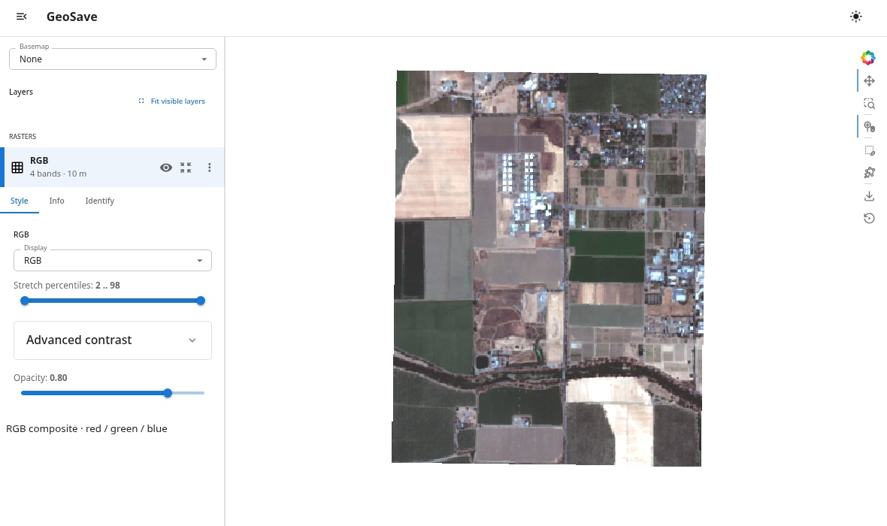

# Explore imagery on a map

Inspect bands, zoom into a region, and compare raster and vector layers without
building a dashboard yourself.

**You need:** the [base installation](../install.md) and the
[sample scene](../first-raster.md#open-the-sample). A live Python process serves
the controls. Basemaps need internet access; choose `basemap="None"` to view
local imagery without a basemap.



## Open the viewer

In a notebook, run:

```python
import geosave as gs

scene = gs.open_raster("sample-scene.tif")
viewer = scene.gs.explore(rgb=("red", "green", "blue"), basemap="None")
viewer
```

The final expression displays the viewer inline. Try these controls:

1. Choose a band or **RGB** in **Display**.
2. Zoom into a field and adjust the contrast.
3. Open **Info** to inspect the selected layer's metadata.
4. Open **Identify** and click the map to inspect values.

The viewer's display settings do not change the source pixels. Viewing pixels
does perform reads; laziness does not mean a map can display without loading data.

## Compare inputs and a derived layer

```python
ndvi = gs.features.ndvi(scene, nir="nir", red="red").rename("ndvi")
comparison = viewer * ndvi.gs.explore()
comparison
```

The sidebar lists the image and index independently. Switch their visibility,
adjust opacity, or use the comparison controls. You can also add a GeoDataFrame
of polygons, or explore a catalog to select which footprints and raster assets
to display.

## Open it in a browser

To serve the original view, call `viewer.serve()`. To serve the comparison
you just constructed, use:

```python
comparison.serve()
```

This starts a local server and opens a browser tab. Keep the Python process
running. A notebook cell returns while the server runs in the background; in
a script, put `.serve()` last: it blocks until you press Ctrl+C. Use
`comparison.stop()` to stop a notebook server. If port 5006 is occupied, use
`comparison.serve(port=5007)`. Construct all layers before serving; creating a
new viewer does not update an already served one.

When finished, close the viewers and then the file:

```python
comparison.close()
viewer.close()
scene.close()
```

**Next:** [explorer controls, catalogs, and performance](../concepts/explorer.md).
For a static figure suitable for a report, use
[`.gs.plot()`](../basics/rasters.md#plot-a-band).
