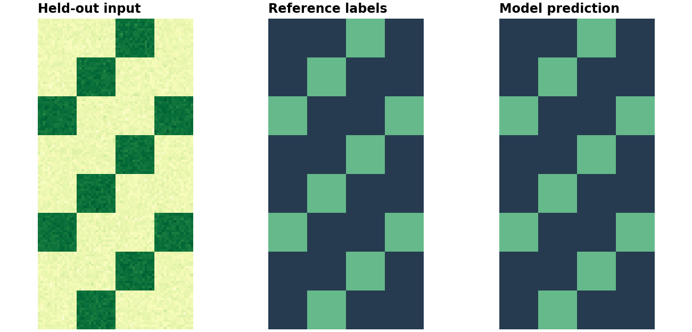

# Train a model and map its predictions

!!! tip "Looking for a real geospatial project?"
    Start with the [land-cover notebooks](../examples.md#real-land-cover-project)
    to train on real Sentinel-2 imagery and expert annotations. This page uses
    synthetic data to check the training, checkpoint, and raster-export mechanics
    offline; its accuracy is not a geospatial benchmark.


Continue from [images to training chips](../quickstart.md): use the saved
`training-scene.tif`, train a small segmentation model, and put predictions
back on the source grid.

**You need:** `geosave[ml]` and the file created by the previous tutorial.
This runs on CPU without downloads. The synthetic labels have a deliberately
easy relationship to the input bands; the result demonstrates training and
geographic export, not real-world model quality.



## Return one sample from a Dataset

```python
import lightning as L
import torch
import xarray as xr
import torch.nn.functional as F
from torch import nn
from torch.utils.data import DataLoader, Dataset

import geosave as gs

L.seed_everything(7, workers=True)
scene = gs.open_raster("training-scene.tif")

class RasterDataset(Dataset):
    def __init__(self, scene):
        self.chips = gs.Chips([scene[["red", "nir", "label"]]], size=32)

    def __len__(self):
        return len(self.chips)

    def __getitem__(self, index):
        chip = self.chips[index].gs.to_numpy(dtype="float32")
        image = torch.from_numpy(chip[:2])
        target = torch.from_numpy(chip[2]).long()
        return image, target
```

The Dataset owns pixel reads, band order, and label conversion. Each chip is a
lazy Dataset, so time or location inputs for the model come from it too. It returns a
plain `(image, target)` tuple. Keep `scene` open until training and prediction
finish: each sample reads its pixels on demand. This tutorial uses its own LightningModule;
GeoSave's generated recipes declare their own sample contracts.

## Separate training and validation regions

```python
train = RasterDataset(scene.isel(x=slice(0, 64)))
valid = RasterDataset(scene.isel(x=slice(64, 128)))
train_loader = DataLoader(train, batch_size=4, shuffle=True, num_workers=0)
valid_loader = DataLoader(valid, batch_size=4, num_workers=0)
```

The two halves contain different pixels. Real experiments need independent
scenes or geographic regions and a reserved test set. Spatial correlation can
make even non-overlapping nearby samples overly similar; choose the separation
according to the question you want the model to answer.

## Define the model and loss

```python
class Segmenter(L.LightningModule):
    def __init__(self):
        super().__init__()
        self.network = nn.Sequential(
            nn.Conv2d(2, 8, kernel_size=1),
            nn.ReLU(),
            nn.Conv2d(8, 2, kernel_size=1),
        )

    def forward(self, image):
        return self.network(image)

    def training_step(self, batch, batch_idx):
        image, target = batch
        loss = F.cross_entropy(self(image), target)
        self.log("train_loss", loss)
        return loss

    def validation_step(self, batch, batch_idx):
        image, target = batch
        loss = F.cross_entropy(self(image), target)
        self.log("val_loss", loss)

    def configure_optimizers(self):
        return torch.optim.Adam(self.parameters(), lr=0.03)

model = Segmenter()
trainer = L.Trainer(
    accelerator="cpu", devices=1, max_epochs=20,
    logger=False, enable_checkpointing=False, enable_model_summary=False,
)
trainer.fit(model, train_loader, valid_loader)
```

Each pixel produces two class scores. Cross-entropy compares them with the
integer target. Lightning handles the training loop and validation. This tiny
network uses only each pixel's bands; spatial models and pretrained encoders
can learn richer patterns.

## Predict on the held-out region

```python
model.eval()

def predictions():
    for key in valid.chips:
        chip = valid.chips[key].gs.to_numpy(dtype="float32")
        image = torch.from_numpy(chip[:2])
        with torch.inference_mode():
            scores = model(image.unsqueeze(0))[0].numpy()
        yield key, scores

pixels = valid.chips.merge(predictions())[0]
source = valid.chips.xarray[0]
scores = xr.DataArray(pixels, dims=("class", "y", "x")).gs.write_grid(source.gs.geobox)
prediction = scores.argmax("class").astype("uint8").rename("prediction")
prediction.gs.to_cog("output", format_paths="prediction.tif", overwrite=True)
prediction.gs.plot(cmap=["#263b50", "#65b98b"], xlabel="")
```

The DataLoader added a batch dimension during training; here `unsqueeze(0)`
adds one for inference. We merge class scores on the chip grid before choosing
the winning class. `Chips.merge()` returns NumPy; `gs.write_grid` places it on the
validation region's grid, so
`output/prediction.tif` can be opened in a GIS.

## Save and reload the trained model

```python
trainer.save_checkpoint("segmenter.ckpt")
restored = Segmenter.load_from_checkpoint("segmenter.ckpt").eval()
scene.close()
```

Keep the `Segmenter` Python definition with this Lightning checkpoint.
A checkpoint preserves training state and weights; it is different from a
[portable GeoSave model release](release.md).

## Take this to real imagery

| Change | What to check |
| --- | --- |
| Replace the synthetic scene | Match grids, decode imagery, handle invalid pixels, and verify class codes before tensor conversion. |
| Add input bands | Keep channel order consistent and change the first layer's input count. |
| Add classes | Change the output count and use integer targets in the matching range. |
| Use missing labels | Set an ignore code and configure both loss and metrics to ignore it. |
| Evaluate quality | Use independent regions and per-class metrics; inspect prediction maps as well as aggregate scores. |

Follow the [real land-cover project](../examples.md) for satellite image/label
pairs. Use [pretrained encoders](pretrained.md) when you are ready to fine-tune,
and [workspaces](workspaces.md) for editable training recipes and configuration.
The [model-input guide](model-spec.md) covers sharing preparation between
training and inference.
