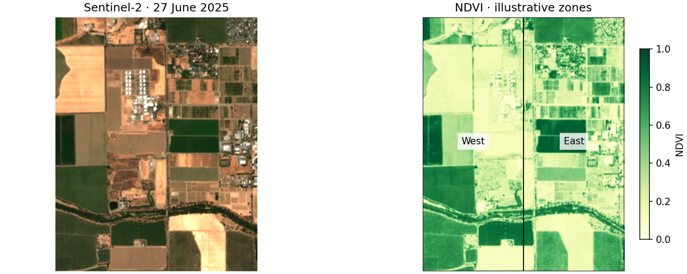
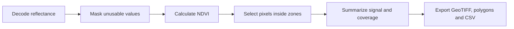

# Compare vegetation within an area

**Question:** which part of a scene has a stronger vegetation signal, and how
much of each area has usable data?

Produce an NDVI GeoTIFF, the zone polygons, and a CSV summarizing two zones in
a real Sentinel-2 scene near Davis, California. This is a small spatial
screening exercise, useful before a field visit or a more detailed time-series
analysis.



**You need:** the [base installation](../install.md) and the
[sample scene](../first-raster.md#open-the-sample). No network request,
credentials, GPU, or training dependencies.



## Calculate NDVI on usable pixels

```python
from pathlib import Path

import geopandas as gpd
import pandas as pd
from shapely.geometry import box

import geosave as gs
from geosave.geodata import io

scene = gs.open_raster("sample-scene.tif")
reflectance = scene.gs.mask_and_scale()
red, nir = reflectance["red"], reflectance["nir"]
usable = (red >= 0) & (nir >= 0) & (red + nir > 0)
ndvi = (
    gs.features.ndvi(scene, nir="nir", red="red")
    .where(usable)
    .rename("ndvi")
    .gs.write_nodata(float("nan"))
)
```

`mask_and_scale` decodes the TIFF's scale and offset and turns nodata into NaN.
The mask also excludes negative reflectance and nonpositive denominators.
Declaring NaN as nodata lets `crop` mask pixels outside a polygon below.

## Define two zones

```python
bounds = scene.gs.bounds
middle = (bounds.left + bounds.right) / 2
zones = gpd.GeoDataFrame(
    {"zone": ["West", "East"]},
    geometry=[
        box(bounds.left, bounds.bottom, middle, bounds.top),
        box(middle, bounds.bottom, bounds.right, bounds.top),
    ],
    crs=bounds.crs,
)
```

The West and East polygons are illustrative halves of the image, **not farm
boundaries**. Do not interpret their averages as individual crop measurements.

## Summarize each zone

```python
pixel_area = abs(scene.gs.resolution.x * scene.gs.resolution.y)
rows = []
for zone, geometry in zip(zones["zone"], zones.geometry):
    inside = ndvi.gs.crop(gpd.GeoSeries([geometry], crs=zones.crs)).compute()
    valid = int(inside.count())
    rows.append({
        "zone": zone,
        "mean": float(inside.mean()),
        "median": float(inside.median()),
        "valid_pixels": valid,
        "coverage": valid / inside.size,
        "valid_hectares": valid * pixel_area / 10_000,
    })
summary = pd.DataFrame(rows).set_index("zone").round(3)
summary
```

```text
       mean  median  valid_pixels  coverage  valid_hectares
zone
West  0.391   0.299         45158     1.000          451.58
East  0.417   0.371         44821     0.993          448.21
```

`crop` keeps the polygon's bounding pixels and masks those whose centres fall
outside it. `coverage` is the fraction of the zone's pixels that remain valid.
At this scene's 10 metre UTM resolution, each pixel represents 100 square
metres. Each zone is small, so computing it reads only that zone's pixels.

## Save the results

```python
output = Path("output/vegetation-zones")
output.mkdir(parents=True, exist_ok=True)
io.write_cog(ndvi.to_dataset(), output / "ndvi.tif", overwrite=True)
zones.to_file(output / "zones.geojson")
summary.to_csv(output / "summary.csv")
scene.close()
```

| Output in `output/vegetation-zones/` | Use it for |
| --- | --- |
| `ndvi.tif` | Open the index in QGIS or another GIS. |
| `zones.geojson` | Inspect the two demonstration polygons. |
| `summary.csv` | Compare mean, median, valid-pixel count, coverage, and area. |

**Valid coverage is not cloud-free coverage.** This small sample has no scene
classification band. The example masks unusable numeric values; inspect the
RGB image for cloud and shadow before interpreting the summary. For routine
monitoring, acquire a quality layer and apply a documented cloud/shadow mask.

## Adapt it to a real project

| Decision | What to change |
| --- | --- |
| Which fields or management areas? | Load your polygons with `gs.open_vector`, reproject them to the raster CRS with `to_crs`, and keep a stable zone ID. |
| Which observation? | [Download imagery](download-imagery.md) for your area and date; inspect both image quality and valid coverage. |
| Which pixels count? | Combine nodata with an appropriate cloud/shadow mask. Report the denominator and missing area. |
| Are the zones comparable? | Compare similar land cover or crop types. Mixed land uses can explain different means. |
| Does the difference persist? | Repeat on a common grid over several dates, retain observation counts, and compare similar seasons. |

A single-date index is not a crop-health diagnosis, yield estimate, or drought
anomaly. A high mean can also hide mixed vegetation and bare ground; compare
the map, median, and coverage before deciding what to investigate.

## Practitioner references

[Digital Earth Africa's crop-health example](https://docs.digitalearthafrica.org/en/latest/sandbox/notebooks/Real_world_examples/Crop_health.html)
compares vegetation time series between planting areas. It motivates the
question and the progression to repeated observations; this starter implements
only the small, single-date spatial comparison.

[The Earth Engine s2cloudless tutorial](https://developers.google.com/earth-engine/tutorials/community/sentinel-2-s2cloudless)
shows why cloud and shadow masking deserves its own processing step. Its mask
is not implemented in this starter.

**Next:** [download your own imagery](download-imagery.md) or
[explore the scene on a map](explore.md).
