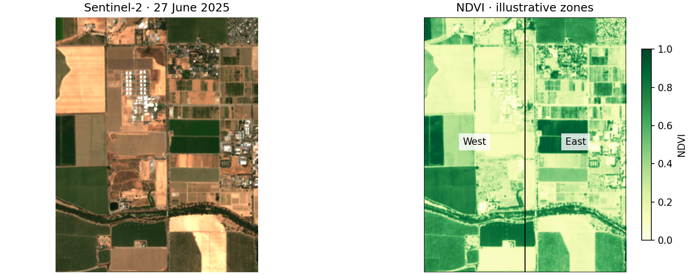
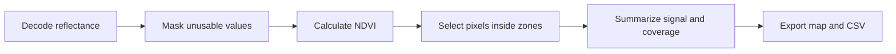

# Compare vegetation within an area

**Question:** which part of a scene has a stronger vegetation signal, and how
much of each area has usable data?

Produce an NDVI GeoTIFF, a map, and a CSV summarizing two zones in a real
Sentinel-2 scene near Davis, California. This is a small spatial screening
exercise, useful before a field visit or a more detailed time-series analysis.



## Run it

**Requires:** the base package and a repository checkout. Uses the bundled
752 KiB sample; no network request, credentials, GPU, or training dependencies.
From the repository root:

```bash
python examples/vegetation_zones.py
```

The [complete Python example](https://github.com/weedkat/geosave/blob/main/examples/vegetation_zones.py)
is deliberately independent of the training notebooks.

| Output in `outputs/vegetation-zones/` | Use it for |
| --- | --- |
| `ndvi.tif` | Open the index in QGIS or another GIS. |
| `zones.geojson` | Inspect the two demonstration polygons. |
| `summary.csv` | Compare mean, median, valid-pixel count, coverage, and area. |
| `map.png` | Review the zones beside the original image. |

Rerunning replaces this example's outputs. Use `--output another-folder` to
keep a separate run.

## Follow the analysis



The script decodes the TIFF's scale and offset before calculating NDVI. It
excludes missing or negative reflectance and nonpositive denominators. Each
polygon selects pixels by their centers; the CSV reports how many of those
pixels remain valid. At this scene's 10 metre UTM resolution, each pixel
represents approximately 100 square metres.

**Valid coverage is not cloud-free coverage.** This small sample has no scene
classification band. The example masks unusable numeric values; inspect the
RGB image for cloud and shadow before interpreting the summary. For routine
monitoring, acquire a quality layer and apply a documented cloud/shadow mask.

The West and East polygons are illustrative halves of the image, **not farm
boundaries**. Do not interpret their averages as individual crop measurements.

## Adapt it to a real project

| Decision | What to change |
| --- | --- |
| Which fields or management areas? | Load your own polygon file, reproject it to the raster CRS, and retain a stable zone ID. |
| Which observation? | [Download imagery](download-imagery.md) for your area and date; inspect both image quality and valid coverage. |
| Which pixels count? | Combine nodata with an appropriate cloud/shadow mask. Report the denominator and missing area. |
| Are the zones comparable? | Compare similar land cover or crop types. Mixed land uses can explain different means. |
| Does the difference persist? | Repeat on a common grid over several dates, retain observation counts, and compare similar seasons. |

A single-date index is not a crop-health diagnosis, yield estimate, or drought
anomaly. A high mean can also hide mixed vegetation and bare ground; compare
the map, median, and coverage before deciding what to investigate.

## Practitioner references

[Digital Earth Africa's crop-health example](https://docs.digitalearthafrica.org/en/latest/sandbox/notebooks/Real_world_examples/Crop_health.html)
compares vegetation time series between planting areas. It motivates the
question and the progression to repeated observations; this starter implements
only the small, single-date spatial comparison.

[The Earth Engine s2cloudless tutorial](https://developers.google.com/earth-engine/tutorials/community/sentinel-2-s2cloudless)
shows why cloud and shadow masking deserves its own processing step. Its mask
is not implemented in this starter.

**Next:** [download your own imagery](download-imagery.md) or
[build a land-cover model from real images and labels](../examples.md#real-land-cover-project).
