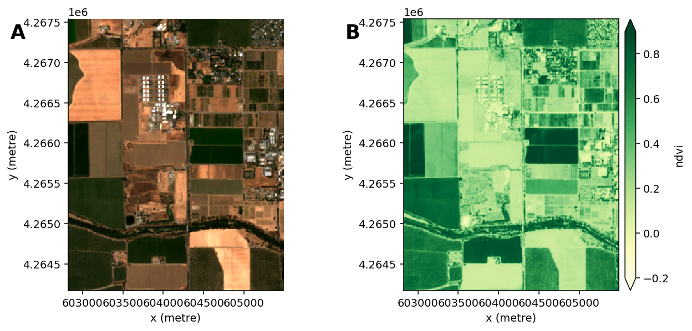

---
hide:
  - toc
---

# GeoSave

Work with geospatial data in familiar Python. Open imagery, explore maps,
prepare samples, train models and export predictions with their locations intact.

Your data stays in **xarray**, **GeoPandas** and **PyTorch** objects. Use GeoSave
in a notebook, a script or an existing project, choosing the operations you need.

[Start with the basics](basics/index.md){ .md-button .md-button--primary }
[Install GeoSave](basics/install.md){ .md-button }

## Map vegetation from imagery

With the [sample scene](basics/first-raster.md#open-the-sample), compare imagery and NDVI:

```python
import geosave as gs

scene = gs.open_raster("sample-scene.tif")
ndvi = gs.features.ndvi(scene, nir="nir", red="red").rename("ndvi")
preview = scene.gs.plot(rgb=("red", "green", "blue"), xlabel="") + ndvi.gs.plot(
    cmap="YlGn", clim=(-0.2, 0.9), xlabel="",
)
preview
```



`scene` is an xarray Dataset; `ndvi` is a DataArray on the same grid.
[Follow the example](basics/first-raster.md) to save and reopen the result.

## What you can do

| Feature | Try it |
| --- | --- |
| Read and write GeoTIFF, Zarr, NetCDF and vector files | [File I/O](basics/io.md) |
| Inspect rasters and vectors on interactive maps | [Explorer](basics/explore.md) |
| Crop, align, decode values and calculate indices | [Prepare imagery](advanced/crop-imagery.md) |
| Search satellite observations by area and date | [STAC](advanced/stac.md) |
| Read aligned training chips and blend model predictions | [Training samples](basics/training-chips.md), [chip placement and merging](reference/chips.md) |
| Compose models with supported pretrained encoders | [Models](advanced/pretrained.md) |
| Train with ordinary PyTorch Datasets and Lightning | [Training](advanced/training.md) |
| Save trained weights and model architecture | [Model releases](advanced/release.md) |
| Inspect the region workflow contract | [Prediction flow](reference/workflow.md) |

## Find your level

| Section | Read it for |
| --- | --- |
| [Basics](basics/index.md) | Small steps, code and visible outputs. |
| [Advanced](advanced/index.md) | Combine operations for larger workflows. |
| [Concepts](concepts/index.md) | Grids, metadata, laziness and model contracts. |
| [API Reference](reference/index.md) | Exact parameters, defaults and return values. |
| [MLOps](mlops/index.md) | Version data and experiments, evaluate and release models. |

[Examples](examples.md) offers complete tasks.
[Contributing](contributing/index.md) explains the project's direction and open work.

!!! note "Alpha software"
    These docs follow `main`. Check [installation and versions](basics/install.md)
    when an installed release differs.
