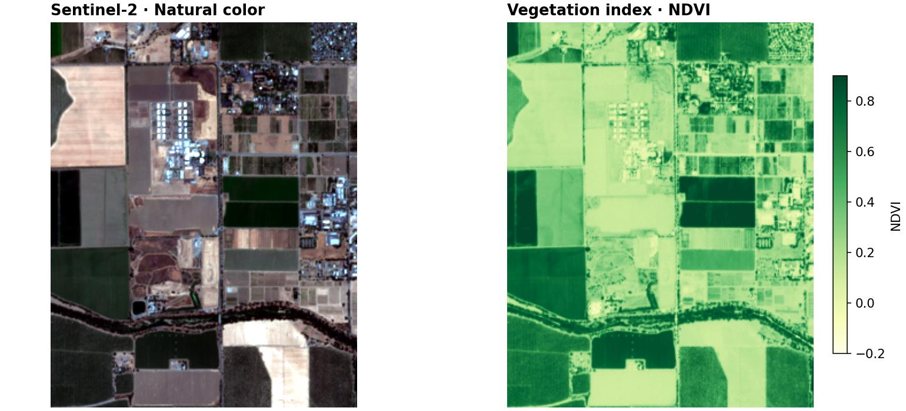

---
hide:
  - toc
---

# Geospatial work, familiar Python

GeoSave helps you find satellite imagery, prepare geospatial datasets, explore
maps, and build models with pretrained encoders. Work with **xarray, GeoPandas,
and PyTorch Lightning**, while keeping geographic information attached.

[Get started](first-raster.md){ .md-button .md-button--primary }
[Install GeoSave](install.md){ .md-button }

## Python you already know

With the [sample scene](first-raster.md#open-the-sample), a vegetation map is:

```python
import geosave as gs

scene = gs.open_raster("sample-scene.tif")
ndvi = gs.features.ndvi(scene, nir="nir", red="red").rename("ndvi")
ndvi.gs.to_cog("output", format_paths="ndvi.tif")
```

`scene` is an xarray Dataset. Select bands with `scene[["red", "nir"]]`, use
ordinary xarray arithmetic, and call `.gs` for geospatial operations. You can
bring GeoSave into an existing project one operation at a time.

{ .gs-home-preview }

*One scene, two views: Sentinel-2 natural color and NDVI. Contains modified
Copernicus Sentinel data (2025). [Run this example](first-raster.md).*

## What you can do

<div class="grid cards" markdown>

-   **Find and download imagery**

    Search satellite catalogs by area and date. Select bands, read a small
    region, and save a GeoTIFF you can use in Python or a GIS.

    [Download your first scene →](guides/download-imagery.md)

-   **Explore on a map**

    Inspect bands, browse footprints, and compare raster and vector layers.

    [Open the explorer →](guides/explore.md)

-   **Prepare geospatial data**

    Crop, align, calculate spectral indices, and save results with their
    georeferencing. Keep large rasters lazy until you need the pixels.

    [Process your files →](guides/ingest-files.md)

-   **Start from pretrained models**

    Use supported Prithvi, Clay, and DINOv3 encoders for your own imagery.

    [Choose an encoder →](guides/pretrained.md)

-   **Make training samples**

    Turn aligned imagery and labels into chips and ordinary PyTorch tensors.

    [Prepare your first chips →](quickstart.md)

-   **Train with Lightning**

    Train on real imagery and labels, then export predictions as maps.

    [Train on real imagery →](examples.md#real-land-cover-project)

</div>

!!! note "Alpha software"
    GeoSave is in active development. These docs follow the source on `main`;
    a published release may differ. The [installation guide](install.md)
    explains releases, test builds, and checking your installed version.
