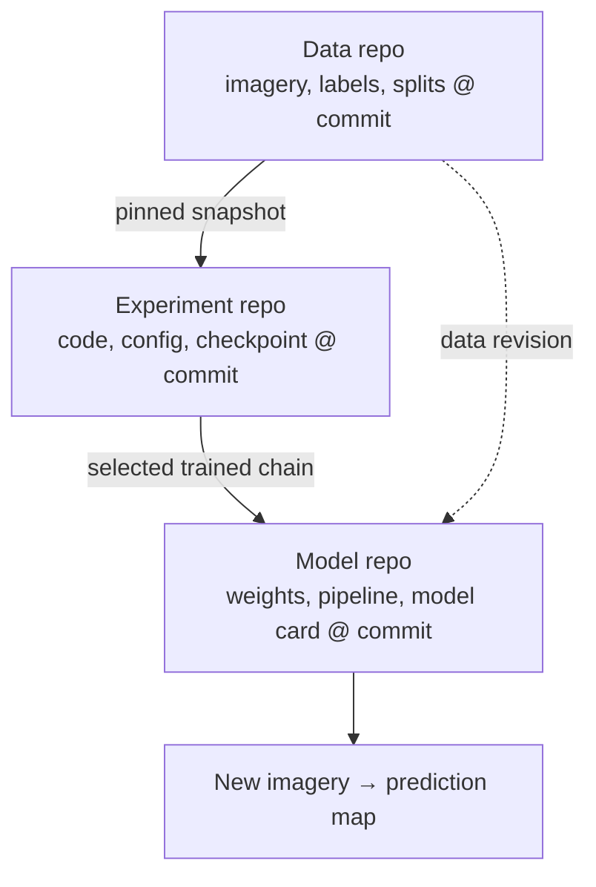

# MLOps for geospatial models

Make model development reproducible with **three repositories: data,
experiments and model releases**. Link their commits so each prediction can
be traced back to the code, training run and inputs that produced it.

| Repository | Keep here |
| --- | --- |
| **Data** · `forest-data` | Raw/processed imagery, labels, observation indexes, splits, preparation scripts, provenance and licenses. |
| **Experiment workspace** · `forest-training` | Dataset/Module code, notebooks, configs, dependency lockfile, metrics and selected Lightning checkpoints. |
| **Model release** · `forest` | `config.json`, trained weights, pipeline settings and a model card linking the data and experiment commits. |

Each project owns one data preparation workflow and one AI task, with several
methods and experiment configs allowed for that task. `project.yaml` records
the task and data directory; the project README explains inputs, outputs,
evaluation, experiment plans and results. Methods live in `modules/<method>/`.

The same data snapshot can support several experiments. Training records keep
the code and results needed to compare those runs. A release promotes the
selected model without carrying every experiment's logs and checkpoints into
deployment.

For a Hugging Face project, use a **dataset repo** for data, a **private model
repo** for experiment archives, and a **public model repo** for the release. Keep
model-specific LitData/chip caches local or in a bucket; record how to rebuild them.

```text
forest-data/
├── raw/  processed/  labels/
├── splits.parquet
└── README.md                 provenance and preparation

forest-training/
├── modules/  configs/  notebooks/
├── pyproject.toml  uv.lock
├── artifacts/<name>/version_N/  config, TensorBoard events and checkpoints/
└── release/                     optional local model exports

forest/
├── config.json
├── model.safetensors
└── README.md                 model card and revision links
```



## 1. Freeze the data

Check image/label alignment, band meaning, units, nodata and class codes.
Keep reusable preparation with the data; keep model-specific normalization
and augmentation with the experiment. See [alignment](../advanced/align-rasters.md) and
[value metadata](../basics/attrs.md).

**Choose splits before cutting chips.** Hold out regions for new-place
prediction or future periods for forecasting. Keep overlapping tiles and
related observations together. Random chip splits can leak nearby pixels
across training and validation; [Roberts et al.](https://doi.org/10.1111/ecog.02881)
explain spatial and temporal blocking.

Reopen the snapshot from another directory and check paths, grids and sample
values. Pin its full commit using the Hub's
[`revision`](https://huggingface.co/docs/huggingface_hub/guides/download#download-from-specific-version)
argument. A versioned index does not freeze mutable external assets.

## 2. Run experiments

Inspect one sample and one batch, then run a short fit before a long run.
Fit normalization statistics on training data only and reuse the same
[preparation at inference](../advanced/model-inputs.md).

Save each useful run's effective config, data/code revisions, dependency
lockfile, seed, metrics and selected checkpoint. Record upstream pretrained
weight revisions too. Start from an [editable training workspace](../advanced/training.md).

## 3. Evaluate on independent data

Use validation data to select models and thresholds; reserve a test set for
final comparison. Report per-class scores or regression errors in physical
units, valid coverage and results by held-out region or period. Inspect maps
for seams, clouds and geographic failure patterns.

For dense outputs, merge overlapping scores before choosing classes and count
each evaluation pixel once. Check your [recipe's evaluation behavior](../reference/training.md).

## 4. Release the selected model

Save locally, reload in a fresh process and compare predictions, class order,
grid and nodata for a fixed input. Reopen an exported prediction raster too.
A Lightning checkpoint resumes training; a GeoSave release packages inference.

The model card should name the exact **data commit**, **experiment commit and
checkpoint**, GeoSave version, input bands/units, output meanings, evaluation
results, limitations and licenses. Record the release commit for deployment.
GeoSave does not fill in this lineage automatically.

Native releases require library-registered components and sub-processors.
See [release and inference](../advanced/release.md). The supervised-segmentation
[publication script](../advanced/training.md#save-and-share-your-work) separates release
and training archives; other generated scripts still need migration.
