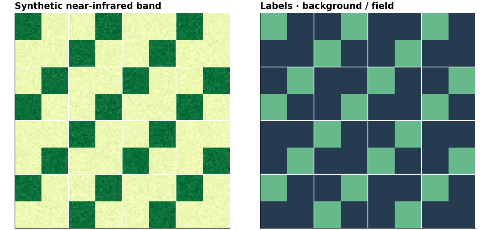

# From images to training chips

Turn a prepared image and label raster into small samples for a segmentation
model. This example runs offline and saves the scene used by the
[next tutorial: training and prediction](guides/training.md).

**You need:** `geosave[ml]`. Basic xarray and PyTorch familiarity helps.
The data is synthetic, so this demonstrates the workflow without implying
accuracy on real satellite imagery.



## Make a small labeled scene

Each sample will contain two input bands and one label map. Class `0` is
background and class `1` is a simulated field. A GeoBox places these invented
pixels on a grid; real files supply their own georeferencing.

```python
import numpy as np
import xarray as xr
from odc.geo.geobox import GeoBox

import geosave as gs

rng = np.random.default_rng(7)
y, x = np.mgrid[:128, :128]
label = (((x // 16 + y // 16) % 3) == 0).astype("uint8")
red = (0.20 + rng.normal(0, 0.02, label.shape)).astype("float32")
nir = (0.25 + 0.40 * label + rng.normal(0, 0.02, label.shape)).astype("float32")
grid = GeoBox.from_bbox(
    (500000, 5000000, 501280, 5001280), crs="EPSG:32633", resolution=10,
)
scene = xr.Dataset({
    "red": (("y", "x"), red),
    "nir": (("y", "x"), nir),
    "label": (("y", "x"), label),
}).gs.write_grid(grid)
scene.gs.to_cog(".", split_asset=(), format_paths="training-scene.tif", overwrite=True)
```

For the next tutorial, all three variables are stored in one GeoTIFF. A TIFF
uses a common dtype, so the label values reopen as floating-point numbers;
the class codes remain `0` and `1`. We convert them to integers for the loss.
In a real project you can keep imagery and labels in separate files.

## Read one tile

```python
source = gs.open_raster("training-scene.tif")
chips = gs.Chips([source[["red", "nir", "label"]]], size=32)
chip = chips[0].gs.to_numpy(dtype="float32")  # First tile across the scenes.
len(chips), chip.shape[-2:]
```

```text
(16, (32, 32))
```

Chips plans windows without reading pixels. Indexing returns a lazy Dataset on the
chip's grid; `gs.to_numpy` reads it. File blocks or upstream calculations may read
more than that window.
Keep the source open while using the chips. `chips.key(0)` returns the
`(sample_index, tile_id)` identity used when merging predictions.

## Convert one sample

```python
import torch

image = torch.from_numpy(chip[:2])
target = torch.from_numpy(chip[2]).long()
image.shape, target.shape
```

```text
(torch.Size([2, 32, 32]), torch.Size([32, 32]))
```

Select input variables explicitly: channel 0 is red, channel 1 is near-infrared.
The target has one integer class per pixel and no channel axis. These arrays
are ready for a normal PyTorch Dataset and DataLoader.

```python
source.close()
```

## Start with your own image and labels

Open both files, select a label variable, and check their exact grids before
combining them:

```python title="Adaptation example — replace paths and band names"
image = gs.open_raster("data/image.tif")
labels = gs.open_raster("data/labels.tif")
if image.gs.geobox is None or image.gs.geobox != labels.gs.geobox:
    raise ValueError("Imagery and labels must have the same georeferenced grid")
scene = image[["red", "nir"]].assign(label=labels["label"])
chips = gs.Chips([scene], size=256, mode="reflect")
```

Keep both source files open until training or prediction has finished, then close
them. For different grids, [align them explicitly](concepts/raster-grids.md), using nearest-neighbor
resampling for categorical labels. Equal array shapes alone do not prove alignment.

Before training, decode packed imagery, handle missing inputs, and map label
codes to `0 … num_classes - 1` or a chosen ignore code. Padding with `255`
requires a label dtype that can represent it and a loss configured to ignore it.
The synthetic example has no missing pixels or padding.

**Next:** [train on these exact samples](guides/training.md). When you have many
scenes or dates, use [catalogs and sampling](guides/catalogs-and-cuts.md) to select
observations before constructing chips. A catalog is optional for this workflow.
